ՀԱՅԱՍՏԱՆԻ ՀԱՆՐԱՊԵՏՈՒԹՅԱՆ ԿՐԹՈՒԹՅԱՆ, ԳԻՏՈՒԹՅԱՆ, ՄՇԱԿՈՒՅԹԻ ԵՎ ՍՊՈՐՏԻ ՆԱԽԱՐԱՐՈՒԹՅՈՒՆ

ՀԱՅԱՍՏԱՆԻ ԱԶԳԱՅԻՆ ՊՈԼԻՏԵԽՆԻԿԱԿԱՆ ՀԱՄԱԼՍԱՐԱՆ

ՄԱԳԻՍՏՐՈՍԱԿԱՆ ԹԵԶ

ԹԵՄԱ\` \_\_\_\_<u>Բեզյեի օպտիմալ սփլայնի կառուցման մասին</u>\_\_\_\_\_\_\_\_\_\_\_\_\_\_\_\_\_\_\_\_\_\_\_\_

ՄԱԳԻՍՏՐԱՆՏ\_\_\_\_\_\_\_\_\_\_<u>Մարտիրոսյան Էլմիրա Սարգսի</u>\_\_\_\_\_\_\_\_\_\_\_\_\_\_\_\_\_\_\_\_\_\_\_

ԿՐԹԱԿԱՆ ԾՐԱԳԻՐ <u>Ինֆորմատիկա և կիրառական մաթեմատիկա (դասիչ՝ 061101.02.7)</u>

ՈՐԱԿԱՎՈՐՄԱՆ ԱՍՏԻՃԱՆ <u>Ինֆորմատիկայի և կիրառական մաթեմատիկայի մագիստրոս</u>

ԵՐԵՎԱՆ 2027

Հ Ա Ս Տ Ա Տ Մ Ա Ն Թ Ե Ր Թ

ԹԵՄԱ\`\_\_\_\_<u>Բեզյեի օպտիմալ սփլայնի կառուցման մասին</u>\_\_\_\_\_\_\_\_\_\_\_\_\_\_\_\_\_\_\_\_\_\_\_\_\_\_\_

Թեզի ղեկավար\`\_\_\_\_\_\_<u>Գ. Ս. Մաչկալյան, ֆ.մ.գ.թ., դոցենտ</u>\_\_\_\_\_\_\_\_\_\_\_\_\_\_\_\_\_\_\_\_\_\_\_\_\_\_

ԱԱՀ, գիտ.աստիճան, կոչում

Մագիստրանտ\`\_\_\_\_ <u>Մարտիրոսյան Էլմիրա Սարգսի</u>\_\_\_\_\_\_\_\_\_\_\_\_\_\_\_\_\_\_\_\_\_\_\_\_\_\_\_\_\_\_

Գրախոս\`\_\_\_\_\_\_\_\_\_\_\_\_\_\_\_\_\_\_\_\_\_\_\_\_\_\_\_\_\_\_\_\_\_\_\_\_\_\_\_\_\_\_\_\_\_\_\_\_\_\_\_\_\_\_\_\_\_\_\_\_\_\_\_\_\_\_\_\_\_\_

ԱԱՀ, գիտ.աստիճան, կոչում

Ամբիոնի վարիչ\`\_\_\_\_\_\_\_\_\_\_\_<u>Տ. Մ. Խուդոյան, ֆ.մ.գ.թ., դոցենտ</u>\_\_\_\_\_\_\_\_\_\_\_\_\_\_\_\_\_\_\_\_\_\_

ԱԱՀ, գիտ.աստիճան, կոչում

Ֆակուլտետի դեկան՝\_\_\_\_\_\_\_\_ <u>Տ. Մ. Խուդոյան, ֆ.մ.գ.թ., դոցենտ</u>\_\_\_\_\_\_\_\_\_\_\_\_\_\_\_\_\_\_\_\_

ԱԱՀ, գիտ.աստիճան, կոչում

ՀԱՅԱՍՏԱՆԻ ԱԶԳԱՅԻՆ ՊՈԼԻՏԵԽՆԻԿԱԿԱՆ ՀԱՄԱԼՍԱՐԱՆ

\_\_\_\_\_\_\_\_\_\_\_\_\_\_\_\_ <u>Կիրառական մաթեմատիկա և ֆիզիկա</u>\_\_\_\_\_\_\_\_\_\_\_\_\_\_ՖԱԿՈՒԼՏԵՏ

\_\_\_\_\_\_\_\_\_\_\_\_\_\_\_\_\_\_\_<u>Մասնագիտական մաթեմատիկական կրթութուն</u>\_\_\_\_\_\_ԱՄԲԻՈՆ

Կրթական ծրագիր \_\_\_\_\_\_\_\_<u>Ինֆորմատիկա և կիրառական մաթեմատիկա</u>\_\_\_\_\_\_\_\_

Թիվ\_\_\_\_\_<u>ՄՄԹ540</u>\_\_\_\_\_\_\_\_\_ ակադեմիական խմբի

<u>\_\_\_\_\_\_\_\_\_\_\_\_\_\_\_\_\_\_\_\_\_Մարտիրոսյան Էլմիրա Սարգսի\_\_\_\_\_\_\_\_\_\_\_\_\_\_\_\_\_\_\_\_\_\_\_\_\_\_\_</u>

(ուսանողի ազգանուն / անուն / հայրանուն)

ՄԱԳԻՍՏՐՈՍԱԿԱՆ ԹԵԶԻ ԱՌԱՋԱԴՐԱՆՔ

1.  Թեման <u>Բեզյեի օպտիմալ սփլայնի կառուցման մասին</u>\_\_\_\_\_\_\_\_\_\_\_\_\_\_\_\_\_\_\_

Հաստատված է ՀԱՊՀ 2026 թ.-ի \_\_\_<u>02</u>\_\_\_ «\_\_\_<u>20</u>\_\_\_\_» թիվ \_\_01-11/52 հրամանով:

2\. Հաշվեբացատրագրի բովանդակություն (բաժիների և մշակման ենթակա հարցերի թվարկմամբ)

<u>Ներածություն: Գլուխ 1. Կորերի և մակերևույթների ներկայացումը, Բեզյեի կորեր: Գլուխ 2. B-սփլայն բազիսային ֆունկցիաներ: Գլուխ 3. B-սփլայն կորեր: Գլուխ 4. Բեզյեի խորանարդային օպտիմալ սփլայնի կառուցումը ինտերպոլյացիոն հանգույցներով (խնդրի դրվածք, C² սփլայնի կառուցում, պարամետրացման ազդեցություն, օպտիմալ պարամետրացում, ծրագրային իրականացում): Եզրակացություններ: Օգտագործված գրականության ցանկ:</u>\_\_\_\_\_\_\_\_\_\_\_\_\_\_\_\_\_\_\_\_\_\_\_\_\_\_\_\_\_\_\_\_\_\_\_\_\_\_\_\_\_\_\_\_\_\_\_\_\_\_\_\_\_\_\_\_\_\_

2.  Թեզի կատարման օրացուցային պլան

<table style="width:99%;">
<colgroup>
<col style="width: 7%" />
<col style="width: 48%" />
<col style="width: 12%" />
<col style="width: 14%" />
<col style="width: 18%" />
</colgroup>
<thead>
<tr>
<th rowspan="2" style="text-align: left;"><p>Հ/Հ</p></th>
<th colspan="3" style="text-align: center;"><p>Թեզի կատարման փուլերը</p></th>
<th rowspan="2" style="text-align: center;"><p>Ծանոթություն</p></th>
</tr>
<tr>
<th style="text-align: center;"><p>Անվանումը</p></th>
<th style="text-align: left;"><p>Կատ.</p>
<p>ժամկետ</p></th>
<th style="text-align: center;"><p>հաշ. ձևը</p></th>
</tr>
</thead>
<tbody>
<tr>
<td style="text-align: left;"><p>1.</p></td>
<td style="text-align: left;"><p>Գրականության ուսումնասիրություն, կորերի պարամետրիկ ներկայացում</p></td>
<td style="text-align: center;"></td>
<td style="text-align: center;"></td>
<td style="text-align: center;"></td>
</tr>
<tr>
<td style="text-align: left;"><p>2.</p></td>
<td style="text-align: left;"><p>Բեզյեի կորեր և Բեզյեի ռացիոնալ կորեր</p></td>
<td style="text-align: center;"></td>
<td style="text-align: center;"></td>
<td style="text-align: center;"></td>
</tr>
<tr>
<td style="text-align: left;"><p>3.</p></td>
<td style="text-align: left;"><p>Թենզորային արտադրյալով մակերևույթներ</p></td>
<td style="text-align: center;"></td>
<td style="text-align: center;"></td>
<td style="text-align: center;"></td>
</tr>
<tr>
<td colspan="2" style="text-align: center;"><p>I ատեստավորում</p></td>
<td style="text-align: center;"></td>
<td style="text-align: center;"></td>
<td style="text-align: center;"></td>
</tr>
<tr>
<td style="text-align: left;"><p>4.</p></td>
<td style="text-align: left;"><p>B-սփլայն բազիսային ֆունկցիաներ և դրանց հատկությունները</p></td>
<td style="text-align: center;"></td>
<td style="text-align: center;"></td>
<td style="text-align: center;"></td>
</tr>
<tr>
<td style="text-align: left;"><p>5.</p></td>
<td style="text-align: left;"><p>Բազիսային ֆունկցիաների հաշվարկային ալգորիթմներ</p></td>
<td style="text-align: center;"></td>
<td style="text-align: center;"></td>
<td style="text-align: center;"></td>
</tr>
<tr>
<td style="text-align: left;"><p>6.</p></td>
<td style="text-align: left;"><p>B-սփլայն կորեր և դրանց ածանցյալները</p></td>
<td style="text-align: center;"></td>
<td style="text-align: center;"></td>
<td style="text-align: center;"></td>
</tr>
<tr>
<td colspan="2" style="text-align: center;"><p>II ատեստավորում</p></td>
<td style="text-align: center;"></td>
<td style="text-align: center;"></td>
<td style="text-align: center;"></td>
</tr>
<tr>
<td style="text-align: left;"><p>7.</p></td>
<td style="text-align: left;"><p>Բեզյեի C² սփլայնի կառուցում հանգույցներով</p></td>
<td style="text-align: center;"></td>
<td style="text-align: center;"></td>
<td style="text-align: center;"></td>
</tr>
<tr>
<td style="text-align: left;"><p>8.</p></td>
<td style="text-align: left;"><p>Պարամետրացման ազդեցության հետազոտություն և օպտիմալ պարամետրացում</p></td>
<td style="text-align: center;"></td>
<td style="text-align: center;"></td>
<td style="text-align: center;"></td>
</tr>
<tr>
<td style="text-align: left;"><p>9.</p></td>
<td style="text-align: left;"><p>Ծրագրային իրականացում, համեմատություն և ստուգումներ</p></td>
<td style="text-align: center;"></td>
<td style="text-align: center;"></td>
<td style="text-align: center;"></td>
</tr>
<tr>
<td style="text-align: left;"><p>10.</p></td>
<td style="text-align: left;"><p>Թեզի ձևավորում</p></td>
<td style="text-align: center;"></td>
<td style="text-align: center;"></td>
<td style="text-align: center;"></td>
</tr>
<tr>
<td colspan="2" style="text-align: center;"><p>III ատեստավորում</p></td>
<td style="text-align: center;"></td>
<td style="text-align: center;"></td>
<td style="text-align: center;"></td>
</tr>
<tr>
<td style="text-align: left;"><p>11.</p></td>
<td style="text-align: center;"><p>Նախնական պաշտպանություն</p></td>
<td style="text-align: center;"></td>
<td style="text-align: center;"></td>
<td style="text-align: center;"></td>
</tr>
</tbody>
</table>

4\. Աշխատանքի պաշտպանության օրը \_\_\_\_\_\_\_\_\_\_\_\_\_\_\_\_\_\_\_\_\_\_\_\_\_\_\_\_\_\_\_\_\_\_\_\_\_\_\_\_\_\_\_

5\. Ամբիոնի վարիչ \_\_\_<u>Տ. Մ. Խուդոյան, ֆ.մ.գ.թ., դոցենտ</u>\_\_\_\_\_\_\_\_\_\_\_\_\_\_\_\_\_\_\_\_\_\_\_\_\_\_

(Ա.Ա.Հ., ստորագրություն, ամսաթիվ)

6\. Աշխատանքի ղեկավար \_\_\_<u>Գ. Ս. Մաչկալյան, ֆ.մ.գ.թ., դոցենտ</u>\_\_\_\_\_\_\_\_\_\_\_\_\_\_\_\_\_\_\_

(Ա.Ա.Հ., ստորագրություն, ամսաթիվ)

7\. Աշխատանքի առաջադրանքը ստացա <u>Մարտիրոսյան Էլմիրա Սարգսի</u>\_\_\_\_\_\_\_\_\_\_\_\_\_\_

(ուսանողի Ա.Ա.Հ., ստորագրություն, ամսաթիվ)

**ՀԱՄԱՌՈՏԱԳԻՐ**

Մագիստրոսական թեզը նվիրված է հարթության վրա տրված ինտերպոլյացիոն հանգույցներով Բեզյեի խորանարդային սփլայնի ավտոմատ կառուցմանը և դրա օպտիմալացմանը։ Աշխատանքի առաջին երեք գլուխներում շարադրված են երկրաչափական մոդելավորման տեսական հիմքերը՝ կորերի պարամետրիկ ներկայացումը, Բեզյեի և Բեզյեի ռացիոնալ կորերը, դը Կաստելյոյի ալգորիթմը, B-սփլայն բազիսային ֆունկցիաները, դրանց հաշվարկային ալգորիթմները և B-սփլայն կորերը։

Չորրորդ գլխում մշակված է եղանակ, որը միայն ինտերպոլյացիոն հանգույցներով, առանց հսկիչ կետերը ձեռքով նշելու, կառուցում է երկրորդ կարգի անընդհատ ածանցյալներով Բեզյեի խորանարդային սփլայն։ Հսկիչ կետերը որոշվում են քառանկյունագծային մատրիցով գծային հավասարումների համակարգից, որը լուծվում է $`O(n)`$ գործողությամբ։ Ստացված են անընդհատության պայմանները կամայական պարամետրացման համար, հետազոտված է հավասարաչափ, ըստ հեռավորության և կենտրոնաձիգ պարամետրացումների ազդեցությունը սփլայնի ձևի վրա։ Օպտիմալ պարամետրացումը գտնվում է որպես ծռման էներգիայի մինիմիզացման խնդրի լուծում. ստանդարտ պարամետրացման համեմատ էներգիան փոքրանում է 34–58 %-ով։ Ցույց է տրված, որ պարամետրական էներգիայի մինիմիզացումը կարող է կորությունը կենտրոնացնել առանձին հանգույցներում, և առաջարկված է երկրաչափական $`\int_{}^{}{\kappa^{2}ds}`$ չափանիշով օպտիմալացում, որը կորության առավելագույն արժեքը փոքրացնում է 23–34 %-ով։

Մեթոդներն իրականացված են ինտերակտիվ վեբ ծրագրում, որի ավտոմատ ստուգումները հաստատում են թեզի տեսական արդյունքները։ Աշխատանքի արդյունքները կարող են կիրառվել գրաֆիկական խմբագրիչներում, տառատեսակների և երթուղիների նախագծման ժամանակ։

Թեզը բաղկացած է ներածությունից, չորս գլխից, եզրակացություններից և օգտագործված գրականության ցանկից։ Աշխատանքի ծավալը 134 էջ է, այն պարունակում է 62 նկար, 11 աղյուսակ, գրականության ցանկը՝ 16 անուն։

Առանցքային բառեր. Բեզյեի կոր, B-սփլայն, ինտերպոլյացիա, պարամետրացում, ծռման էներգիա, օպտիմալ սփլայն, կորություն։

**ԲՈՎԱՆԴԱԿՈՒԹՅՈՒՆ**

[ՆԵՐԱԾՈՒԹՅՈՒՆ [7](#ներածություն)](#ներածություն)

[ԳԼՈՒԽ 1. ԿՈՐԵՐԻ ԵՎ ՄԱԿԵՐԵՎՈՒՅԹՆԵՐԻ ՆԵՐԿԱՅԱՑՈՒՄԸ: ԲԵԶՅԵԻ ԿՈՐԵՐ [11](#գլուխ-1.-կորերի-եվ-մակերեվույթների-ներկայացումը-բեզյեի-կորեր)](#գլուխ-1.-կորերի-եվ-մակերեվույթների-ներկայացումը-բեզյեի-կորեր)

[1.1 Անբացահայտ և պարամետրիկ տեսքեր [11](#անբացահայտ-և-պարամետրիկ-տեսքեր)](#անբացահայտ-և-պարամետրիկ-տեսքեր)

[1.2 Կորի աստիճանային բազիսը [17](#կորի-աստիճանային-բազիսը)](#կորի-աստիճանային-բազիսը)

[1.3 Բեզյեի կորեր [18](#բեզյեի-կորեր)](#բեզյեի-կորեր)

[1.4 Բեզյեի ռացիոնալ կորեր [29](#բեզյեի-ռացիոնալ-կորեր)](#բեզյեի-ռացիոնալ-կորեր)

[1.5 Թենզորային արտադրյալով մակերևույթներ [42](#թենզորային-արտադրյալով-մակերևույթներ)](#թենզորային-արտադրյալով-մակերևույթներ)

[ԳԼՈՒԽ 2. B-ՍՓԼԱՅՆ ԲԱԶԻՍԱՅԻՆ ՖՈՒՆԿՑԻԱՆԵՐ [53](#գլուխ-2.-b-սփլայն-բազիսային-ֆունկցիաներ)](#գլուխ-2.-b-սփլայն-բազիսային-ֆունկցիաներ)

[2.1 Ներածություն [53](#ներածություն-1)](#ներածություն-1)

[2.2 B-սփլայն բազիսային ֆունկցիաների սահմանումը և հատկությունները [57](#b-սփլայն-բազիսային-ֆունկցիաների-սահմանումը-և-հատկությունները)](#b-սփլայն-բազիսային-ֆունկցիաների-սահմանումը-և-հատկությունները)

[2.3 B-սփլայն բազիսային ֆունկցիաների ածանցյալները [67](#b-սփլայն-բազիսային-ֆունկցիաների-ածանցյալները)](#b-սփլայն-բազիսային-ֆունկցիաների-ածանցյալները)

[2.4 Բազիսային ֆունկցիաների լրացուցիչ հատկություններ [71](#բազիսային-ֆունկցիաների-լրացուցիչ-հատկություններ)](#բազիսային-ֆունկցիաների-լրացուցիչ-հատկություններ)

[2.5 Հաշվարկային ալգորիթմներ [76](#հաշվարկային-ալգորիթմներ)](#հաշվարկային-ալգորիթմներ)

[ԳԼՈՒԽ 3. B-ՍՓԼԱՅՆ ԿՈՐԵՐ [89](#գլուխ-3.-b-սփլայն-կորեր)](#գլուխ-3.-b-սփլայն-կորեր)

[3.1 B-սփլայն կորերի սահմանումը և հատկությունները [89](#b-սփլայն-կորերի-սահմանումը-և-հատկությունները)](#b-սփլայն-կորերի-սահմանումը-և-հատկությունները)

[3.2 B-սփլայն կորի ածանցյալները [100](#b-սփլայն-կորի-ածանցյալները)](#b-սփլայն-կորի-ածանցյալները)

[ԳԼՈՒԽ 4. ԲԵԶՅԵԻ ԽՈՐԱՆԱՐԴԱՅԻՆ ՕՊՏԻՄԱԼ ՍՓԼԱՅՆԻ ԿԱՌՈՒՑՈՒՄԸ ԻՆՏԵՐՊՈԼՅԱՑԻՈՆ ՀԱՆԳՈՒՅՑՆԵՐՈՎ [109](#գլուխ-4.-բեզյեի-խորանարդային-օպտիմալ-սփլայնի-կառուցումը-ինտերպոլյացիոն-հանգույցներով)](#գլուխ-4.-բեզյեի-խորանարդային-օպտիմալ-սփլայնի-կառուցումը-ինտերպոլյացիոն-հանգույցներով)

[4.1 Խնդրի դրվածքը [109](#խնդրի-դրվածքը)](#խնդրի-դրվածքը)

[4.2 Երկրորդ կարգի անընդհատ ածանցյալներով Բեզյեի սփլայնի կառուցումը [110](#երկրորդ-կարգի-անընդհատ-ածանցյալներով-բեզյեի-սփլայնի-կառուցումը)](#երկրորդ-կարգի-անընդհատ-ածանցյալներով-բեզյեի-սփլայնի-կառուցումը)

[4.3 Պարամետրացման ազդեցությունը սփլայնի ձևի վրա [113](#պարամետրացման-ազդեցությունը-սփլայնի-ձևի-վրա)](#պարամետրացման-ազդեցությունը-սփլայնի-ձևի-վրա)

[4.4 Օպտիմալ պարամետրացում [117](#օպտիմալ-պարամետրացում)](#օպտիմալ-պարամետրացում)

[4.5 Ծրագրային իրականացում և ստուգումներ [123](#ծրագրային-իրականացում-և-ստուգումներ)](#ծրագրային-իրականացում-և-ստուգումներ)

[ԵԶՐԱԿԱՑՈՒԹՅՈՒՆՆԵՐ ԵՎ ԱՌԱՋԱՐԿՈՒԹՅՈՒՆՆԵՐ [131](#եզրակացություններ-եվ-առաջարկություններ)](#եզրակացություններ-եվ-առաջարկություններ)

[ՕԳՏԱԳՈՐԾՎԱԾ ԳՐԱԿԱՆՈՒԹՅԱՆ ՑԱՆԿ [133](#օգտագործված-գրականության-ցանկ)](#օգտագործված-գրականության-ցանկ)

# ՆԵՐԱԾՈՒԹՅՈՒՆ

**Աշխատանքի ընդհանուր բնութագիրը։** Աշխատանքը վերաբերում է երկրաչափական մոդելավորմանը՝ կիրառական մաթեմատիկայի այն բնագավառին, որն ուսումնասիրում է կորերի և մակերևույթների ներկայացման, կառուցման և մշակման եղանակները համակարգչում։ Դիտարկվում է հարթության վրա տրված կետերով անցնող հարթ կորի կառուցման խնդիրը, որտեղ կորը ներկայացվում է Բեզյեի խորանարդային կորերից կազմված սփլայնի տեսքով։

**Թեմայի արդիականությունը։** Բեզյեի կորերը և B-սփլայնները կորերի ներկայացման ստանդարտ միջոց են համակարգչային նախագծման (CAD), համակարգչային գրաֆիկայի, տառատեսակների, անիմացիայի և ռոբոտաշինության մեջ \[1\], \[2\]։ Տարածված գրաֆիկական խմբագրիչներում սփլայնը կառուցելիս օգտագործողը պետք է ձեռքով նշի ոչ միայն կորի կետերը, այլև յուրաքանչյուր հատվածի հսկիչ կետերը, ինչը պահանջում է Բեզյեի կորերի կառուցվածքի իմացություն և չի ապահովում կորության անընդհատություն միացման կետերում։ Վերջին տարիներին մշակվում են գործիքներ, որոնք կորը կառուցում են միայն օգտագործողի նշած կետերով \[16\]։ Միևնույն կետերով կարելի է կառուցել անվերջ թվով տարբեր սփլայններ, և դրանց ձևը էապես կախված է պարամետրացման ընտրությունից \[8\], \[14\], \[15\]։ Այդ պատճառով արդիական է լավագույն, այսինքն՝ հնարավորինս քիչ ծռված սփլայնի ավտոմատ կառուցման խնդիրը։

**Աշխատանքի նպատակը։** Մշակել եղանակ և ծրագիր, որոնք միայն ինտերպոլյացիոն հանգույցներով ավտոմատ կառուցում են երկրորդ կարգի անընդհատ ածանցյալներով Բեզյեի խորանարդային սփլայն, և գտնել այն պարամետրացումը, որի դեպքում սփլայնը լավագույնն է ծռման էներգիայի չափանիշով։

Նպատակին հասնելու համար լուծվել են հետևյալ խնդիրները.

1\) ուսումնասիրել կորերի ներկայացման եղանակները, Բեզյեի և Բեզյեի ռացիոնալ կորերի հատկությունները (գլուխ 1),

2\) ուսումնասիրել B-սփլայն բազիսային ֆունկցիաները, դրանց հաշվարկային ալգորիթմները և B-սփլայն կորերը (գլուխներ 2, 3),

3\) ստանալ երկրորդ կարգի անընդհատ ածանցյալներով Բեզյեի սփլայնի հսկիչ կետերի համակարգը կամայական պարամետրացման համար և մշակել դրա լուծման արդյունավետ ալգորիթմ (բաժիններ 4.2, 4.3),

4\) հետազոտել պարամետրացման ազդեցությունը սփլայնի ձևի վրա և ձևակերպել ու լուծել օպտիմալ պարամետրացման խնդիրը (բաժիններ 4.3, 4.4),

5\) իրականացնել մեթոդները ծրագրային ձևով, թվայնորեն ստուգել տեսական արդյունքները և համեմատել այլ մեթոդների հետ (բաժին 4.5)։

**Տեսական, մեթոդական և տեղեկատվական հիմքերը։** Աշխատանքի տեսական հիմքն են կազմում երկրաչափական մոդելավորման և սփլայնների տեսության հիմնարար աշխատությունները \[1\]–\[6\], \[10\], \[11\], թվային օպտիմալացման մեթոդները \[7\] և կորերի պարամետրացման վերաբերյալ հետազոտությունները \[8\], \[12\]–\[16\]։ Գլուխներ 1–3-ի շարադրանքը և ալգորիթմներ A2.1–A2.5-ը հիմնված են \[1\] մենագրության վրա։

**Հետազոտության մեթոդները։** Աշխատանքում կիրառվել են գծային հանրահաշվի մեթոդներ (ժապավենային մատրիցով համակարգերի լուծում Գաուսի մեթոդով), վարիացիոն սկզբունքներ (ծռման էներգիայի մինիմիզացում, Լագրանժի բազմապատկիչների մեթոդ), թվային օպտիմալացման կոորդինատային որոնման մեթոդ և թվային ինտեգրում։ Գծային հավասարումների համակարգի մոտեցումն ընտրվել է, քանի որ այն տալիս է ճշգրիտ լուծում $`O(n)`$ գործողությամբ, ինչը թույլ է տալիս սփլայնը վերահաշվել իրական ժամանակում, իսկ կոորդինատային որոնումը՝ քանի որ նպատակային ֆունկցիան բացահայտ տեսքով չի արտահայտվում և դրա ածանցյալները հասանելի չեն։ Արդյունքների հավաստիությունը ստուգվել է երկու անկախ ծրագրային իրականացումների համեմատությամբ և ավտոմատ թեստերով։

**Գիտական նորույթը։** Աշխատանքում ստացվել են հետևյալ նոր արդյունքները.

1\) Բեզյեի հսկիչ կետերի համար ստացվել են երկրորդ կարգի ածանցյալների անընդհատության պայմանները կամայական պարամետրացման դեպքում (4.15)–(4.16), որոնց համակարգի մատրիցը քառանկյունագծային է,

2\) ձևակերպվել և լուծվել է պարամետրացման օպտիմալացման խնդիրը ֆիքսված ընդհանուր ժամանակի պայմանով և ցույց է տրվել, որ ըստ հեռավորության պարամետրացումը մոտ է օպտիմալին,

3\) ցույց է տրվել, որ պարամետրական ծռման էներգիայի մինիմիզացումը կարող է երկրաչափորեն վատթարացնել կորը, և առաջարկվել է օպտիմալացում $`\int_{}^{}{\kappa^{2}ds}`$ երկրաչափական չափանիշով, ինչպես նաև հայտնաբերվել է, որ այդ խնդիրը ուռուցիկ չէ և համաչափ տվյալների դեպքում կարող է ունենալ ոչ համաչափ լուծումներ,

4\) առաջարկվել է ստանդարտ և օպտիմալ սփլայնների միջև սահուն անցման եղանակ, որը թույլ է տալիս կորի ձևն ինտերակտիվ կառավարել իրական ժամանակում։

**Գործնական նշանակությունը։** Մշակված եղանակը թույլ է տալիս գրաֆիկական խմբագրիչում օգտագործողին նշել միայն կորի կետերը, իսկ հսկիչ կետերն ավտոմատ հաշվարկել։ Արդյունքը ներկայացված է Բեզյեի հատվածների տեսքով և կարող է անմիջապես օգտագործվել ցանկացած գրաֆիկական համակարգում (SVG, PostScript, PDF, տառատեսակներ)։ Մշակված ինտերակտիվ ծրագիրը կարող է օգտագործվել նաև ուսումնական գործընթացում՝ երկրաչափական մոդելավորման դասընթացում։

**Ստացված արդյունքները։** Միայն ինտերպոլյացիոն հանգույցներով կառուցվում է երկրորդ կարգի անընդհատ ածանցյալներով սփլայն, որի հսկիչ կետերը հաշվվում են $`O(n)`$ գործողությամբ։ Օպտիմալ պարամետրացումը ստանդարտի համեմատ փոքրացնում է ծռման էներգիան 34–58 %-ով, իսկ երկրաչափական չափանիշով օպտիմալացումը փոքրացնում է կորության առավելագույն արժեքը 23–34 %-ով։ Օպտիմալ սփլայնի էներգիան Քեթմուլ–Ռոմի C¹ սփլայնի համեմատ փոքր է 18–26 %-ով, իսկ մեկ բազմանդամով ինտերպոլյացիայի համեմատ՝ 18–68 անգամ։

**Աշխատանքի փորձարկումը և հրապարակումները։** Աշխատանքի հիմնական արդյունքները ներկայացված են \[9\] հոդվածում։

**Աշխատանքի կառուցվածքը։** Թեզը բաղկացած է ներածությունից, չորս գլխից, եզրակացություններից և առաջարկություններից, օգտագործված գրականության ցանկից (16 անուն)։ Աշխատանքի ծավալը 134 էջ է, այն պարունակում է 62 նկար և 11 աղյուսակ։ Առաջին գլխում դիտարկված են կորերի և մակերևույթների անբացահայտ և պարամետրիկ ներկայացումները, աստիճանային բազիսը, Բեզյեի և Բեզյեի ռացիոնալ կորերը և թենզորային արտադրյալով մակերևույթները։ Երկրորդ գլխում շարադրված են B-սփլայն բազիսային ֆունկցիաների սահմանումը, հատկությունները, ածանցյալները և հաշվարկային ալգորիթմները։ Երրորդ գլխում դիտարկված են B-սփլայն կորերը և դրանց ածանցյալները։ Չորրորդ գլխում ներկայացված են աշխատանքի հիմնական արդյունքները՝ ինտերպոլյացիոն հանգույցներով Բեզյեի սփլայնի կառուցման եղանակը, պարամետրացման ազդեցության հետազոտությունը, օպտիմալ պարամետրացումը և ծրագրային իրականացումը։

# ԳԼՈՒԽ 1. ԿՈՐԵՐԻ ԵՎ ՄԱԿԵՐԵՎՈՒՅԹՆԵՐԻ ՆԵՐԿԱՅԱՑՈՒՄԸ: ԲԵԶՅԵԻ ԿՈՐԵՐ

## 1.1 Անբացահայտ և պարամետրիկ տեսքեր

Երկրաչափական մոդելավորման մեջ կորերի և մակերևույթների ներկայացման երկու ամենատարածված ձևերն են անբացահայտ և պարամետրիկ տեսքերով ներկայացումները \[1\], \[2\]։

$`oxy`$-հարթության մեջ գտնվող կորը կարող է տրվել հետևյալ հավասարումով՝ $`f(x,y) = 0`$: Այս հավասարումը նկարագրում է կորի վրա գտնվող կետերի $`x`$ և $`y`$ կոորդինատների միջև եղած կապը։ Տրված կորի համար հավասարումը միակն է՝ հաստատուն արտադրիչի ճշտությամբ ։ Որպես օրինակ կարելի է բերել միավոր շառավղով շրջանագիծը, որի կենտրոնը սկզբնակետում է, և սահմանվում է համապատասխան հավասարումով $`f(x) = x^{2} + y^{2} - 1 = 0\ (Նկար\ 1․1)`$:

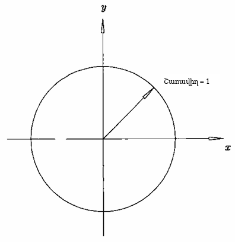

*Նկար 1.1. 1 շառավղով շրջանագիծ, որի կենտրոնը գտնվում է կոորդինատական համակարգի սկզբնակետում*

Պարամետրիկ տեսքով կորի յուրաքանչյուր կոորդինատ ներկայացվում է առանձին՝ որպես անկախ պարամետրի բացահայտ ֆունկցիա՝

``` math
C(u)\  = \ (x(u),\ y(u)),\ \ a\  \leq \ u\  \leq \ b\ :
```

Այսպիսով, $`C(u)`$-ն u-անկախ փոփոխականի վեկտոր ֆունկցիա է։ Թեպետ \[a, b\] միջակայքը կամայական է, այն սովորաբար նորմավորվում է \[0, 1\] - ում։ Շրջանագծի առաջին քառորդը սահմանվում է համապատասխան պարամետրիկ ֆունկցիաներով՝

``` math
x(u) = cos(u),
```

$`y(u)\  = \ sin(u)\ ,\ \ 0 \leq \ u\  \leq \frac{\pi}{2}\ :`$ (1.1)

Նշանակելով $`t\  = \ \tan{(\frac{u}{2})}`$, կարելի է ստանալ նոր պարամետրիկ ներկայացման ձև։

``` math
x(t)\  = \ \frac{1\  - \ t^{2}}{1\  + \ t^{2}}\ ,
```

$`y(t)\  = \ \frac{2t}{1\  + \ t^{2}}\ ,\ \ \ 0 \leq \ t\  \leq \ 1\ :`$ (1.2)

Այսպիսով, կորի պարամետրիկ ներկայացումը միակը չէ։

Կարելի է նաև $`C(u) = (x(u),y(u))`$ կորը դիտարկել որպես մասնիկի թողած հետք ժամանակի ընթացքում․ այստեղ $`u`$-ն «ժամանակային» փոփոխականն է, իսկ \[a, b\] միջակայքը՝ ժամանակի տևողությունը։ Կորի առաջին և երկրորդ կարգի ածանցյալները համապատասխանաբար արտահայտում են մասնիկի արագությունն ու արագացումը։\
(1.1) և (1.2) հավասարումները ածանցելով՝ ստանում ենք արագության վեկտորների արտահայտությունները\`

``` math
C^{ˊ}(u)\  = \ (x^{ˊ}(u)\ ,\ y^{ˊ}(u))\  = \ ( - \sin{(u)\ ,\ \cos{(u)}})\ ,
```

``` math
C^{ˊ}(t)\  = \ (x^{ˊ}(t)\ ,y^{ˊ}(t)\ )\  = \ (\frac{- 4t}{{(1\  + \ t^{2})}^{2}}\ ,\ \frac{2(1\  - \ t^{2})}{{(1\  + \ t^{2})}^{2}})\ :\ 
```

Նկատենք, որ արագության վեկտորի մեծությունը՝ $`C^{ˊ}(u)`$, հաստատուն է․

$`\left| C^{ˊ}(u) \right|\  = \ \sqrt{\sin^{2}{(u)\  + \ \cos^{2}{(u)}}}`$ $`= \ 1\ :`$

Այսինքն, մասնիկի շարժման ուղղությունը ժամանակի ընթացքում փոխվում է, բայց նրա արագությունը մնում է անփոփոխ։ Սա կոչվում է **համասեռ պարամետրացում**։ $`C^{ˊ}(t)`$ – ի մեջ տեղադրելով $`t = 0`$ և $`t = 1`$, կստանանք $`C^{ˊ}(0) = (0,\ 2)`$ և $`C^{ˊ}(1) = ( - 1,\ 0)`$, ինչը նշանակում է, որ մասնիկի սկզբնական արագությունը երկու անգամ մեծ է վերջնականից (Նկար 1.2)։

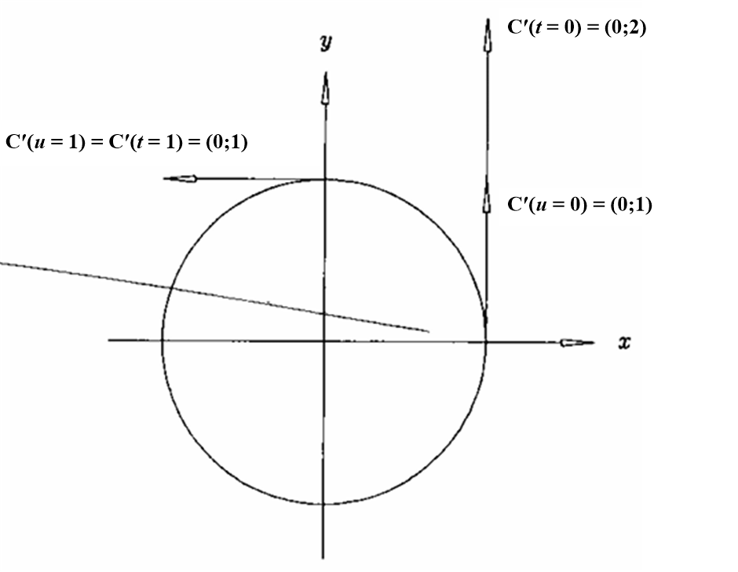

*Նկար 1.2. Արագության* $`C^{ˊ}(u)`$ *և* $`C^{ˊ}(t)`$ *վեկտորները, երբ* $`u,\ t = 0`$ *և 1*

Մակերևույթը սահմանվում է հետևյալ հավասարմամբ՝ $`f(x,y,z) = 0`$։\
Որպես օրինակ կարող ենք դիտարկել միավոր շառավղով սֆերան, որի կենտրոնը գտնվում է կոորդինատների սկզբնակետում։ Այն պատկերված է Նկար 1.3-ում և սահմանվում է հետևյալ $`x^{2} + \ y^{2} + \ z^{2} - 1 = 0`$ հավասարումով: Նույն սֆերայի միակ **պարամետրիկ ներկայացումը** տրվում է որոշակի $`S(u,\ v) = (x(u,\ v),\ y(u,\ v),\ z(u,\ v))`$ ֆունկցիաների միջոցով, որտեղ՝

``` math
x(u,\ v)\  = \ \sin{(u)\cos{(v)\ ,}}
```

``` math
y(u,\ v)\  = \ \sin{(u)\sin{(v)\ ,}}
```

$`z(u,\ v)\  = \ \cos{(u)\ ,\ \ \ \ \ \ \ }`$ $`0\  \leq \ u\  \leq \ \pi\ ,\ \ 0\  \leq \ v\  \leq \ 2\pi\ :`$ (1.3)

Նկատենք, որ մակերևույթ կառուցելու համար մեզ հարկավոր են երկու պարամետր։ Ֆիքսելով u-ն և փոփոխելով v-ն կստանանք մակերևույթի լայնական գծերը, իսկ ֆիքսելով v-ն և փոփոխելով u-ն կստանանք դրա երկայնական գծերը։

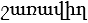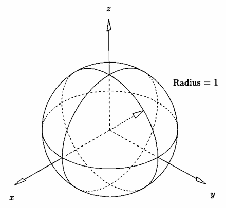

*Նկար 1.3. 1 շառավղով գնդային մակերևույթ, որի կենտրոնը գտնվում է կոորդինատական սկզբնակետում։*

Նշանակենք $`S(u,\ v)`$-ի մասնակի ածանցյալները\` $`S_{u}(u,\ v) = \left( x_{u}(u,\ v),\ y_{u}\ (u,\ v),\ z_{u}(u,\ v) \right)`$ և $`S_{v}(u,\ v) = \left( x_{v}(u,\ v),\ y_{v}\ (u,\ v),\ z_{v}(u,\ v) \right)`$, որոնք ներկայացնում են լայնական և երկայնական ուղղություններով «արագությունները»։ Այն բոլոր կետում, որտեղ $`S_{u} \times S_{v}`$ վեկտորային արտադրյալը ոչ զրոյական է, մակերևույթի միավոր N նորմալը տրվում է հետևյալ արտահայտությամբ (Նկար 1.4 )՝

$`N\  = \ \frac{S_{u} \times S_{v}\ }{\left| S_{u} \times S_{v} \right|}`$ (1.4)

Տվյալ կետում մակերևույթի նորմալի և շոշափող հարթության գոյությունը երկրաչափական հատկություն է և կախված չէ ընտրված պարամետրացումից։ Տարբեր պարամետրացումները տալիս են տարբեր մասնակի ածանցյալներ, սակայն եթե 1.4 հավասարման հարաբերության բաժանարարը զրո չէ, ապա կստանանք նույն նորմալը։\
Գնդային մակերևույթի 1.3 պարամետրիկ ներկայացումից պարզ է, որ ցանկացած $`v`$-ի համար $`\ \ 0 \leq v \leq 2\pi,\ \ S_{v}(0,\ v) = S_{v}(\pi,\ v) = 0`$, հետևաբար հյուսիսային և հարավային բևեռներում $`S_{v}`$ ածանցյալը դառնում են զրոյական, ուստի տվյալ պարամետրացմամբ նորմալները չի կարելի հաշվել 1.4 բանաձևով, թեև ակնհայտ է, որ բևեռներում դրանք գոյություն ունեն։

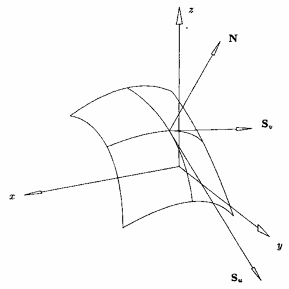

*Նկար 1.4.* $`S(u,\ v)`$*-ի մասնակի ածանցյալ և նորմալ վեկտորները*

Դիտարկված ներկայացման ձևերից և ոչ մեկը չի կարելի համարել ավելի նպատակահարմար․ երկուսն էլ ունեն իրենց առավելություններն ու թերությունները։ Երկրաչափական մոդելավորման հաջող կիրառությունը սովորաբար հիմնված է երկուսի համատեղ օգտագործման վրա։ Ստորև տրված է դրանց համեմատական բնութագրումները.

- Պարամետրիկ մեթոդը հեշտությամբ ընդլայնվում է՝ ավելացնելով $`z`$-կոորդինատը՝ հնարավորություն տալով ստանալու տարածությունում կորեր՝ $`C(u) = (x(u),y(u),z(u))`$, մինչդեռ անբացահայտ ձևով միայն հնարավոր է ստանալ կորեր հարթությունում։

- Անբացահայտ ձևով դժվար է ներկայացնել կորերի կամ մակերևույթների սահմանափակ մասեր, մինչդեռ պարամետրիկ ձևում սահմանափակությունը արտահայտված է պարամետրի միջակայքի սահմաններով։ Չնայած դրան, չսահմանափակված կորերը (օրինակ՝ $`f(x,\ y) = ax + by + c = 0`$ ուղիղ գիծը) դժվար է արտահայտել պարամետրիկ ձևով։

- Պարամետրիկ կորերը ունեն բնական ուղղություն՝ $`C(a)`$-ից դեպի $`C(b)`$, ինչը թույլ է տալիս կորի երկայնքով հեշտությամբ ստեղծել կետերի հաջորդականություններ։ Անբացահայտ ներկայացման դեպքում դա անհնար է։ Նույնը վերաբերում է մակերևույթի վրա կետային ցանցերի ստեղծմանը։

- Պարամետրիկ ձևը առավել հարմար է մարմինների նախագծման և համակարգչային ներկայացման համար։ Շատ պարամետրիկ ֆունկցիաների գործակիցները՝ օրինակ Բեզյեի և B-սփլայն ֆունկցիաների դեպքում, ունեն հստակ երկրաչափական նշանակություն։ Սա ապահովում է ինտուիտիվ նախագծման մեթոդներ և թվայնապես կայուն ալգորիթմներ՝ ակնհայտ երկրաչափական բնույթով։

- Շատ երկրաչափական գործողությունների բարդությունը զգալիորեն կախված է ներկայացման ձևից։ Օրինակ՝

  - կետի հաշվարկը կորի կամ մակերևույթի վրա բարդ է անբացահայտ ներկայացմամբ։

  - տրված կետի պատկանելության որոշումը մակերևույթին կամ կորին բարդ է պարամետրիկ ձևով։

- Պարամետրիկ ձևում երբեմն հանդիպում են պարամետրիկ անոմալիաներ, որոնք կապ չունեն մարմնի իրական երկրաչափության հետ։ Օրինակ՝ միավոր սֆերայի պարագայում բևեռները կրիտիկական կետեր են, որոնք ալգորիթմորեն դժվար են արտահայտվում, բայց երկրաչափորեն ոչնչով չեն տարբերվում գնդի վրա ցանկացած այլ կետից։

## 1.2 Կորի աստիճանային բազիսը

Ակնհայտ է, որ թույլ տալով, որ $`x(u)`$, $`y(u)`$ և $`z(u)`$ կոորդինատական ֆունկցիաները լինեն կամայական, մենք կարող ենք ստանալ կորերի մեծ բազմազանություն։ Սակայն երկրաչափական մոդելավորման համակարգի իրագործման ժամանակ կարող են առաջանալ որոշ փոխզիջումներ։

Իդեալական կլինի այն տարբերակը, երբ սահմանափակվենք այնպիսի ֆունկցիաների դասով, որոնք՝

• ունակ են ճշգրիտ ներկայացնելու բոլոր այն կորերը, որոնք անհրաժեշտ են համակարգի օգտագործողներին,

• կարող են հեշտությամբ, արդյունավետորեն և ճշգրիտ կերպով մշակվել համակարգչով, մասնավորապես՝

- կորերի վրա կետերի և ածանցյալների հաշվարկը դրանցով պետք է լինի արդյունավետ,

- դրանց թվային մշակումը պետք է քիչ զգայուն լինի կլորացման սխալների նկատմամբ,

- հաշվարկների ժամանակ զբաղեցնում են քիչ հիշողություն,

<!-- -->

- պարզ են և մաթեմատիկորեն ընդունելի։

Այսօր լայնորեն կիրառվում է **բազմանդամային ֆունկցիաների** դասը։ Թեպետ այս դասի ֆունկցիաները բավարարում են ցանկի վերջին երկու չափանիշներին, կան մի շարք կարևոր կորերի (և մակերևույթների) տեսակներ, որոնք չեն կարող ճշգրիտ ներկայացվել բազմանդամներով․ դրանք միայն հնարավոր է այսպիսի համակարգերում մոտարկել։

Այս և հաջորդ բաժնում կքննարկենք բազմանդամային ֆունկցիաների արտահայտման երկու հիմնական եղանակ՝ **աստիճանային բազիսի** և **Բեզյեի մեթոդները**։ Թեպետ դրանք մաթեմատիկապես համարժեք են, սակայն հետագայում կտեսնենք, որ Բեզյեի մեթոդը շատ ավելի հարմար է համակարգչում կորերի ներկայացման և մշակման համար։

Այսպիսով, աստիճանային բազիսով $`n`$-րդ աստիճանի կորը տրվում է՝

$`C(u)\  = \ (x(u)\ ,\ y(u),\ z(u))\  = \ \sum_{i\  = \ 0}^{n}{a_{i}u^{i}\ ,\ \ 0 \leq \ u\  \leq \ 1\ :\ }`$ (1.5)

Այստեղ $`a_{i} = (x_{i},y_{i},z_{i})`$ վեկտորներ են, հետևաբար՝

``` math
x(u)\  = \ \sum_{i\  = \ 0}^{n}{x_{i}u^{i}}\ ;\ \ y(u)\  = \ \sum_{i\  = \ 0}^{n}{y_{i}u^{i}\ ;\ \ z(u)\  = \ \sum_{i\  = \ 0}^{n}{z_{i}u^{i}\ :\ }}
```

(1.5) հավասարումը կարող ենք ներկայացնել մատրիցային տեսքով՝

$`C(u)\  = \ \left\lbrack a_{0}\ \ a_{1}\ ...\ a_{n} \right\rbrack\left\lbrack \begin{array}{r}
1 \\
u \\
. \\
. \\
. \\
u^{n}
\end{array} \right\rbrack\  = \ \left\lbrack a_{i} \right\rbrack^{T}\left\lbrack u^{i} \right\rbrack\ :`$ (1.6)

Դիֆերենցելով (1.5) -ը, կստանանք՝

``` math
a_{i}\  = \ \frac{C^{(i)}\left. \ (u) \right|_{u\  = \ 0}\ }{i!}\ ,
```

որտեղ $`C^{(i)}\left. \ (u) \right|_{u\ } - \ ն`$ $`u\  = \ 0`$ կետում $`C(u)`$ -ի ածանցյալն է։ Այսպիսով,$`\ n + 1`$ հատ $`\{ u^{i}\}`$ ֆունկցիաները կոչվում են **բազիսային** ֆունկցիաներ, իսկ $`a_{i}`$-երը՝ **բազիսով ներկայացման գործակիցներ**։

Տրված $`u_{0}`$-ի համար աստիճանային բազիսով կորի $`C(u_{0})`$ կետը առավել արդյունավետ է հաշվարկվում **Հորների մեթոդով** ՝

- 1-ին աստիճանի համար՝ $`C(u_{0})\  = \ a_{1}u_{0}\  + \ a_{0}`$

- 2-րդ աստիճանի համար՝ $`C(u_{0})\  = \ (a_{2}u_{0}\  + \ a_{1})u_{0}\  + \ a_{0}`$

․․․․..........................

- n-րդ աստիճանի համար՝ $`C(u_{0})\  = \ ((...(a_{n}u_{0}\  + \ a_{n\  - \ 1})u_{0}\  + \ a_{n\  - \ 2})u_{0}\  + \ ...\  + \ a_{0}`$

## 1.3 Բեզյեի կորեր

Հաջորդիվ մենք կքննարկենք մեկ այլ պարամետրիկ բազմանդամային կոր՝ **Բեզյեի կորը (Bézier curve)**։ Քանի որ ինչպես աստիճանային բազիսի ձևը, այնպես էլ Բեզյեի ձևը կոորդինատային ֆունկցիաների համար օգտագործում են բազմանդամներ, դրանք մաթեմատիկորեն համարժեք են։ Այսինքն՝ ցանկացած կոր, որը կարելի է ներկայացնել մեկ ձևով, կարելի է ներկայացնել նաև մյուսով։

Սակայն **Բեզյեի մեթոդը** երկրաչափական մոդելավորման համար զգալիորեն ավելի արդյունավետ է, քան աստիճանային բազիսով ձևը։

Այստեղ Բեզյեի կորերի մեր ներկայացումը կլինի համեմատաբար ոչ ֆորմալ։

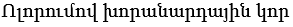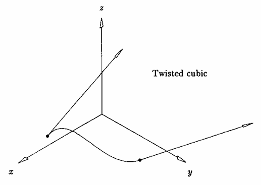

*Նկար 1.5. Խորանարդային Բեզյեի կորը եռաչափ տարածությունում*

Աստիճանային բազիսի ձևն ունի հետևյալ թերությունները՝

• այն ինտերակտիվ ձևավորման համար ինտուիտիվ չէ․ $`\left\{ a_{i} \right\}`$ գործակիցները քիչ տեղեկություն են հաղորդում կորի ձևի մասին։ Բացի այդ, կորը կառուցողը սովորաբար ցանկանում է կորի **երկու եզրակետերում** սահմանել վերջնական պայմաններ, այլ ոչ թե միայն մեկնարկային եզրակետում։

• սրանով մշակվող ալգորիթմները ունեն **հանրահաշվական**, այլ ոչ թե երկրաչափական բնույթ (օրինակ՝ Հորների մեթոդը)։

• արժեքային առումով այն այնքան էլ հուսալի ձև չէ․ օրինակ՝ Հորների մեթոդում, եթե գործակիցների մեծությունները զգալիորեն տարբերվում են իրարից ապա այնտեղ հարկավոր է կատարել կլորացումներ։

**Բեզյեի մեթոդը** վերացնում է այս թերություններից շատերը։

$`n`$-րդ աստիճանի Բեզյեի կորն սահմանվում է հետևյալ կերպ՝

``` math
\begin{array}{r}
C(u) = \ \sum_{i\  = \ 0}^{n}{B_{i,n}(u)P_{i}\ ,\ \ 0\  \leq \ u\  \leq \ 1}:\#(1.7)
\end{array}
```

Այստեղ բազիսային $`\left\{ B_{i,n}(u) \right\}`$ ֆունկցիաները հանդիսանում են դասական $`n`$-րդ աստիճանի **Բեռնշտայնի բազմանդամներ**, որոնք տրվում են հետևյալ բանաձևով՝

``` math
\begin{array}{r}
B_{i,n}(u) = \ \frac{n!}{i!(n\  - \ i)!}u^{i}(1\  - \ u)^{n\  - \ i}\ \ :\#(1.8)
\end{array}
```

Այս ձևի երկրաչափական գործակիցները՝ $`\{ P_{i}\}`$-րը, կոչվում են **կառավարման կետեր** ։ Պարզ է նաև, որ սահմանման մեջ (հավասարում 1.7) պարտադիր է, որ $`u \in \lbrack 0,1\rbrack`$։

Օրինակներ՝

1.  Երբ $`n\  = \ 1`$. (1.8) հավասարումից ստանում ենք՝ $`B_{0,1}(u) = 1 - u`$ և $`B_{1,1}(u) = u`$։ Այս դեպքում (1.7) հավասարումը դառնում է՝ $`C(u) = (1 - u)P_{0} + uP_{1}`$: Սա ուղիղ գծի հատված է՝ $`P_{0}`$-ից դեպի $`P_{1}`$(տես Նկ. 1.6)։

    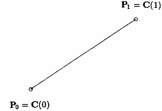

*Նկար 1.6. Առաջին աստիճանի Բեզյեի կոր*

2.  Երբ $`n\  = \ 2`$. (1.7) և (1.8) հավասարումներից հետևում է՝ $`C(u) = (1 - u)^{2}P_{0} + 2u(1 - u)P_{1} + u^{2}P_{2}`$: Սա պարաբոլային աղեղ է, որը ձգվում է $`P_{0}`$-ից մինչև $`P_{2}`$(տես Նկ. 1.7)։ Նկատենք, որ՝

- $`\left\{ P_{0},P_{1},P_{2} \right\}`$ կետերով կազմված բազմանկյունը, որը կոչվում է **կառավարման բազմանկյուն** , բավական լավ է մոտարկում կորի ձևը,

- $`P_{0} = C(0)`$, իսկ $`P_{2} = C(1)`$,

- կորի ծայրակետերում շոշափողները զուգահեռ են $`P_{1} - P_{0}`$ և $`P_{2} - P_{1}`$ վեկտորներին (այս արդյունքը կհստակեցվի հետագայում),

- կորն ամբողջությամբ գտնվում է $`P_{0}P_{1}P_{2}`$-ով կազմված եռանկյան սահմաններում։

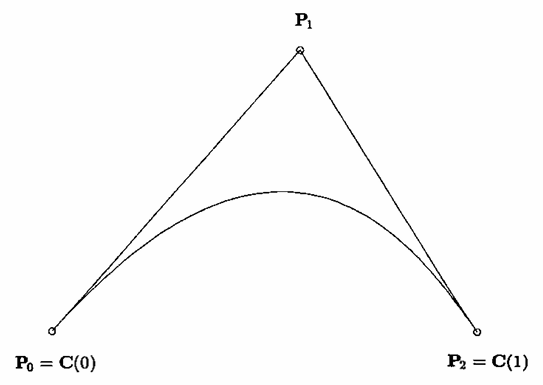

*Նկար 1.7. Երկրորդ աստիճանի Բեզյեի կոր*

3.  Երբ $`n\  = \ 3`$. Այս դեպքում՝ $`C(u) = (1 - u)^{3}P_{0} + 3u(1 - u)^{2}P_{1} + 3u^{2}(1 - u)P_{2} + u^{3}P_{3}`$: Բեզյեի խորանարդային կորերի օրինակներ ներկայացված են Նկ. 1.8a–1.11f-ում։ Նկատենք՝

- կառավարման բազմանկյունները մոտարկում են կորերի ձևերը,

- $`P_{0} = C(0)`$, իսկ $`P_{3} = C(1)`$,

- ծայրակետերի շոշափողները զուգահեռ են $`P_{1} - P_{0}`$ և $`P_{3} - P_{2}`$ վեկտորներին,

- **ուռուցիկ թաղանթի հատկություն**՝ կորերը ամբողջությամբ գտնվում են իրենց կառավարման կետերի կողմից սահմանված ուռուցիկ թաղանթի ներսում (տես Նկ. 1.8c),

- **տատանումների նվազման հատկություն**՝ որևէ ուղիղ գիծ չի հատում կորն ավելի շատ անգամ, քան այն հատում է կառավարման բազմանկյունը։ Այս հատկությունն արտահայտում է այն փաստը, որ Բեզյեի կորն իր կառավարման բազմանկյան «ուղղությամբ է ընթանում» և չի տատանվում ավելի, քան կառավարման բազմանկյունը (տես Նկ. 1.8f),

- սկզբում ($`u = 0`$-ի դեպքում) կորը շեղվում է նույն ուղղությամբ, ինչ $`P_{0}P_{1}P_{2}`$-ը, իսկ $`u = 1`$-ի դեպքում՝ $`P_{1}P_{2}P_{3}`$-ի ուղղությամբ,

- կառավարման բազմանկյան մեջ առաջացած օղակը հնարավոր է, որ առաջացնի օղակ կորի վրա։ Նկ. 1.8e-ում կորում օղակ չի առաջացել, իսկ Նկ. 1.8f-ում այն առաջացել է։

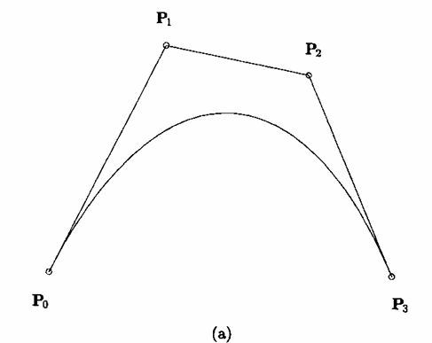 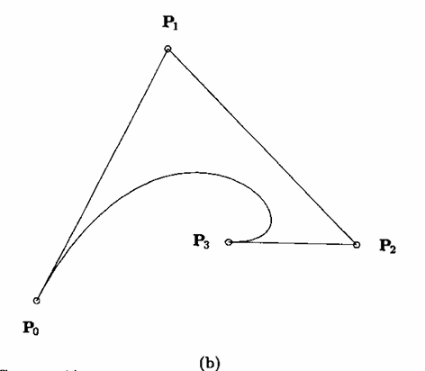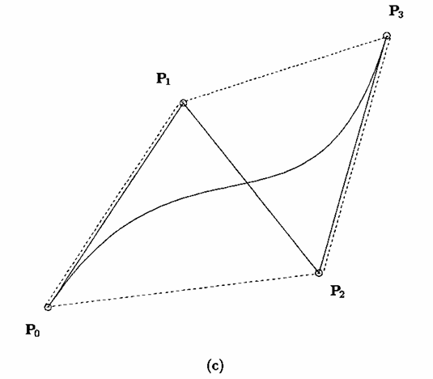 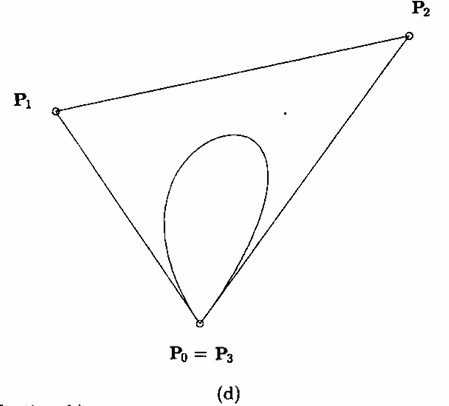 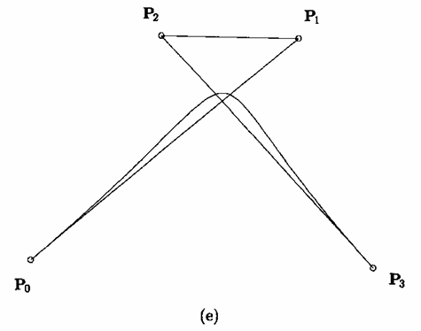 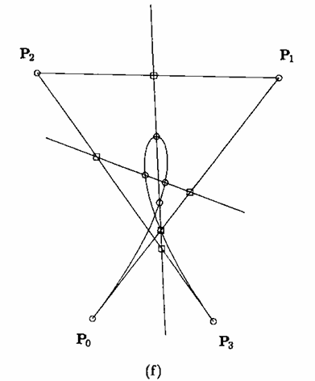

*Նկար 1.8. Բեզյեի խորանարդային կորեր*

4.  Երբ $`n\  = \ 6`$. Նկ. 1.9-ում ցուցադրված է վեցերորդ աստիճանի **փակ Բեզյեի կոր**։\
    Կորը ողորկ է $`C(0) = C(1)`$-ում, քանի որ $`P_{1} - P_{0}`$ զուգահեռ է $`P_{6} - P_{5}`$-ին։\
    «Ողորկ» ասելով նկատի ունենք, որ $`u = 0`$-ում և $`u = 1`$-ում շոշափող վեկտորները ունեն նույն ուղղությունը։

Բացի վերոնշյալ հատկություններից, Բեզյեի կորերը **ինվարիանտ են սովորական երկրաչափական ձևափոխությունների նկատմամբ**, ինչպիսիք են պտույտը, տեղաշարժը և մասշտաբավորումը։ Այսինքն՝ կորի ձևափոխությունը կատարվում է՝ կառավարման կետերը փոխելով։

Յուրաքանչյուր կորի (կամ մակերևույթի) ներկայացման սխեմայում **բազիսային ֆունկցիաների ընտրությունը** որոշում է տվյալ սխեմայի երկրաչափական բնութագրերը։ Դիտարկենք բազիսային ֆունկցիաները\
$`\{ B_{i,n}(u)\}`$՝ $`n = 1,\ 2,\ 3,\ 9`$ արժեքների համար։

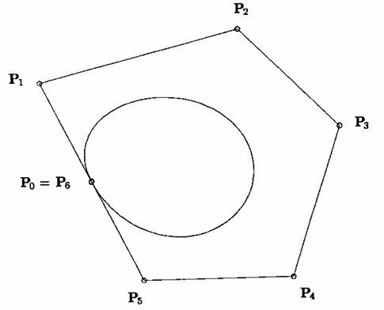

*Նկար 1.9. Վեցերորդ աստիճանի ողորկ Բեզյեի կոր*

Այս ֆունկցիաներն ունեն հետևյալ հատկությունները՝

1)  Բացասական չեն․ $`B_{i,n}(u) \geq 0`$ բոլոր $`i,n`$ և $`0 \leq u \leq 1`$

2)  $`\sum_{i = 0}^{n}{B_{i,n}(u)} = 1,\forall\text{ }0 \leq u \leq 1`$

3)  $`B_{0,n}(0) = B_{n,n}(1) = 1`$

4)  Յուրաքանչյուր $`B_{i,n}(u)`$ ֆունկցիա $`\lbrack 0,1\rbrack`$ միջակայքում ունի ճիշտ **մեկ մաքսիմում**, որը տեղի է ունենում $`u = \frac{i}{n}`$ կետում։

5)  Ցանկացած $`n`$-ի համար $`\{ B_{i,n}(u)\}`$ բազմանդամների հավաքածուն համաչափ է $`u = \frac{1}{2}`$-ի նկատմամբ։

6)  Անդրադարձ սահմանում.$`B_{i,n}(u) = (1 - u)B_{i,n - 1}(u) + uB_{i - 1,n - 1}(u)`$ (տես Նկ. 1.10)։ Այստեղ սահմանում ենք՝$`B_{i,n}(u) = 0,\text{եթե }i < 0\text{ կամ }i > n`$

7)  Բեռնշտայնի բազմանդամների ածանցյալը տրվում է հետևյալ ձևով՝ $`\frac{dB_{i,n}(u)}{du} = n(B_{i - 1,n - 1}(u) - B_{i,n - 1}(u))`$, որտեղ $`B_{- 1,n - 1}(u) = B_{n,n - 1}(u) = 0`$։

(1.8) հավասարումից ստանում ենք, որ $`B_{0,0}(u) = 1`$։ Օգտվելով 6-րդ հատկությունից, ստանում ենք Բեռնշտայնի գծային և քառակուսի բազմանդամները՝

``` math
\begin{matrix}
B_{0,1}(u) & = (1 - u)B_{0,0}(u) + uB_{- 1,0}(u) = 1 - u, \\
B_{1,1}(u) & = (1 - u)B_{1,0}(u) + uB_{0,0}(u) = u, \\
B_{0,2}(u) & = (1 - u)B_{0,1}(u) + uB_{- 1,1}(u) = (1 - u)^{2}, \\
B_{1,2}(u) & = (1 - u)B_{1,1}(u) + uB_{0,1}(u) = (1 - u)u + u(1 - u) = 2u(1 - u), \\
B_{2,2}(u) & = (1 - u)B_{2,1}(u) + uB_{1,1}(u) = u^{2}:
\end{matrix}
```

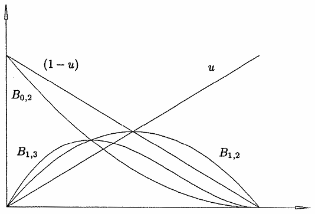\
*Նկար 1.10.* $`B_{1,3}(u)`$*գծային բազմանդամի ռեկուրսիվ ներկայացումը։*

Ֆիքսված u - ի համար հատկություն (1.6)-ը տալիս է Բեռնշտայնի բազմանդամները հաշվելու պարզ ալգորիթմներ (Աղյուսակներ 1.1, 1.2)։ $`B_{1,3}`$-ի հաշվարկը ներկայացված է Աղյուսակ 1.1-ում։

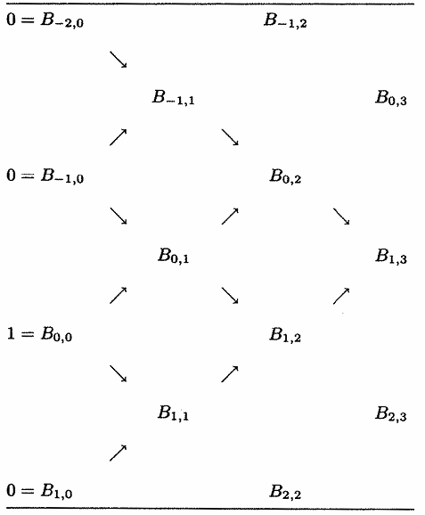

*Աղյուսակ 1.1.* $`B_{1,3}`$*-ի հաշվարկը*

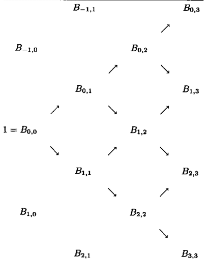

*Աղյուսակ 1.2. Բոլոր խորանարդային (երրորդ աստիճանի) Բեռնշտայնի բազմանդամների հաշվարկը։*

Օգտագործելով (1.7) հատկությունը\` հեշտ է ստանալ Բեզյեի կորի ածանցյալի ընդհանուր արտահայտությունը՝

``` math
\begin{array}{r}
C^{ˊ}(u) = \frac{d\left( \sum_{i = 0}^{n}{B_{i,\ n}(u)P_{i}} \right)}{du} = \\
\ \sum_{i\  = \ 0}^{n}{{B_{i\ ,\ n}}^{ˊ}(u)}P_{i} = \sum_{i\  = \ 0}^{n}{n\left( B_{i\  - \ 1\ ,\ n\  - \ 1}(u) - \ B_{i\ ,\ n\  - \ 1}(u) \right)P_{i} = \ n\sum_{i\  = \ 0}^{n\  - \ 1}{B_{i\ ,\ n\  - \ 1}(u)\left( P_{i\  + \ 1}\  - \ P_{i} \right):}}\ \#(1.9)
\end{array}
```

(1.9) Հավասարումից մենք հեշտությամբ ստանում ենք Բեզյեի կորի եզրային կետերում ածանցյալների բանաձևերը, օրինակ՝

``` math
{C^{ˊ}(0) = n\left( P_{1} - P_{0} \right)\ \ ,\ \ \ \ \ \ \ \ \ C^{ˊˊ}(0) = n(n - 1)\left( P_{0} - {2P}_{1} + \ P_{2} \right)\ \ ,\ \ 
}\begin{array}{r}
C^{ˊ}(1) = n\left( P_{n} - P_{n - 1} \right)\ ,\ \ {\ \ \ C}^{ˊˊ}(1) = n(n - 1)\left( P_{n} - {2P}_{1} + \ P_{n - 2} \right)\ ;\#(1.10)
\end{array}
```

(1.9) և (1.10) հավասարումներից հետևում է, որ՝

> • $`n`$-րդ աստիճանի Բեզյեի կորի ածանցյալը $`(n - 1)`$-րդ աստիճանի Բեզյեի կոր է։
>
> • $`u = 0`$-ում և $`u = 1`$-ում ածանցյալների հավասարումները համաչափ են (ինչը բացատրվում է բազիսային ֆունկցիաների համաչափությամբ)։
>
> • Կորի $`k`$-րդ աստիճանի ածանցյալը յուրաքանչյուր ծայրակետում կախված է միայն համապատասխան կողմի $`k + 1`$ հենակետերից՝ բավականին ինտուիտիվ երկրաչափական ձևով։

Դիցուք $`n = 2`$, և $`C(u) = \sum_{i = 0}^{2}P_{i}B_{i,2}(u)`$։ Այդ դեպքում կարող ենք ասել, որ՝

``` math
C(u) = (1 - u)\lbrack(1 - u)P_{0} + uP_{1}\rbrack + u\lbrack(1 - u)P_{1} + uP_{2}\rbrack
```
Գծային է Գծային է

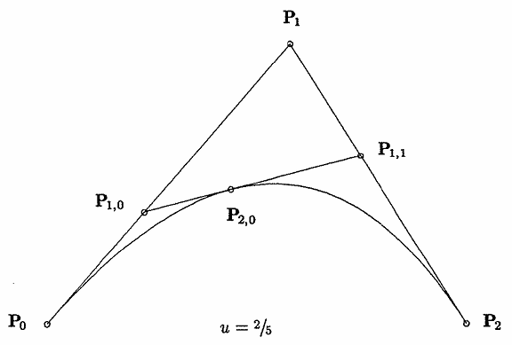

*Նկար 1.11. Բեզյեի քառակուսային կորի վրա կետի ստացումը կրկնվող գծային ինտերպոլացիայով u = 2/5 դեպքում*

Այստեղից հետևում է, որ $`C(u)`$-ն ստացվում է որպես երկու առաջին աստիճանի Բեզյեի կորերի գծային ինտերպոլյացիա։ Մասնավորապես, $`C(u)`$-ի վրա ցանկացած կետ կարելի է ստանալ **երեք հաջորդական գծային ինտերպոլյացիաներով**։

Դիցուք ունենք հաստատուն $`u = u_{0}`$։ Դիտարկենք հետևյալ հավասարումները՝

``` math
\begin{matrix}
P_{1,0} & = (1 - u_{0})P_{0} + u_{0}P_{1}, \\
P_{1,1} & = (1 - u_{0})P_{1} + u_{0}P_{2}, \\
P_{2,0} & = (1 - u_{0})P_{1,0} + u_{0}P_{1,1},
\end{matrix}
```
Այստեղից կարող ենք ասել, որ $`C(u_{0}) = P_{2,0}`$։ Այս գործընթացը պատկերված է Նկ. 1.11-ում, իսկ խորանարդայինի կառուցման գործընթացը՝ Նկ. 1.12-ում։

Ընդհանուր դեպքում $`n`$-րդ աստիճանի Բեզյեի $`C_{n}(P_{0},\ldots,P_{n})`$ կորը մենք կարող ենք ներկայացնել հետևյալ ձևով՝

``` math
C_{n}(P_{0},\ ...\ ,\ P_{n})\  = \ (1\  - \ u)C_{n\  - \ 1}(P_{0},\ ...\ ,\ P_{n\  - \ 1})\  + \ uC_{n\  - \ 1}(P_{1},\ ...\ ,P_{n})\ :\ \ \ \ \ \ \ \ \ \ \ \ \ \ \ \ \ \ \ (1.11)
```

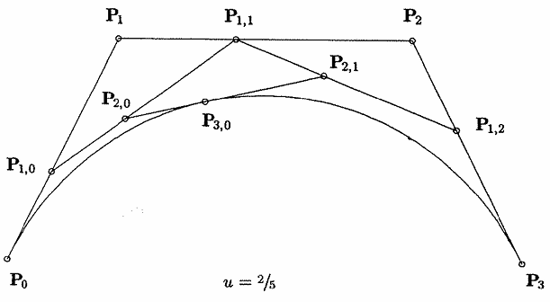

*Նկար 1.12. Բեզյեի խորանարդային կորի վրա կետի ստացումը կրկնվող գծային ինտերպոլացիայով u = 2/5 դեպքում*

Այս բանաձևը բխում է բազիսային ֆունկցիաների ռեկուրսիվության սահմանումից (տես՝ հատկություն 1․6)։ Ֆիքսենք $`u = u_{0}`$ և նշանակենք $`P_{i} = P_{0,i}`$ ։ (1.11) հավասարումը $`n`$-րդ աստիճանի Բեզյեի կորի վրա $`C(u_{0}) = P_{n,0}(u_{0})`$ կետի հաշվարկը տալիս է հետևյալ **ռեկուրսիվ ալգորիթմը**՝

$`P_{k,\ i}\left( u_{0} \right){= \left( 1 - u_{0} \right)P}_{k - 1,i}\left( u_{0} \right) + u_{0}P_{k - 1,i + 1}\left( u_{0} \right),\ \ \ \ \ \left\{ \begin{array}{r}
k = 1,\ \ldots,n \\
i = 0,\ \ldots,\ n - k
\end{array} \right.`$ (1.12)

Այս հավասարումը հայտնի է որպես **դը Կաստելյոյի ալգորիթմ**։ Սա անկյունների կտրելու գործընթաց է (տես Նկ. 1.11 և 1.12), որի արդյունքում ստացվում է կետերի եռանկյուն աղյուսակ՝ ներկայացված Աղյուսակ 1.3-ում։

Այս բաժինը եզրափակենք **Բեզյեի** և **աստիճանաբազիսային մեթոդների** համեմատությամբ։ (1.10) հավասարումը, ինչպես նաև ուռուցիկ թաղանթի և տատանումների նվազման հատկությունները Բեզյեի կորերն ինտերակտիվ ձևավորման և ձևափոխման համար դարձնում են շատ հարմար։

Հենակետերը կառուցողին տալիս են կորի ձևի նկատմամբ շատ ավելի ինտուիտիվ վերահսկողություն, քան աստիճանաբազիսային մեթոդի գործակիցները։

Բացի այդ, **դը Կաստելյոյի ալգորիթմում** կլորացման սխալները շատ ավելի փոքր են, քան **Հորների ալգորիթմում**։ Դա հասկանալի է ինտուիտիվորեն՝ հաշվի առնելով, որ դը Կաստելյոյի ալգորիթմը պարզապես կրկնվող գծային ինտերպոլյացիա է այն կետերի միջև, որոնք գտնվում են կորի շրջակայքում։ Բեզյեի մեթոդի միակ թերությունն այն է, որ կետի հաշվարկը համեմատաբար պակաս արդյունավետ է։

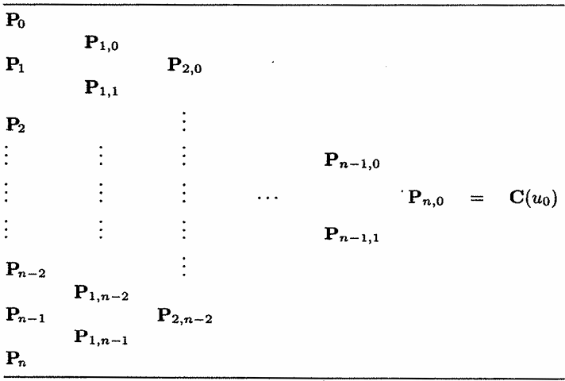

*Աղյուսակ 1.3. դը Կաստելյոյի ալգորիթմով հաշվարկված կետերը*

## 1.4 Բեզյեի ռացիոնալ կորեր

Այժմ քննարկենք **ռացիոնալ կորերի** և **համասեռ կոորդինատների** գաղափարները։ Այս հասկացությունները պատկերացնելու համար տանք **Բեզյեի** **ռացիոնալ կորերի** կարճ սահմանումը։ Այս կորերը ռացիոնալ B-սփլայն կորերի մասնավոր դեպքերն են։

Թեպետ բազմանդամներն ունեն բազմաթիվ առավելություններ, գոյություն ունեն մի շարք կարևոր կորերի և մակերևույթների տեսակներ, որոնք չեն կարող ճշգրիտ ներկայացվել բազմանդամներով։ Դրանց թվում են՝ շրջանագծերը, էլիպսները, հիպերբոլները, գլանները, կոները, գնդային մակերևույթները և այլն։

Որպես օրինակ, դիտարկենք, O$`xy`$ հարթության մեջ գտնվող, սկզբնակետում կենտրոն ունեցող **միավոր շրջանագիծը** և ցույց տանք, որ այն չի կարող ներկայացվել բազմանդամային կոորդինատական ֆունկցիաներով։

Հակառակն ընդունելով՝ ենթադրենք, որ

``` math
{x(u) = a_{0} + a_{1}u + \cdots + a_{n}u^{n}
}{y(u) = b_{0} + b_{1}u + \cdots + b_{n}u^{n}}
```

Այդ դեպքում $`x^{2} + y^{2} - 1 = 0`$ - ն նշանակում է , որ

``` math
\begin{matrix}
0 & = (a_{0} + a_{1}u + \cdots + a_{n}u^{n})^{2} + (b_{0} + b_{1}u + \cdots + b_{n}u^{n})^{2} - 1 = \\
 & = (a_{0}^{2} + b_{0}^{2} - 1) + 2(a_{0}a_{1} + b_{0}b_{1})u \\
 & + (a_{1}^{2} + 2a_{0}a_{2} + b_{1}^{2} + 2b_{0}b_{2})u^{2} \\
 & + \cdots + (a_{n - 1}^{2} + 2a_{n - 2}a_{n} + b_{n - 1}^{2} + 2b_{n - 2}b_{n})u^{2n - 2} \\
 & + 2\left( a_{n}a_{n - 1} + b_{n}b_{n - 1} \right)u^{2n - 1} + \left( a_{n}^{2} + b_{n}^{2} \right)u^{2n}\ \ ։\ \ 
\end{matrix}
```

Քանի որ այս հավասարումը ճիշտ է **բոլոր** $`u`$-երի համար, ուստի վերջինիս բոլոր գործակիցները պետք է հավասար լինեն 0 ։

Սկսելով ամենաբարձր աստիճանի անդամից և իջնելով աստիճան առ աստիճան, $`n`$ քայլերում ստանում ենք, որ՝ $`a_{i} = 0\ \text{և }b_{i} = 0\ \text{բոլոր }1 \leq i \leq n`$ - ի համար ։ Իրոք

**1.** $`a_{n}^{2} + b_{n}^{2} = 0`$–ը ենթադրում է, որ $`a_{n} = 0\ \text{և}{\ b}_{n} = 0։`$

**2.** $`a_{n - 1}^{2} + 2a_{n - 2}a_{n} + b_{n - 1}^{2} + 2b_{n - 2}b_{n} = 0`$ և քայլ 1–ի արդյունքից հետևում է , որ $`a_{n - 1}^{2} + b_{n - 1}^{2} = 0,`$ինչն իր հերթին նշանակում է, որ $`a_{n - 1} = b_{n - 1} = 0\ ։`$

**…**

**n.** $`a_{1}^{2} + 2a_{0}a_{2} + b_{1}^{2} + 2b_{0}b_{2} = 0`$ և քայլ $`n - 1`$–ի արդյունքը ենթադրում է, որ $`a_{1}^{2} + b_{1}^{2} = 0,`$ ինչն էլ իր հերթին նշանակում է, որ $`a_{1} = b_{1} =`$<!-- -->0 ։

Այսպիսով՝

$`x(u) = a_{0}\ ,\ \ y(u) = b_{0}`$ ,

որի արդյունքում ստացվում է ակնհայտ հակասություն (այս դեպքում կորը կդառնա հաստատուն կետ, ոչ թե շրջանագիծ)։

Դասական մաթեմատիկայից հայտնի է, որ **բոլոր կոնական կորերը**, ներառյալ՝ շրջանագիծը, կարող են ներկայացվել **ռացիոնալ ֆունկցիաներով**, այսինքն՝ երկու բազմանդամների հարաբերությամբ։ Փաստորեն, դրանք ներկայացվում են հետևյալ ձևի ռացիոնալ ֆունկցիաներով՝

$`x(u) = \frac{X(u)}{W(u)},\ \ \ y(u) = \frac{Y(u)}{W(u)}`$ ։ (1.13)

որտեղ $`X(u)`$, $`Y(u)`$ և $`W(u)`$ բազմանդամներ են։ Այսինքն՝ յուրաքանչյուր կոորդինատային ֆունկցիա ունի միևնույն հայտարարը։ Դիտարկենք հետևյալ օրինակները․

1.  Միավոր շառավղով շրջանագիծ, որի կենտրոնը կոորդինատային սկզբնակետում է․

    $`x(u) = \frac{1 - u^{2}}{1 + u^{2}},\ \ y(u) = \frac{2u}{1 + u^{2}}`$ :

2.  Էլիպս, որի կենտրոնը գտնվում է կոորդինատների սկզբնակետում: Այստեղ $`y`$-առանցքը մեծ առանցքն է, $`x`$-առանցքը՝ փոքր առանցքը, իսկ մեծ և փոքր շառավղերը համապատասխանաբար 2 և 1 են․

``` math
x(u) = \frac{1 - u^{2}}{1 + u^{2}},y(u) = \frac{4u}{1 + u^{2}}\ ։
```

3.  Հիպերբոլ՝ $`P = (0,\text{\:\,}\frac{4}{3})`$ կենտրոնով, որտեղ $`y`$-առանցքը հանդիսանում է լայնական առանցք․

$`x(u) = \frac{- 1 + 2u}{1 + 2u - 2u^{2}},y(u) = \frac{4u(1 - u)}{1 + 2u - 2u^{2}}`$ ։

> Հիպերբոլի ստորին ճյուղը (որն ունի գագաթ $`P = (0,2/3)`$-ում) անցնում է այն $`u`$-ների համար, որոնք բավարարում են՝

``` math
u \in \left( \frac{1 - \sqrt{3}}{2},\ \frac{1 + \sqrt{3}}{2} \right)։
```

4.  Պարաբոլ, որի գագաթը գտնվում է սկզբնակետում, իսկ $`y`$-առանցքը հանդիսանում է համաչափական առանցք՝ $`x(u) = u,y(u) = u^{2}`$։ Նկատենք, որ պարաբոլների ներկայացման համար ռացիոնալ ֆունկցիաների անհրաժեշտություն չկա։ Իսկ շրջանագծի հավասարումների դեպքում հեշտ է տեսնել, որ ցանկացած $`u`$-ի համար $`\left( x(u),y(u) \right)`$ կետը գտնվում է կոորդինատների սկզբնակետում կենտրոն ունեցող միավոր շրջանագծի վրա։ Իրոք,

``` math
(x(u))^{2} + (y(u))^{2} = \left( \frac{1 - u^{2}}{1 + u^{2}} \right)^{2} + \left( \frac{2u}{1 + u^{2}} \right)^{2}
```
    $`= \frac{1 - 2u^{2} + u^{4} + 4u^{2}}{\left( 1+u^{2})^{2} \right.\ } = \frac{\left( 1+u^{2})^{2} \right.\ }{\left( 1+u^{2})^{2} \right.\ } = 1`$ ։

    Այժմ սահմանենք $`n`$-րդ աստիճանի **Բեզյեի ռացիոնալ կորը** հետևյալ կերպ՝

$`C(u) = \frac{\sum_{i = 0}^{n}B_{i,n}(u)\text{ }w_{i}\text{ }P_{i}}{\sum_{i = 0}^{n}B_{i,n}(u)\text{ }w_{i}}\ ,\ \ 0 \leq u \leq 1`$ ։

Այստեղ $`P_{i} = (x_{i},y_{i},z_{i})`$ տրված կետերն են, իսկ $`B_{i,n}(u)`$-ները՝ ինչպես նախկինում, Բեռնշտայնի բազիսային ֆունկցիաները։ $`w_{i}`$-ները սկալյարներ են և կոչվում են **կշիռներ**։

Այսպիսով՝

``` math
W(u) = \sum_{i = 0}^{n}B_{i,n}(u)\text{ }w_{i}
```

ընդհանուր հայտարար ֆունկցիան է։ Բացառությամբ այն դեպքերի, երբ հստակորեն նշվում է հակառակը, մենք միշտ կընդունենք, որ $`w_{i} > 0\ \text{բոլոր }i\text{-երի համար},`$ ինչն իր հերթին ապահովում է, որ $`W(u) > 0\ \text{բոլոր }u \in \lbrack 0,1\rbrack\text{-երի համար։}`$

Այդ դեպքում կարող ենք գրել ․

``` math
\begin{array}{r}
\ \ \ \ \ \ \ \ \ \ \ \ \ \ \ \ \ \ \ \ \ \ \ \ \ \ \ \ \ \ \ \ \ \ \ \ \ \ \ \ \ \ \ \ \ \ \ \ \ C(u) = \sum_{i = 0}^{n}R_{i,n}(u)\text{ }P_{i},\ 0 \leq \ \ u\  \leq 1\ ,\ \ \#(1.15)
\end{array}
```

որտեղ

$`R_{i,n}(u) = \frac{B_{i,n}(u)\text{ }w_{i}}{\sum_{j = 0}^{n}B_{j,n}(u)\text{ }w_{j}}`$ :

$`R_{i,n}(u)`$-երը տվյալ կորի բազիսային ռացիոնալ ֆունկցիաներն են։ Նկ. 1.13a-ում ցուցադրված է այդպիսի խորանարդային ֆունկցիաների օրինակ, իսկ Նկ. 1.13b-ում՝ համապատասխան խորանարդային ռացիոնալ Բեզյեի կորը։

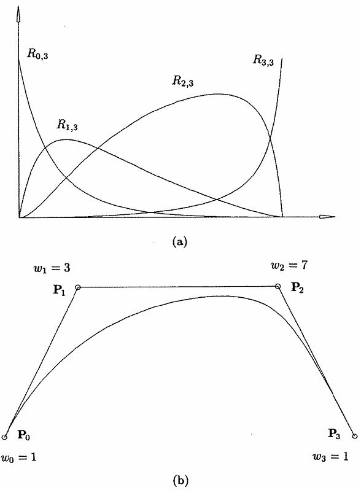

*Նկար 1.13.Ռացիոնալ խորանարդային (a) Բազիսային ֆունկցիաները (b) Բեզյեի կորը*

$`R_{i,n}(u)`$-ները ունեն մի շարք հատկություններ, որոնք հեշտությամբ կարելի է ստանալ (1.18) հավասարումից և $`B_{i,n}(u)`$-երի համապատասխան հատկություններից․

1)  Բացասական չեն․ $`R_{i,n}(u) \geq 0\ \text{բոլոր }i,n\text{-երի և }0 \leq u \leq 1`$ ;

2)  Միավոր տրոհում $`\sum_{i = 0}^{n}R_{i,n}(u) = 1\ \text{բոլոր }0 \leq u \leq 1`$ ;

3)  $`R_{0,n}(0) = R_{n,n}(1) = 1`$ ;

4)  $`R_{i,n}(u)`$-ն $`\lbrack 0;1\rbrack`$ միջակայքում ունի ճիշտ մեկ մաքսիմում արժեք ։

5)  եթե $`w_{0} = w_{1} = \ldots = w_{n}`$, ապա $`R_{i,n}(u) = B_{i,n}(u)\ \text{բոլոր }i\text{-երի համար},`$ այսինքն՝ $`B_{i,n}(u)`$-երը հանդիսանում են $`R_{i,n}(u)`$-երի մասնավոր դեպք։

Սրանցից հետևում են Բեզյեի ռացիոնալ կորերի հետևյալ երկրաչափական հատկությունները․

6)  **ուռուցիկ թաղանթի հատկություն** ․ եթե բոլոր $`P_{i}`$ կետերը գտնվում են միևնույն հարթության մեջ, ապա Բեզյեի ռացիոնալ կորն ամբողջությամբ գտնվում է այդ կետերի ուռուցիկ թաղանթի ներսում,

7)  **ձևափոխությունների ինվարիանտություն** ․ կորի պտույտները, տեղաշարժերը և մասշտաբավորումները կատարվում են միայն փոփոխելով կառավարման կետերը,

8)  **տատանումների նվազման հատկություն**․ նույնն է, ինչ բազմանդամային Բեզյեի կորերի համար (տես նախորդ գլուխը),

9)  **եզրակետերի ինտերպոլյացիա** ․ $`C(0) = P_{0},C(1) = P_{n},`$

10) $`u = 0`$-ում (և $`u = 1`$-ում) $`k`$-րդ ածանցյալը կախված է միայն առաջին (վերջին)

    $`k + 1`$ հատ կառավարման կետերից և կշիռներից․ մասնավորապես,

``` math
C'(0) \parallel (P_{1} - P_{0}),C'(1) \parallel (P_{n} - P_{n - 1}),
```

11) բազմանդամային Բեզյեի կորերը հանդիսանում են Բեզյեի ռացիոնալ կորերի մասնավոր դեպք։

Որպես օրինակ դիտարկենք Բեզյեի ռացիոնալ **շրջանագծային աղեղը**։

$`C(u) = \left( x(u),y(u) \right) = \left( \frac{1 - u^{2}}{1 + u^{2}},\text{\:\,}\frac{2u}{1 + u^{2}} \right)\ \ 0 \leq \ u \leq 1`$ ։

Սա ներկայացնում է միավոր շրջանագծի մեկ քառորդը, ինչպես պատկերված է Նկ. 1.14a-ում։ Այժմ ստանանք այս շրջանագծային աղեղի համար Բեզյեի քառակուսային ռացիոնալ ներկայացումը։ Ակնհայտ է, որ ըստ ծայրակետային ինտերպոլացիայի և k-րդ ածանցյալի հատկությունների՝

$`P_{0} = (1,0),\ \ \ P_{1} = (1,1),\ \ \ P_{2} = (0,1)`$ ։

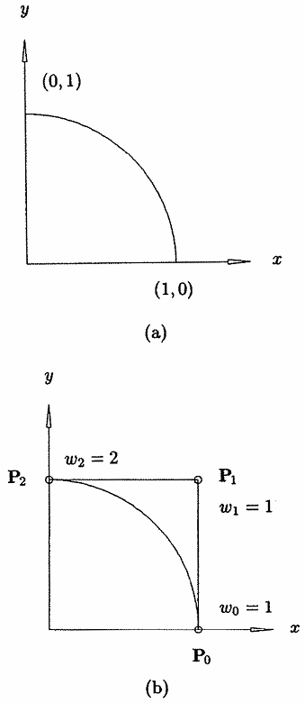

*Նկար 1.14. Միավոր շրջանագծի ներկայացումը (a)* $`x(u) = \frac{1 - u^{2}}{1 + u^{2}}`$ *և* $`y(u) = \frac{2u}{1 + u^{2}}`$*՝ մեկ քառորդի համար (b) Բեզյեի կորը, որը համապատասխանում է Նկ. 1.14a-ին\
(*$`w_{0} = 1`$*,* $`w_{1} = 1`$*,* $`w_{2} = 2`$*)։*

Կշիռների համար ունենք՝

$`W(u) = 1 + u^{2} = \sum_{i = 0}^{2}B_{i,2}(u)\text{ }w_{i} = (1 - u)^{2}w_{0} + 2u(1 - u)w_{1} + u^{2}w_{2}`$ ։

Տեղադրելով $`u = 0`$՝ ստանում ենք $`w_{0} = 1`$։ Նույն կերպ, երբ $`u = 1`$՝ $`w_{2} = 2`$։\
Վերջապես, տեղադրելով $`u = \frac{1}{2}`$, ստանում ենք՝

``` math
\frac{5}{4} = \frac{1}{4}w_{0} + \frac{1}{2}w_{1} + \frac{1}{4}w_{2},
```

և օգտագործելով $`w_{0} = 1`$ և $`w_{2} = 2`$՝ ստանում ենք $`w_{1} = 1`$ (տես Նկ. 1.14b)։

Այն ռացիոնալ կորերը, որոնք տրված են (1.13) հավասարումներով ներկայացված կոորդինատային ֆունկցիաներով, ունեն գեղեցիկ երկրաչափական մեկնաբանություն, որը ապահովում է արդյունավետ մշակում և տվյալների կոմպակտ պահպանում։\
Դրանց հիմնական գաղափարը կայանում է նրանում, որ **համասեռ կոորդինատների** միջոցով $`n`$-չափանի տարածության մեջ գտնվող ռացիոնալ կորը ներկայացվում է որպես բազմանդամային կոր՝ $`\left( n+1 \right)`$-չափանի տարածության մեջ։

Սկսենք եռաչափ Էվկլիդյան տարածության մեջ գտնվող մի կետից՝

$`P = (x,y,z)`$ ։

Այնուհետև $`P`$ -ն քառաչափ տարածության մեջ ներկայացնենք որպես՝

$`P^{w} = (wx,wy,wz,w) = (X,Y,Z,W),w \neq 0`$ ։

Այժմ, որպեսզի $`P^{w}`$-ից ստանանք $`P`$-ն, դրա բոլոր կոորդինատները բաժանենք չորրորդ կոորդինատին՝ $`W`$-ին, այսինքն՝ $`P^{w}`$-ն սկզբնակետից պրոյեկտենք $`W = 1`$ հիպերհարթության վրա (տես Նկ. 1.15-ը երկչափ դեպքի համար, երբ $`P = (x,y)`$)։

Այս արտապատկերումը, որը կնշանակենք $`H`$-ով, հանդիսանում է **պրոյեկտիվ արտապատկերում**, որի կենտրոնը գտնվում է կոորդինատների սկզբնակետում․

``` math
P = H(P^{w}) = H(X,Y,Z,W) = \left\{ \begin{matrix}
\left( \frac{X}{W},\frac{Y}{W},\frac{Z}{W} \right), & \text{եթե }W \neq 0, \\
\text{ուղղություն }(X,Y,Z), & \text{եթե }W = 0\ ։\ 
\end{matrix} \right.\ 
```

Նկատենք, որ կամայական $`x,y,z`$-երի և $`w_{1} \neq w_{2}`$-ի համար՝

``` math
\begin{matrix}
 & H(P^{w_{1}}) = H(w_{1}x,w_{1}y,w_{1}z,w_{1}) = (x,y,z) = H(w_{2}x,w_{2}y,w_{2}z,w_{2}) = H(P^{w_{2}})\ ։\  & & \text{(1.16)}
\end{matrix}
```

Այժմ, տրված $`\left\{ P_{i} \right\}`$ կառավարման կետերի և $`\left\{ w_{i} \right\}`$ կշիռների համար, կառուցենք **կշիռ ունեցող կառավարման կետերը**՝

$`P_{i}^{w} = (w_{i}x_{i},w_{i}y_{i},w_{i}z_{i},w_{i})`$ ։

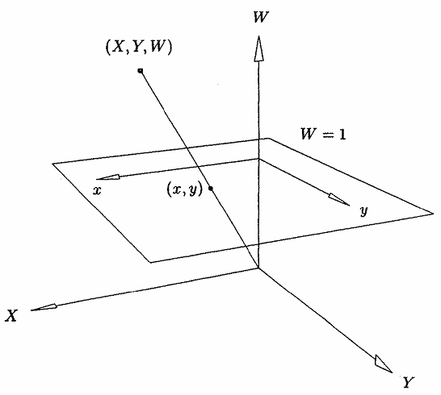

*Նկար 1.15.Էվկլիդյան տարածության մեջ կետերի ներկայացումը համասեռ տեսքով*

Այնուհետև քառաչափ տարածության մեջ սահմանենք Բեզյեի ոչ-ռացիոնալ կորը՝

``` math
\begin{matrix}
 & \ \ \ \ \ \ \ \ \ \ \ \ \ \ \ \ \ \ \ \ \ \ \ \ \ \ \ \ \ \ \ \ \ \ \ \ \ \ \ \ \ \ \ \ \ \ \ \ \ \ \ \ \ \ \ \ \ \ \ \ \ \ \ \ \ \ \ \ \ \ \ \ \ \ C^{w}(u) = \sum_{i = 0}^{n}B_{i,n}(u)\text{ }P_{i}^{w}\ ։\  & & \text{                                 }\text{(1.17)}
\end{matrix}
```

Այժմ կիրառելով $`H`$ պրոյեկտիվ արտապատկերումը $`C^{w}(u)`$-ի վրա (հավասարում (1.14)), կստանանք համապատասխան Բեզյեի ռացիոնալ կորը (տես Նկ. 1.16)։

Մասնավորապես, օգտագործելով (1.17) հավասարման կոորդինատային ֆունկցիաները, կստանանք՝

``` math
{X(u) = \sum_{i = 0}^{n}B_{i,n}(u)\text{ }w_{i}X_{i},
}{Y(u) = \sum_{i = 0}^{n}B_{i,n}(u)\text{ }w_{i}Y_{i},
}{Z(u) = \sum_{i = 0}^{n}B_{i,n}(u)\text{ }w_{i}Z_{i},
}
```
$`W(u) = \sum_{i = 0}^{n}B_{i,n}(u)\text{ }w_{i}`$ ։

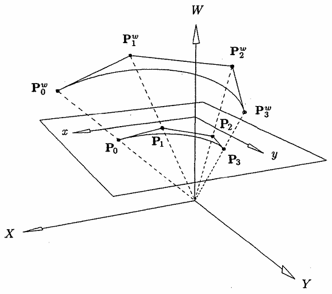

*Նկար 1.16. Բեզյեի ռացիոնալ կորի կառուցումը երկրաչափական տեսքով*

Կորը եռաչափ տարածության մեջ ներդնելով, ստացվում են հետևյալ հավասարումները՝

``` math
{x(u) = \frac{X(u)}{W(u)} = \frac{\sum_{i = 0}^{n}B_{i,n}(u)\text{ }w_{i}X_{i}}{\sum_{i = 0}^{n}B_{i,n}(u)\text{ }w_{i}},
}{y(u) = \frac{Y(u)}{W(u)} = \frac{\sum_{i = 0}^{n}B_{i,n}(u)\text{ }w_{i}Y_{i}}{\sum_{i = 0}^{n}B_{i,n}(u)\text{ }w_{i}},}
```

$`z(u) = \frac{Z(u)}{W(u)} = \frac{\sum_{i = 0}^{n}B_{i,n}(u)\text{ }w_{i}Z_{i}}{\sum_{i = 0}^{n}B_{i,n}(u)\text{ }w_{i}}`$ ։

Այս հավասարումների վեկտորական ներկայացումը կունենա հետևյալ տեսքը՝

``` math
C(u) = (x(u),y(u),z(u)) = \frac{\sum_{i = 0}^{n}B_{i,n}(u)\text{ }w_{i}(X_{i},Y_{i},Z_{i})}{\sum_{i = 0}^{n}B_{i,n}(u)\text{ }w_{i}}\ ։
```

Մեր մշակված ալգորիթմների համար մենք հիմնականում կօգտագործենք (1.17) հավասարմամբ տրված ձևը, ինչպես նաև դրա համանման ձևը ռացիոնալ B-սփլայն կորերի համար։

Այսպիսով, ոչ-ռացիոնալ ձևերը մշակվում են քառաչափ տարածության մեջ, իսկ արդյունքները տեղափոխվում են եռաչափ տարածություն՝ $`H`$ արտապատկերումը կիրառելով։ Մենք փոխադարձաբար կօգտագործենք ենք թե՛ $`C^{w}(u)`$-ն, թե՛ $`C(u)`$-ն՝ որպես Բեզյեի ռացիոնալ (կամ B-սփլայն) կորի նշանակում, թեև խիստ իմաստով $`C^{w}(u)`$-ն ռացիոնալ կոր չէ։

Դիտարկենք հետևյալ օրինակները՝

1.  Վերադառնանք Նկ. 1.14b-ում պատկերված շրջանային աղեղին։ Դիցուք\
    $`P_{0} = (1,0),P_{1} = (1,1),P_{2} = (0,1),\ \ w_{0} = 1,w_{1} = 1,w_{2} = 2`$։ Հետևաբար, (1.17) հավասարումն օգտագործելով եռաչափ տարածության մեջ կառավարման կետերը կլինեն՝ $`P_{0}^{w} = (1,0,1),P_{1}^{w} = (1,1,1),P_{2}^{w} = (0,2,2)։`$ Այստեղից կստանանք $`C^{w}(u) = (1 - u)^{2}P_{0}^{w} + 2u(1 - u)P_{1}^{w} + u^{2}P_{2}^{w}`$ ոչ-ռացիոնալ պարաբոլային աղեղը, որը $`W = 1`$ հարթության վրա պրոյեկտելով վերածվում է շրջանային աղեղի (տես Նկ. 1.17)։ Ենթադրենք $`u_{0}`$-ն ֆիքսված է։ Քանի որ $`C^{w}(u)`$-ն բազմանդամային Բեզյեի կոր է, մենք $`C^{w}(u_{0})`$-ն հաշվելու համար կարող ենք օգտագործել դը Կաստելյոյի ալգորիթմը, որից հետո այն կարտապատկերենք՝ $`C\left( u_{0} \right) = H\left\{ C^{w}\left( u_{0} \right) \right\} ։`$ Այսպիսով, կիրառենք (1.12) հավասարումը $`P_{i}^{w}`$-ների վրա՝

> 
> ``` math
> P_{k,i}^{w}(u_{0}) = (1 - u_{0})\text{ }P_{k - 1,i}^{w} + u_{0}\text{ }P_{k - 1,i + 1}^{w},
> ```
>
> որտեղ
>
> $`k = 1,\ldots,n,\ \ i = 0,\ldots,n - k`$ ։

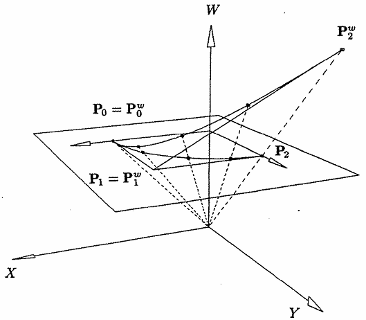

*Նկար 1.17. Շրջանաձև աղեղի համասեռ ներկայացում*

2.  Այժմ, նախորդ օրինակում ստացված և իրենից Բեզյեի ռացիոնալ կոր ներկայացնող շրջանային աղեղի վրա $`u = \frac{1}{2}`$-ում գտնվող կետը հաշվելու համար կիրառենք (1.19) հավասարումը։ Աղեղը տրված է՝ $`C^{w}(u) = (1 - u)^{2}P_{0}^{w} + 2u(1 - u)P_{1}^{w} + u^{2}P_{2}^{w},`$ որտեղ $`P_{0}^{w} = (1,0,1),P_{1}^{w} = (1,1,1),P_{2}^{w} = (0,2,2).`$ Ստացված կետերի եռանկյունաձև հաշվարկը ցուցադրված է Աղյուսակ 1.4-ում։ Այնուհետև

    $`C\left( \frac{1}{2} \right) = H\left\{ C^{w}\left( \frac{1}{2} \right) \right\} = H\left\{ (\frac{3}{4}\ ;\ 1\ ;\ \frac{5}{4}) \right\} = \left( \frac{3}{5},\frac{4}{5} \right)`$ :

    Այժմ ստանանք նույն կետը՝ օգտագործելով աղյուսակ 1.1-ում մեր կողմից մշակված մյուս ներկայացումները։ Դիցուք՝

    $`C(u) = \left( \frac{1 - u^{2}}{1 + u^{2}},\frac{2u}{1 + u^{2}} \right)`$ :

    Կստանանք՝

``` math
C\left( \frac{1}{2} \right) = \left( \frac{1 - \left( \frac{1}{2} \right)^{2}\ }{1 + \left( \frac{1}{2} \right)^{2}},\frac{2\left( \frac{1}{2} \right)}{1 + \left( \frac{1}{2} \right)^{2}} \right) = \left( \frac{3}{5},\frac{4}{5} \right):
```
    Օգտագործելով (1.17) հավասարումը, հաշվենք՝

``` math
C^{w}\left( \frac{1}{2} \right) = \ \sum_{i = 0}^{2}{B_{i,\ 2}\left( \frac{1}{2} \right)P_{i}^{w}} =
```

``` math
{= \left( 1-\frac{1}{2} \right)^{2}(1,0,1) + 2\left( \frac{1}{2} \right)\left( 1-\frac{1}{2} \right)(1,1,1) + \left( \frac{1}{2} \right)^{2}(0,2,2)
}{= \frac{1}{4}(1,0,1) + \frac{1}{2}(1,1,1) + \frac{1}{4}(0,2,2) = \left( \frac{3}{4},\text{ }1,\text{ }\frac{5}{4} \right):
}
```
    Այսպիսով, պրոյեկտելով կրկին ստացանք $`(\frac{3}{5}\ ;\ \frac{4}{5})`$կետը։ (1.18) և (1.15) հավասարումները նույնպես բերում են այդ արդյունքին։

    Վերջապես նշենք, որ

``` math
C\left( \frac{1}{2} \right) = \left( \frac{3}{5},\ \frac{4}{5} \right)
```

    կետը չի հանդիսանում առաջին քառորդում գտնվող շրջանագծային աղեղի միջնակետը, այսինքն՝ պարամետրիզացիան **հավասարաչափ չէ**։ Այն գտնվում է աղեղի սկզբնակետից ավելի քան կես երկարության վրա։

    Սա ինտուիտիվորեն ճիշտ է, քանի որ $`C(u)`$-ի ածանցյալը հաշվելով կարելի է տեսնել, որ սկզբնական արագությունը երկու անգամ մեծ է վերջնական արագությունից։

    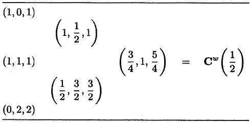

*Աղյուսակ 1.4.* $`C^{w}(\frac{1}{2})`$*կետի ստացումը շրջանագծի աղեղի վրա*

## 1.5 Թենզորային արտադրյալով մակերևույթներ

C(u) կորը մեկ պարամետրից կախված վեկտորական ֆունկցիա է: Այն ուղղագիծ հատվածի արտապատկերումն է (դեֆորմացիան) եռաչափ էվկլիդեսյան տարածության մեջ: Մակերևույթը երկու պարամետրից՝ u-ից և v-ից կախված վեկտորական ֆունկցիա է և իրենից ներկայացնում է uv հարթության R տիրույթի արտապատկերումը եռաչափ էվկլիդեսյան տարածության մեջ:

Այսպիսով, այն ունի հետևյալ տեսքը.

``` math
S(u,v) = \left( x(u,v),\ y(u,v),\ z(u,v) \right),\quad(u,v) \in R:
```

Գոյություն ունեն մակերևույթների ներկայացման բազմաթիվ սխեմաներ: Դրանք միմյանցից տարբերվում են կիրառվող կոորդինատային ֆունկցիաներով և R տիրույթի տեսակով: Հավանաբար ամենապարզ մեթոդը, որն ամենալայնն է կիրառվում երկրաչափական մոդելավորման մեջ, թենզորային արտադրյալի սխեման է:

Թենզորային արտադրյալի մեթոդը հիմնականում երկկողմանի կորերի սխեմա է: Այն օգտագործում է բազիսային ֆունկցիաներ և երկրաչափական գործակիցներ: Բազիսային ֆունկցիաները u-ից և v-ից կախված երկփոփոխական ֆունկցիաներ են, որոնք կառուցվում են որպես մեկ փոփոխականով բազիսային ֆունկցիաների արտադրյալներ:

Երկրաչափական գործակիցները դասավորված են երկկողմանի n × m ցանցով: Այսպիսով, թենզորային արտադրյալով մակերևույթն ունի հետևյալ տեսքը.

``` math
\begin{array}{r}
S(u,v) = \left( x(u,v),\ y(u,v),\ z(u,v) \right) = \sum_{i = 0}^{n}{\sum_{j = 0}^{m}{f_{i}(u)\, g_{j}(v)\, b_{i,j}}},\#(1.20)
\end{array}
```

որտեղ՝

``` math
\left\{ \begin{aligned}
 & b_{i,j} = \left( x_{i,j},\ y_{i,j},\ z_{i,j} \right) \\
 & 0 \leq u,\ v \leq 1
\end{aligned} \right.\ ;
```

Նկատենք, որ այս արտապատկերման (u, v)տիրույթը քառակուսի է (ընդհանուր դեպքում՝ ուղղանկյուն): Նկատենք նաև, որ S(u, v)-ն ունի մատրիցային տեսք.

``` math
S(u,v) = \left\lbrack f_{i}(u) \right\rbrack^{T} \cdot \left\lbrack b_{i,j} \right\rbrack\left\lbrack g_{j}(v) \right\rbrack,
```

որտեղ $`\lbrack f_{i}(u)\rbrack^{T}`$-ը (1) × (n + 1) տող-վեկտոր է, $`\lbrack g_{j}(v)\rbrack`$-ն՝ (m + 1) × (1) սյուն-վեկտոր, իսկ $`\lbrack b_{i,j}\rbrack`$-ն՝ եռաչափ կետերի (n + 1) × (m + 1) չափի մատրից է:

Որպես օրինակ դիտարկենք աստիճանային բազիսով մակերևույթը.

``` math
\begin{array}{r}
S(u,v) = \sum_{i = 0}^{n}{\sum_{j = 0}^{m}{a_{i,j}\, u^{i}v^{j}}} = \left\lbrack u^{i} \right\rbrack^{T}\left\lbrack a_{i,j} \right\rbrack\left\lbrack v^{j} \right\rbrack,\quad\quad\left\{ \begin{aligned}
 & a_{i,j} = \left( x_{i,j},\ y_{i,j},\ z_{i,j} \right) \\
 & 0 \leq u,\ v \leq 1
\end{aligned} \right.\ :\#(1.21)
\end{array}
```

Այստեղ ունենք $`f_{i}(u) = u^{i}`$ և $`g_{j}(v) = v^{j}`$, իսկ բազիսային ֆունկցիաները $`\{ u^{i}v^{j}\}`$ արտադրյալներն են: Եթե ֆիքսենք $`u = u_{0}`$, ապա՝

``` math
\begin{array}{r}
C_{u_{0}}(v) = S\left( u_{0},v \right) = \sum_{j = 0}^{m}{\left( \sum_{i = 0}^{n}{a_{i,j}\, u_{0}^{i}} \right)v^{j}} = \sum_{j = 0}^{m}{b_{j}\left( u_{0} \right)\, v^{j}},\#(1.22)
\end{array}
```

որտեղ՝

``` math
b_{j}(u_{0}) = \sum_{i = 0}^{n}{a_{i,j}\, u_{0}^{i}};
```

Ինչը հանդիսանում է աստիճանային բազիսով կոր, որն ընկած է S(u, v) մակերևույթի վրա: Նմանապես, $`C_{v_{0}}(u)`$-ն աստիճանային բազիսով կոր է՝ ընկած S(u, v)-ի վրա, ընդ որում $`C_{u_{0}}(v)`$ և $`C_{v_{0}}(u)`$ կորերը հատվում են մակերևույթի $`S(u_{0},v_{0})`$ կետում: Այս կորերը կոչվում են իզոպարամետրական կորեր (կամ իզոկորեր): $`C_{u_{0}}(v)`$-ն կոչվում է v-կոր, իսկ $`C_{v_{0}}(u)`$-ն՝ u-կոր (տես Նկար 1.18):

(1.21) հավասարումը կարող է գրվել որպես.

``` math
\begin{aligned}
S(u,v) & = \underset{b_{0}}{\overset{\left\{ a_{0,0} + a_{0,1}v + a_{0,2}v^{2} + \cdots + a_{0,m}v^{m} \right\}}{︸}} + \\
 & + u\underset{b_{1}}{\overset{\left\{ a_{1,0} + a_{1,1}v + a_{1,2}v^{2} + \cdots + a_{1,m}v^{m} \right\}}{︸}} + \\
 & + u^{2}\underset{b_{2}}{\overset{\left\{ a_{2,0} + a_{2,1}v + a_{2,2}v^{2} + \cdots + a_{2,m}v^{m} \right\}}{︸}} + \\
 & \ \  \vdots \\
 & + u^{n}\underset{b_{n}}{\overset{\left\{ a_{n,0} + a_{n,1}v + a_{n,2}v^{2} + \cdots + a_{n,m}v^{m} \right\}}{︸}} = \\
 & = b_{0} + b_{1}u + b_{2}u^{2} + \cdots + b_{n}u^{n}:
\end{aligned}
```

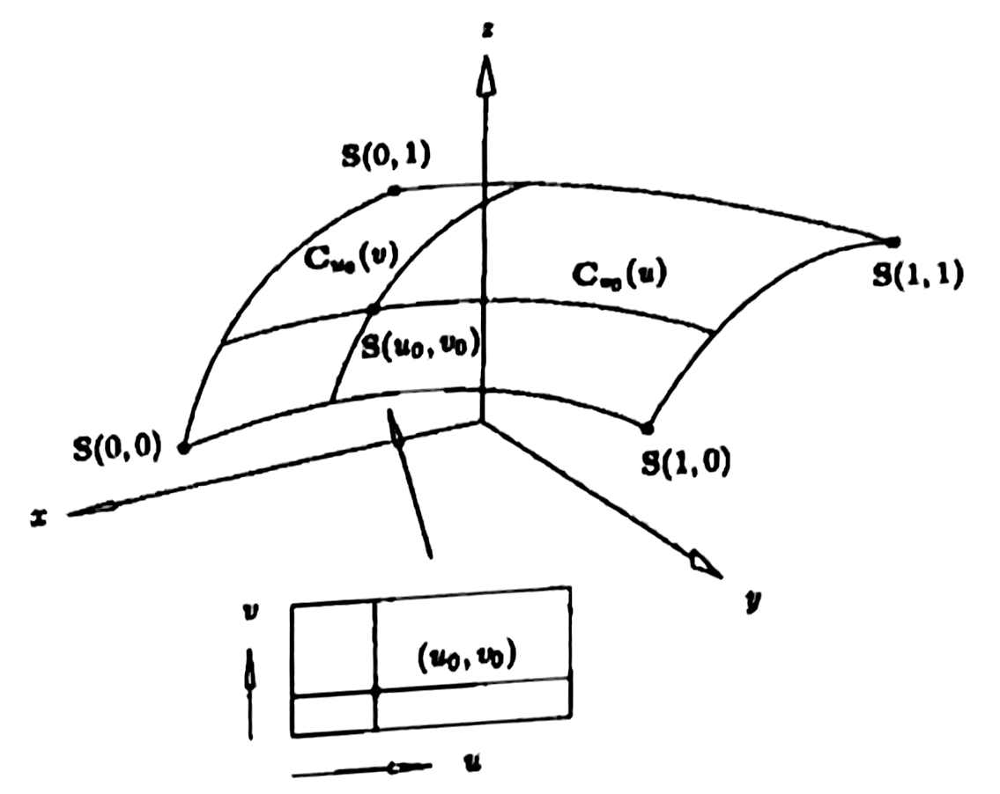

*Նկար 1.18. Թենզորային արտադրյալով մակերևույթ, որը ցույց է տալիս իզոպարամետրական կորերը:*

Ձևավոր փակագծերում գտնվող անդամները պարզ բազմանդամներ են, որոնք կարող են հաշվարկվել Հորների ալգորիթմով՝ տալով $`b_{0},\ b_{1},\ \ldots,\ b_{n}`$ արժեքները: Օգտագործելով այս b-երը և կրկին կիրառելով ալգորիթմը՝ մենք ստանում ենք մակերևույթի վրայի կետը:

Վերը նշվածը բնորոշ է թենզորային արտադրյալով մակերևույթների համար կիրառվող ալգորիթմներին: Դրանք սովորաբար ստացվում են կորերի ալգորիթմների ընդլայնման միջոցով՝ հաճախ սկզբում մեկ ուղղությամբ մշակելով գործակիցների n (կամ m) տողերը (որպես կորեր), այնուհետև մյուս ուղղությամբ մշակելով մեկ կամ մի քանի տողեր:

Դիֆերենցելով (1.21) հավասարումը՝ ստանում ենք.

``` math
S_{u}(u,v) = \sum_{i = 1}^{n}{\sum_{j = 0}^{m}{i\, a_{i,j}\, u^{i - 1}v^{j}}},\quad\quad S_{v}(u,v) = \sum_{i = 0}^{n}{\sum_{j = 1}^{m}{j\, a_{i,j}\, u^{i}v^{j - 1}}}:
```

Նկատենք, որ ֆիքսված $`(u_{0},v_{0})`$ կետի համար՝ $`S_{u}(u_{0},v_{0}) = C'_{v_{0}}(u_{0})`$ և $`S_{v}(u_{0},v_{0}) = C'_{u_{0}}(v_{0})`$: (N) նորմալ վեկտորը հաշվարկվում է (1.4) հավասարման միջոցով:

Ոչ-ռացիոնալ Բեզյեի մակերևույթները ստացվում են հսկիչ կետերի երկկողմանի ցանցի և մեկ փոփոխականով Բեռնշտայնի բազմանդամների արտադրյալների միջոցով.

``` math
\begin{array}{r}
S(u,v) = \sum_{i = 0}^{n}{\sum_{j = 0}^{m}{B_{i,n}(u)\, B_{j,m}(v)\, P_{i,j}}},\quad\quad 0 \leq u,\ v \leq 1:\#(1.23)
\end{array}
```

$`B_{0,2}(u)B_{1,3}(v)`$ բազիսային ֆունկցիան պատկերված է Նկար 1.19a-ում, իսկ Նկար 1.19b-ում ցուցադրված է քառակուսային × խորանարդային Բեզյեի մակերևույթ:

Ֆիքսված $`u = u_{0}`$-ի դեպքում.

``` math
\begin{array}{r}
\begin{aligned}
C_{u_{0}}(v) = S(u_{0},v) & = \sum_{i = 0}^{n}{\sum_{j = 0}^{m}{B_{i,n}(u_{0})\, B_{j,m}(v)\, P_{i,j}}} = \\
 & = \sum_{j = 0}^{m}{B_{j,m}(v)\left( \sum_{i = 0}^{n}{B_{i,n}(u_{0})\, P_{i,j}} \right)} = \\
 & = \sum_{j = 0}^{m}{B_{j,m}(v)\, Q_{j}(u_{0})},
\end{aligned}\#(1.24)
\end{array}
```

որտեղ՝

``` math
Q_{j}(u_{0}) = \sum_{i = 0}^{n}{B_{i,n}(u_{0})\, P_{i,j}},\quad\quad j = 0,\ldots,m
```

հանդիսանում է մակերևույթի վրա ընկած Բեզյեի կոր: Նմանապես,

$`C_{v_{0}}(u) = \sum_{i = 0}^{n}{B_{i,n}(u)\, Q_{i}(v_{0})}`$-ն հանդիսանում է մակերևույթի վրա ընկած Բեզյեի u իզոկոր:

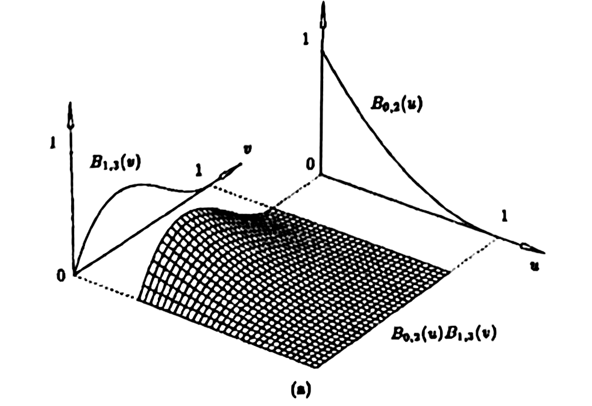

*Նկար 1.19. (a) Բեզյեի թենզորային արտադրյալով բազիսային ֆունկցիան՝* $`B_{0,2}(u)B_{1,3}(v)`$*; (b) քառակուսային × խորանարդային Բեզյեի մակերևույթ:*

Ինչպես և կորերի դեպքում, իրենց գերազանց հատկությունների շնորհիվ Բեզյեի մակերևույթները երկրաչափական մոդելավորման կիրառություններում ավելի հարմար են, քան աստիճանային բազիսով մակերևույթները: Մասնավորապես, ունեն հետևյալ հատկությունները.

• ոչ-բացասականություն. $`B_{i,n}(u)\, B_{j,m}(v) \geq 0`$ բոլոր i, j, u, v-երիհամար,

• միավորի տրոհում. $`\sum_{i = 0}^{n}{\sum_{j = 0}^{m}{B_{i,n}(u)\, B_{j,m}(v)}} = 1`$ բոլոր u-ի և v-իհամար,

• S(u, v)-ն պարունակվում է իր հսկիչ կետերի ուռուցիկ թաղանթում,

• ձևափոխությունների նկատմամբ ինվարիանտություն,

• մակերևույթը ինտերպոլացնում է (անցնում է դրանցով) չորս անկյունային հսկիչ կետերը,

• եռանկյունացման դեպքում հսկիչ ցանցը ձևավորում է մակերևույթի բազմանկյուն հարթ մոտարկում:

Հետաքրքիր է նշել, որ Բեզյեի մակերևույթների համար տատանումների նվազման հայտնի հատկություն գոյություն չունի:

Դե-Կաստալյեի ալգորիթմը նույնպես հեշտությամբ ընդլայնվում է Բեզյեի մակերևույթի վրա կետեր հաշվարկելու համար: Հղում կատարեք (1.24) հավասարմանը և Նկար 1.20-ին: Թող $`(u_{0},v_{0})`$-ն լինի ֆիքսված: Ֆիքսված $`j_{0}`$-ի համար $`Q_{j_{0}}(u_{0}) = \sum_{i = 0}^{n}{B_{i,n}(u_{0})\, P_{i,j_{0}}}`$ կետը ստացվում է հսկիչ կետերի $`j_{0}`$-րդ տողի նկատմամբ Դե-Կաստալյեի ալգորիթմի կիրառմամբ, այսինքն՝ $`\{ P_{i,j_{0}}\}`$-ի համար, որտեղ $`i = 0,\ldots,n`$: Հետևաբար, Դե-Կաստալյեի ալգորիթմի կիրառումը (m + 1) անգամ տալիս է $`C_{u_{0}}(v)`$ կորը, և դրա կրկնակի կիրառումը $`C_{u_{0}}(v)`$-ի վրա $`v = v_{0}`$ դեպքում տալիս է $`C_{u_{0}}(v_{0}) = S(u_{0},v_{0})`$: Այս գործընթացը պահանջում է՝

``` math
\begin{array}{r}
\frac{n(n + 1)(m + 1)}{2} + \frac{m(m + 1)}{2}\#(1.25)
\end{array}
```

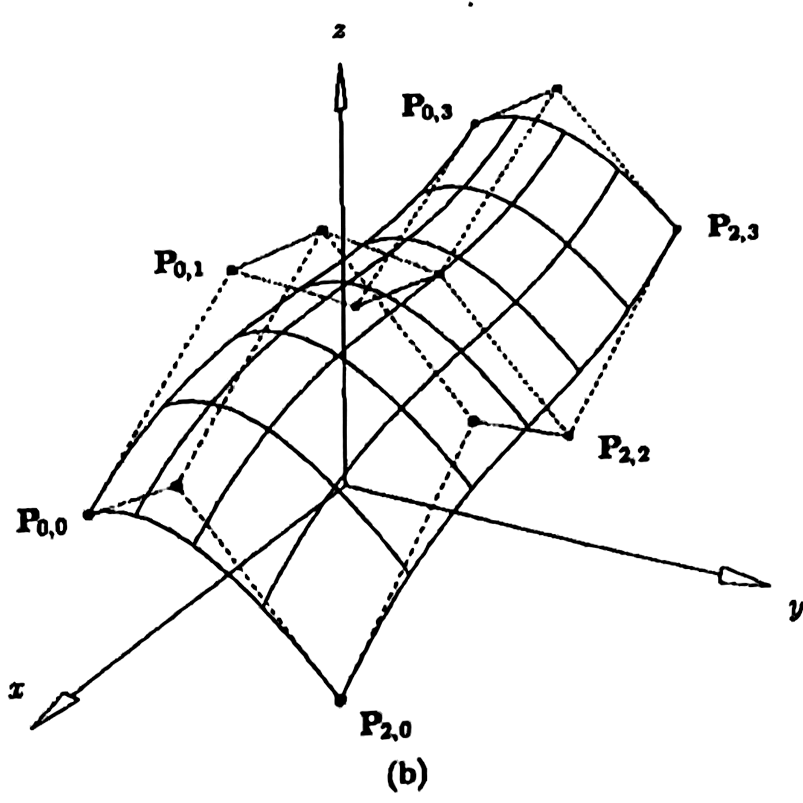

*Նկար 1.19.(Շարունակություն)*

գծային ինտերպոլացիաներ: Համաչափությունից ելնելով՝ մենք կարող ենք սկզբում հաշվարկել $`C_{v_{0}}(u)`$-ն (Դե-Կաստալյեի ալգորիթմի n + 1 կիրառում) և այնուհետև հաշվել $`C_{v_{0}}(u_{0}) = S(u_{0},v_{0})`$: Սա պահանջում է՝

|     | $`\frac{m(m + 1)(n + 1)}{2} + \frac{n(n + 1)}{2}`$ | (1.26) |
|-----|------------------------------------------------|-------:|

գծային ինտերպոլացիաներ: Այսպիսով, եթե n \> m, ապա սկզբում հաշվարկեք $`C_{v_{0}}(u)`$-ն, հետո $`C_{v_{0}}(u_{0})`$, հակառակ դեպքում՝ սկզբում հաշվարկեք $`C_{u_{0}}(v)`$-ն, հետո $`C_{u_{0}}(v_{0})`$:

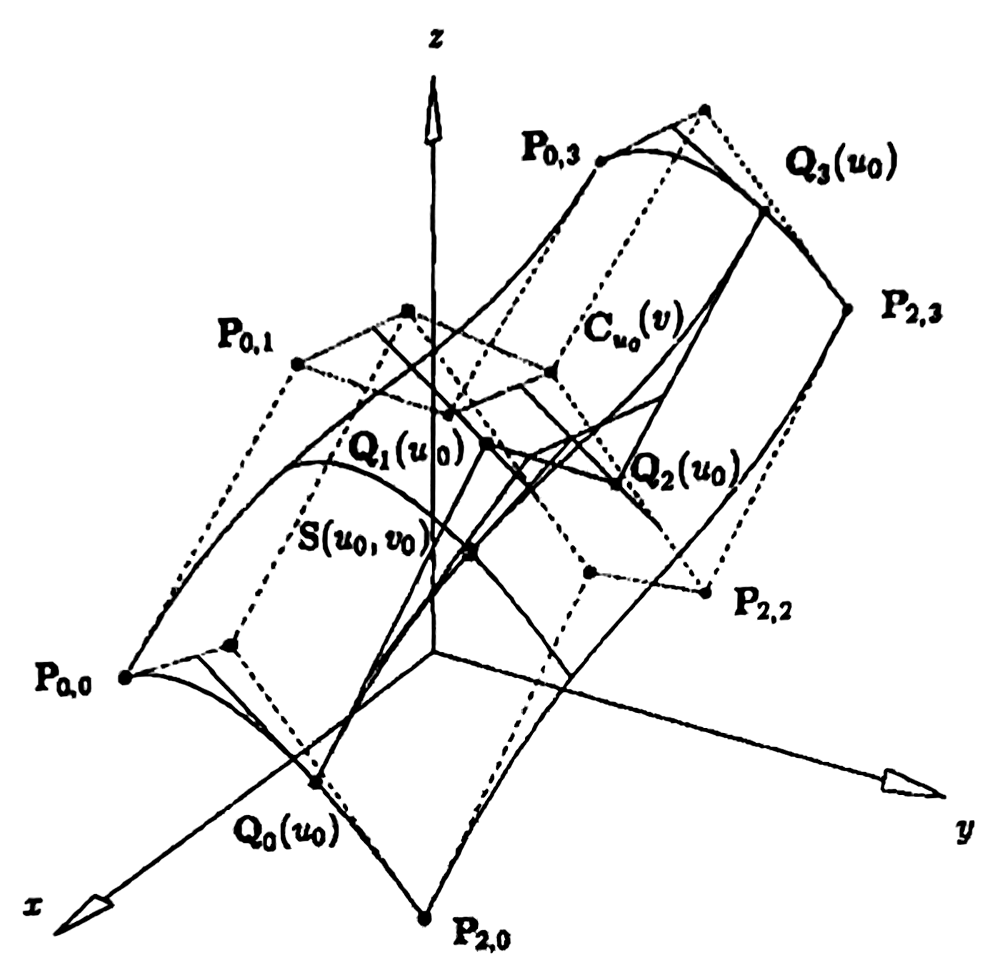

Նկար 1.20. Դե-Կաստալյեի ալգորիթմը Բեզյեի մակերևույթի համար:

Սահմանենք Բեզյեի ռացիոնալ մակերևույթը որպես չորս չափանի բազմանդամային Բեզյեի մակերևույթի պերսպեկտիվ պրոյեկցիա։

``` math
\begin{array}{r}
S^{w}(u,v) = \sum_{i = 0}^{n}{\sum_{j = 0}^{m}{B_{i,n}(u)\, B_{j,m}(v)\, P_{i,j}^{w}}}\#(1.27)
\end{array}
```

և

``` math
\begin{array}{r}
\begin{aligned}
S(u,v) = H\left\{ S^{w}(u,v) \right\} & = \frac{\sum_{i = 0}^{n}{\sum_{j = 0}^{m}{B_{i,n}(u)\, B_{j,m}(v)\, w_{i,j}\, P_{i,j}}}}{\sum_{i = 0}^{n}{\sum_{j = 0}^{m}{B_{i,n}(u)\, B_{j,m}(v)\, w_{i,j}}}} = \\
 & = \sum_{i = 0}^{n}{\sum_{j = 0}^{m}{R_{i,j}(u}},v)\, P_{i,j},
\end{aligned}\#(1.28)
\end{array}
```

որտեղ՝

``` math
R_{i,j}(u,v) = \frac{B_{i,n}(u)\, B_{j,m}(v)\, w_{i,j}}{\sum_{r = 0}^{n}{\sum_{s = 0}^{m}{B_{r,n}(u)\, B_{s,m}(v)\, w_{r,s}}}}:
```

Նկատենք, որ $`R_{i,j}(u,v)`$-ն հանդիսանում են ռացիոնալ ֆունկցիաներ, բայց չեն հանդիսանում այլ բազիսային ֆունկցիաների արտադրյալներ: Հետևաբար, S(u, v)-ն թենզորային արտադրյալով մակերևույթ չէ, իսկ $`S^{w}(u,v)`$-ն հանդիսանում է այդպիսին: Ինչպես կորերի դեպքում, մենք հիմնականում աշխատում ենք (1.27) հավասարման հետ և պրոյեկտում ենք արդյունքները: Նկար 1.21a-ն ցույց է տալիս ռացիոնալ բազիսային ֆունկցիա, իսկ Նկար 1.21b-ն պատկերում է քառակուսային × խորանարդային Բեզյեի ռացիոնալ մակերևույթ: Համեմատեք այս նկարները 1.24a և 1.24b նկարների հետ:

Ենթադրելով, որ $`w_{i,j} > 0`$ բոլոր i-ի և j-ի համար, Բեզյեի ոչ-ռացիոնալ մակերևույթների (և $`B_{i,n}B_{j,m}`$ արտադրյալ ֆունկցիաների) համար նախկինում թվարկված հատկությունները բնականորեն տարածվում են նաև Բեզյեի ռացիոնալ մակերևույթների վրա: Ավելին, եթե $`w_{i,j} = 1`$ բոլոր i-ի և j-ի համար, ապա $`R_{i,j}(u,v) = B_{i,n}(u)\, B_{j,m}(v)`$, և համապատասխան մակերևույթը դառնում է ոչ-ռացիոնալ:

Օրինակ 1.15: Կառուցենք գլանային մակերևույթի հատված: Ինչպես հայտնի է՝

``` math
C^{w}(u) = \sum_{i = 0}^{2}{B_{i,2}(u)\, P_{i}^{w}},
```

որտեղ $`\{ P_{i}^{w}\} = \{(0,1,0,1),\ (0,1,1,1),\ (0,0,2,2)\}`$ հանդիսանում է շրջանագծի աղեղ yz հարթության մեջ: Օգտագործելով զուգահեռ տեղափոխությունը՝ կունենանք

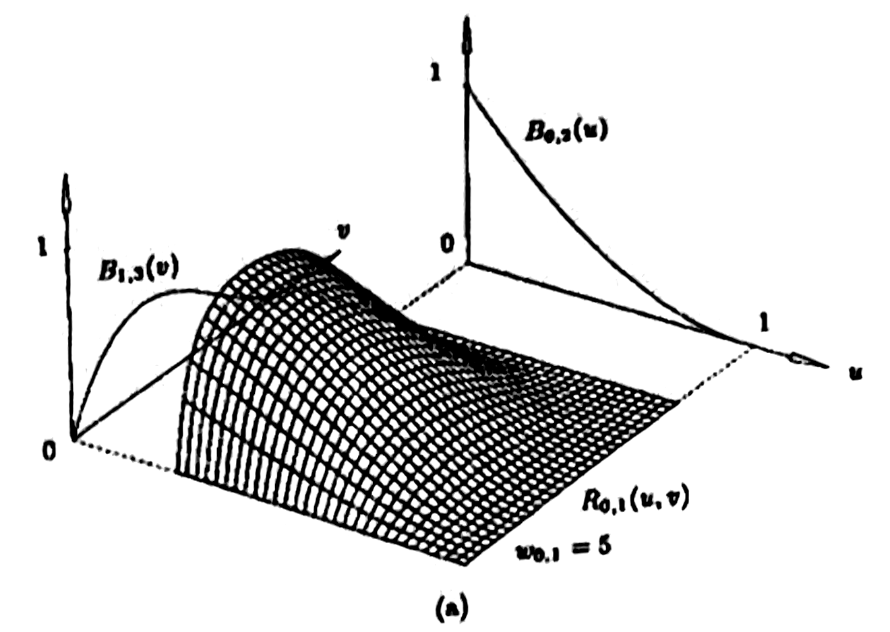

*Նկար 1.21. (a)* $`R_{0,1}(u,v)`$ *ռացիոնալ բազիսային ֆունկցիան (*$`w_{0,1} = 5`$ *արժեքով, իսկ մնացած բոլոր կշիռները հավասար են մեկի); (b) քառակուսային × խորանարդային Բեզյեի ռացիոնալ մակերևույթ:*

``` math
C_{0}^{w}(u) = \sum_{i = 0}^{2}{B_{i,2}(u)\, P_{i,0}^{w}}\quad\text{և}\quad C_{1}^{w}(u) = \sum_{i = 0}^{2}{B_{i,2}(u)\, P_{i,1}^{w}},
```

որտեղ՝

``` math
\left\{ P_{i,0}^{w} \right\} = \left\{ (1,1,0,1),\ (1,1,1,1),\ (2,0,2,2) \right\},
```

և

``` math
\left\{ P_{i,1}^{w} \right\} = \left\{ ( - 1,1,0,1),\ ( - 1,1,1,1),\ ( - 2,0,2,2) \right\},
```

համապատասխանաբար հանդիսանում են շրջանագծի աղեղներ x = 1 և x = −1 հարթություններում (տես Նկար 1.22): $`C_{0}^{w}`$ և $`C_{1}^{w}`$ կորերի միջև գծային ինտերպոլացիան տալիս է գլանային մակերևույթ, այսինքն՝

``` math
S^{w}(u,v) = \sum_{i = 0}^{2}{\sum_{j = 0}^{1}{B_{i,2}(u)\, B_{j,1}(v)\, P_{i,j}^{w}}}:
```

Ֆիքսված $`u = u_{0}`$-ի դեպքում $`C_{u_{0}}^{w}(v) = \sum_{j = 0}^{1}{B_{j,1}(v)\, Q_{j}^{w}(u_{0})}`$-ն ուղղագիծ հատված է $`C_{0}^{w}(u_{0})`$-ից դեպի $`C_{1}^{w}(u_{0})`$՝ զուգահեռ x առանցքին: Ֆիքսված $`v = v_{0}`$-ի դեպքում

$`C_{v_{0}}^{w}(u) = S^{w}(u,v_{0}) = \sum_{i = 0}^{2}{B_{i,2}(u)\, Q_{i}^{w}(v_{0})}`$-ն շրջանագծային աղեղ է

$`x = (1 - v_{0})(1) + v_{0}( - 1) = 1 - 2v_{0}`$ հարթության մեջ: Այժմ հաշվենք $`S(1/2,\ 1/2)`$ կետը: Նկատենք, որ n \> m: Սկզբում ստանանք $`C_{v_{0} = 1/2}^{w}(u)`$:

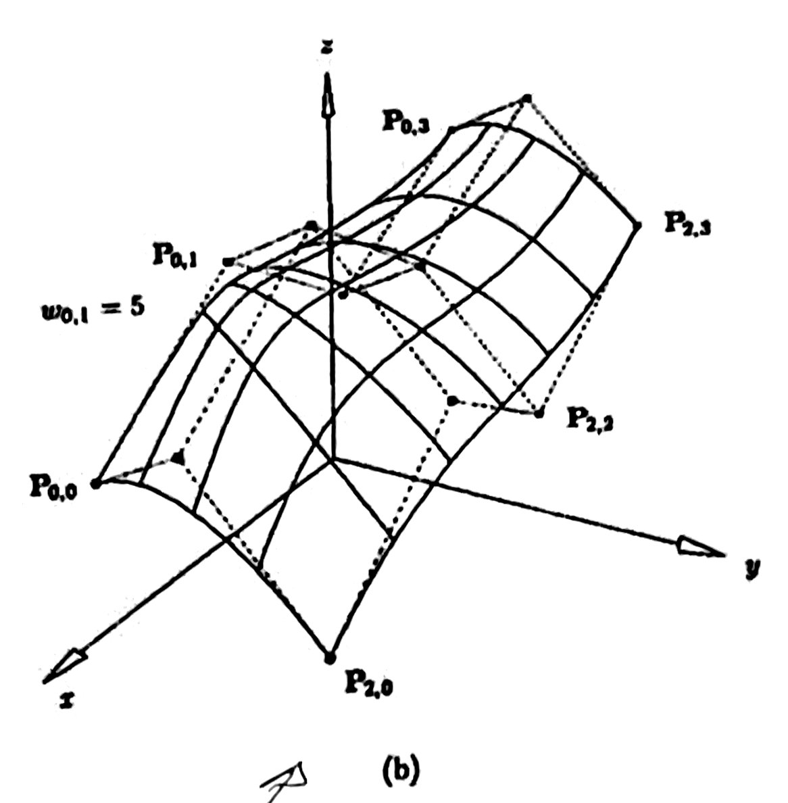

*Նկար 1.21.(b) (Շարունակություն)*

``` math
\begin{matrix}
(1,1,0,1) & \\
 & (0,1,0,1) = Q_{0}^{w}(v_{0}) \\
( - 1,1,0,1) & 
\end{matrix}
```

``` math
\begin{matrix}
(1,1,0,1) & \\
 & (0,1,0,1) = Q_{0}^{w}(v_{0}) \\
( - 1,1,0,1) & 
\end{matrix}
```

``` math
\begin{matrix}
(1,1,1,1) & \\
 & (0,1,1,1) = Q_{1}^{w}(v_{0}) \\
( - 1,1,1,1) & 
\end{matrix}
```

``` math
\begin{matrix}
(2,0,2,2) & \\
 & (0,0,2,2) = Q_{2}^{w}(v_{0}) \\
( - 2,0,2,2) & 
\end{matrix}:
```

Այժմ $`C_{v_{0} = 1/2}^{w}(u) = \sum_{i = 0}^{2}{B_{i,2}(u)\, Q_{i}^{w}(v_{0})}`$-ն շրջանագծային աղեղ է Oyz հարթության մեջ: Այդ դեպքում՝

``` math
\begin{matrix}
(0,1,0,1) & & \\
 & \left( 0,1,\frac{1}{2},1 \right) & \\
(0,1,1,1) & & \left( 0,\frac{3}{4},1,\frac{5}{4} \right) = S^{w}\left( \frac{1}{2},\frac{1}{2} \right) \\
 & \left( 0,\frac{1}{2},\frac{3}{2},\frac{3}{2} \right) & \\
(0,0,2,2) & & 
\end{matrix}:
```

Եվ պրոյեկտումը տալիս է՝

``` math
S\left( \frac{1}{2},\frac{1}{2} \right) = H\left\{ \left( 0,\frac{3}{4},1,\frac{5}{4} \right) \right\} = \left( 0,\frac{3}{5},\frac{4}{5} \right):
```

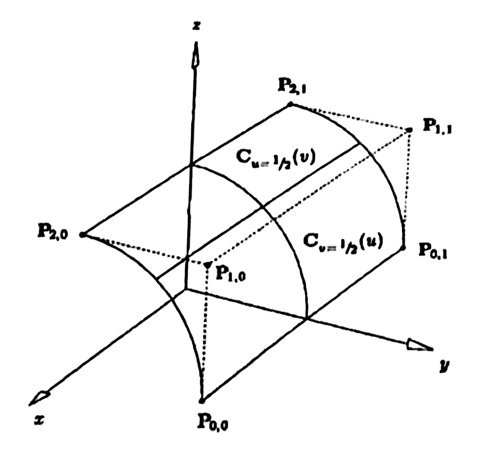

*Նկար 1.22. Գլանային մակերևույթի հատված որպես Բեզյեի ռացիոնալ մակերևույթ:*

# ԳԼՈՒԽ 2. B-ՍՓԼԱՅՆ ԲԱԶԻՍԱՅԻՆ ՖՈՒՆԿՑԻԱՆԵՐ

## 2.1 Ներածություն

Կորերը, որոնք բաղկացած են ընդամենը մեկ բազմանդամային կամ ռացիոնալ սեգմենտներից, հաճախ անբավարար են \[1\], \[3\]։ Դրանց թերություններն են՝

- մեծ թվով սահմանափակումներին բավարարելու համար պահանջվում է բարձր աստիճան. օրինակ, տվյալ $`n`$ կետերով բազմանդամային Բեզյեի կոր կառուցելու համար անհրաժեշտ է $`(n - 1)`$-աստիճան։ Սակայն բարձր աստիճանի կորերն անարդյունավետ են մշակելու տեսանկյունից և թվայնորեն անկայուն են.
- որոշ բարդ ձևեր ճշգրիտ մոտարկելու համար պահանջվում է բարձր աստիճան;
- միասեգմենտ կորերը (մակերևույթները) լավ հարմարեցված չեն ձևի ինտերակտիվ դիզայնի նախագծման համար. թեև Բեզյեի կորերի ձևը կարելի է փոփոխել դրանց հսկիչ կետերի (և կշիռների) միջոցով, այդ վերահսկողությունը բավականաչափ լոկալ չէ։

Լուծումն այն է, որ օգտագործվեն կորեր (մակերևույթներ), որոնք կտոր առ կտոր բազմանդամային են կամ կտոր առ կտոր ռացիոնալ։ Նկար 2.1-ում ցույց է տրված $`\mathbf{C}(u)`$ կորը, որը կազմված է $`m`$ $`( = 3)`$ հատված $`n`$-րդ աստիճանի բազմանդամներից։ $`\mathbf{C}(u)`$-ն սահմանված է $`u \in \lbrack 0,1\rbrack`$ վրա։ $`u_{0} = 0 < u_{1} < u_{2} < u_{3} = 1`$ պարամետրի արժեքները կոչվում են բեկման կետեր։ Դրանք արտապատկերվում են երեք բազմանդամային սեգմենտների ծայրակետերի վրա։ Սեգմենտները նշանակում ենք $`\mathbf{C}_{i}(u)`$-ով, $`1 \leq i \leq m`$։ Այդ սեգմենտները կառուցված են այնպես, որ դրանք միանում են իրար որոշակի աստիճանի անընդհատությամբ (ոչ պարտադիր նույնը յուրաքանչյուր բեկման կետում)։ Թող $`\mathbf{C}_{i}^{(j)}`$-ը նշանակի $`\mathbf{C}_{i}`$-ի $`j`$-րդ ածանցյալը։ $`\mathbf{C}(u)`$-ն կոչվում է $`C^{k}`$ անընդհատ $`u_{i}`$ բեկման կետում, եթե $`\mathbf{C}_{i}^{(j)}(u_{i}) = \mathbf{C}_{i + 1}^{(j)}(u_{i})`$ բոլոր $`0 \leq j \leq k`$-ի համար։

$`\mathbf{C}_{i}(u)`$-ն ներկայացնելու համար կարող է օգտագործվել ցանկացած ստանդարտ բազմանդամային ձև։ Նկար 2.2-ը ցույց է տալիս Նկար 2.1-ի Բեզյեի խորանարդային կորի երեք սեգմենտները ձևով։ $`\mathbf{P}_{i}^{j}`$-ն նշանակում է $`j`$-րդ հատվածի $`i`$-րդ հսկիչ կետը։

Եթե աստիճանը հավասար է երեքի, և $`U = \{ u_{0},u_{1},u_{2},u_{3}\}`$ բեկման կետերը մնում են ֆիքսված, և եթե թույլ ենք տալիս $`\mathbf{P}_{i}^{j}`$ տասներկու հսկիչ կետերին կամայականորեն փոփոխվել, ապա ստանում ենք $`V`$ վեկտորական տարածությունը, որը կազմված է բոլոր կտոր առ կտոր խորանարդային բազմանդամ u կորերից:

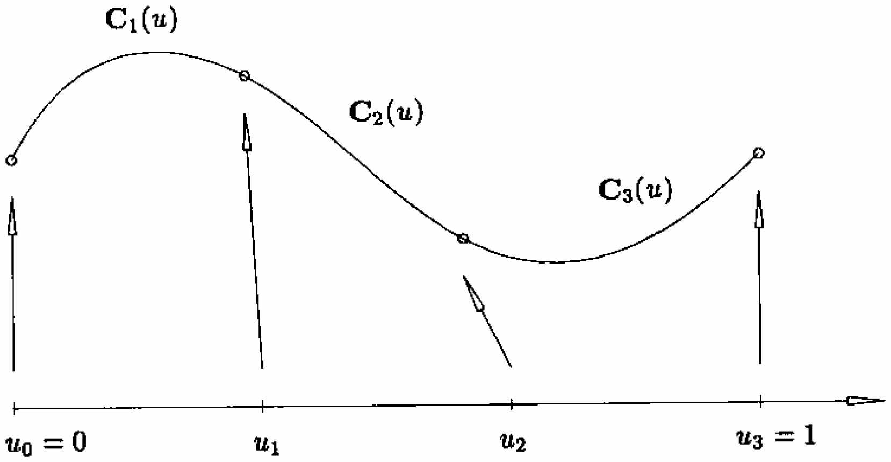

*Նկար 2.1. Երեք սեգմենտներով կտոր առ կտոր խորանարդային բազմանդամ կոր ։*

$`V`$-ն ունի տասներկու չափողականություն, և $`V`$ տարածությունից կորը կարող է անընդհատ չլինել $`u_{1}`$ կամ $`u_{2}`$ կետերում։ Այժմ ենթադրենք, որ մենք պահանջում ենք (ինչպես Նկար 2.2-ում), որ $`\mathbf{P}_{3}^{1} = \mathbf{P}_{0}^{2}`$ և $`\mathbf{P}_{3}^{2} = \mathbf{P}_{0}^{3}`$։ Սա առաջացնում է $`V^{0}`$ ՝ $`U`$-ի վրա բոլոր այն կտոր առ կտոր խորանարդային բազմանդամ կորերի վեկտորական տարածությունը, որոնք գոնե $`C^{0}`$ ամենուր անընդհատ են։ $`V^{0}`$-ն ունի տասը չափողականություն, և $`V^{0} \subset V`$։

$`C^{1}`$ անընդհատության պահանջի կիրառումն ինչ-որ չափով ավելի բարդ է։ Դիտարկենք $`u = u_{1}`$ դեպքը։ Ենթադրենք, որ $`\mathbf{P}_{3}^{1} = \mathbf{P}_{0}^{2}`$։ Նշանակենք

``` math
v = \frac{u - u_{0}}{u_{1} - u_{0}}\quad\text{և}\quad w = \frac{u - u_{1}}{u_{2} - u_{1}}
```

որպես տեղային պարամետրեր՝ համապատասխանաբար $`\lbrack u_{0},u_{1}\rbrack`$ և $`\lbrack u_{1},u_{2}\rbrack`$ միջակայքերի վրա։ Այդ դեպքում $`0 \leq v,w \leq 1`$։ $`C^{1}`$ անընդհատությունը $`u_{1}`$ կետում ենթադրում է

``` math
\frac{1}{u_{1} - u_{0}}\mathbf{C}_{1}^{(1)}(v = 1) = \mathbf{C}_{1}^{(1)}(u_{1}) = \mathbf{C}_{2}^{(1)}(u_{1}) = \frac{1}{u_{2} - u_{1}}\mathbf{C}_{2}^{(1)}(w = 0)
```

և (1.10) հավասարումից հետևում է, որ

``` math
\frac{3}{u_{1} - u_{0}}(\mathbf{P}_{3}^{1} - \mathbf{P}_{2}^{1}) = \frac{3}{u_{2} - u_{1}}(\mathbf{P}_{1}^{2} - \mathbf{P}_{0}^{2})
```

Այսպիսով՝

``` math
\begin{array}{r}
\mathbf{P}_{3}^{1} = \frac{\left( u_{2} - u_{1} \right)\mathbf{P}_{2}^{1} + \left( u_{1} - u_{0} \right)\mathbf{P}_{1}^{2}}{u_{2} - u_{0}}\#(2.1)
\end{array}
```

(2.1) հավասարումից հետևում է, որ $`\mathbf{P}_{3}^{1}`$-ը և $`\mathbf{P}_{3}^{2}`$-ը կարելի է գրել համապատասխանաբար $`\mathbf{P}_{2}^{1},\mathbf{P}_{1}^{2}`$ և $`\mathbf{P}_{2}^{2},\mathbf{P}_{1}^{3}`$ արտահայտություններով։ Հետևաբար՝ $`V^{1}`$-ը, այսինքն՝ $`U`$-ի վրա բոլոր $`C^{1}`$ անընդհատ կտոր առ կտոր խորանարդային բազմանդամ կորերի վեկտորական տարածությունը, ունի ութ չափողականություն, և $`V^{1} \subset V^{0} \subset V`$։

Այստեղից պարզ է, որ դարձնում, որ կտոր առ կտոր բազմանդամ կորի առանձին բազմանդամ սեգմենտների պահպանումն ու մշակումը իդեալական մեթոդ չէ՝ այդպիսի կորերի մշակման համար։

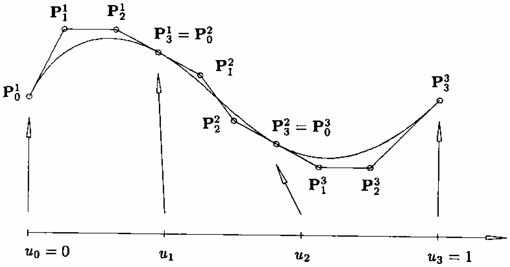

*Նկար 2.2. Պատկերված է նկ․2.1-ի Բեզյեի խորանարդային կորի երեք սեգմենտներ*

Նախ և առաջ պետք է պահվեն ավելորդ տվյալներ՝ տասներկու գործակից, մինչդեռ $`C^{1}`$ անընդհատ խորանարդային կորերի համար բավական է ընդամենը ութը, իսկ $`C^{2}`$ անընդհատ խորանարդային կորերի համար՝ ընդամենը վեցը: Երկրորդ, Բեզյեի կորի դեպքում $`\mathbf{C}(u)`$-ի անընդհատությունը կախված է հսկիչ կետերի դիրքից, հետևաբար հսկիչ կետերի տեղաբաշխման հարցում կա սահմանափակ ճկունություն՝ պահպանելով անընդհատությունը: Եթե դիզայներն ուզում է $`C^{1}`$ անընդհատություն և գոհ է $`\mathbf{C}_{1}(u)`$ և $`\mathbf{C}_{3}(u)`$ հատվածներից, բայց ցանկանում է փոփոխել $`\mathbf{C}_{2}(u)`$-ի ձևը, ապա նա ոչինչ անել չի կարող. $`\mathbf{C}_{2}(u)`$-ի հսկիչ կետերից և ոչ մեկը հնարավոր չէ փոփոխել: Երրորդ, կորի անընդհատությունը որոշելու համար անհրաժեշտ է հաշվարկ (ինչպես, օրինակ, (2.1) հավասարումը)։

Մենք ուզում ենք կորի ներկայացում հետևյալ տեսքով

``` math
\begin{array}{r}
\mathbf{C}(u) = \sum_{i = 0}^{n}f_{i}(u)\,\mathbf{P}_{i}\mathbf{\#}(2.2)
\end{array}
```

տեսքով, որտեղ $`\mathbf{P}_{i}`$-երը հսկիչ կետեր են, իսկ $`\{ f_{i}(u),i = 0,\ldots,n\}`$-ը կտոր առ կտոր բազմանդամային ֆունկցիաներ են, որոնք կազմում են բազիս ցանկալի աստիճանի և անընդհատության բոլոր կտոր առ կտոր բազմանդամային ֆունկցիաների վեկտորական տարածության համար (ֆիքսված հսկիչ կետերի հաջորդականության համար՝ $`U = \{ u_{i}\},0 \leq i \leq m`$): Նկատենք, որ անընդհատությունը որոշվում է բազիսային ֆունկցիաներով, հետևաբար հսկիչ կետերը կարող են փոփոխվել՝ առանց փոխելու կորի անընդհատությունը: Ավելին, $`\{ f_{i}\}`$-երը պետք է ունենան «սովորական» լավ անալիտիկ հատկություններ, օրինակ՝ բաժին 1.3-ում թվարկվածները: Սա ապահովում է, որ (2.2) բանաձևով սահմանված կորերն ունենան Բեզյեի կորերին նման լավ երկրաչափական հատկություններ, օրինակ՝ ուռուցիկ թաղանթ վարիացիայի նվազում, ձևափոխությունների նկատմամբ ինվարիանտություն: Մեկ այլ կարևոր հատկություն, որը մենք փնտրում ենք մեր բազիսային ֆունկցիաներում, տեղային կրիչի հատկությունն է. սա նշանակում է, որ յուրաքանչյուր $`f_{i}(u)`$ ոչ զրոյական է միայն ենթամիջակայքերի սահմանափակ քանակի վրա, ոչ թե ամբողջ տիրույթում՝ $`\lbrack u_{0},u_{m}\rbrack`$: Քանի որ $`\mathbf{P}_{i}`$-ը բազմապատկվում է $`f_{i}(u)`$-ով, $`\mathbf{P}_{i}`$-ի տեղաշարժը ազդում է կորի ձևի վրա միայն այն ենթամիջակայքերում, որտեղ $`f_{i}(u)`$-ն ոչ զրոյական է:

Վերջապես, ունենալով համապատասխան կտոր առ կտոր բազմանդամ բազիսային ֆունկցիաներ, մենք կարող ենք կառուցել կտոր առ կտոր ռացիոնալ կորեր

``` math
\begin{array}{r}
\mathbf{C}^{w}(u) = \sum_{i = 0}^{n}f_{i}(u)\,\mathbf{P}_{i}^{w}\#(2.3)
\end{array}
```

և ոչ ռացիոնալ և ռացիոնալ թենզորական արտադրյալ մակերևույթներ

``` math
\mathbf{S}(u,v) = \sum_{i = 0}^{n}{\sum_{j = 0}^{m}f_{i}}(u)g_{j}(v)\,\mathbf{P}_{i,j}
```

``` math
\begin{array}{r}
\mathbf{S}^{w}(u,v) = \sum_{i = 0}^{n}{\sum_{j = 0}^{m}f_{i}}(u)g_{j}(v)\,\mathbf{P}_{i,j}^{w}\#(2.4)
\end{array}
```

Այս գլխի մնացած մասում մենք ուսումնասիրում ենք այսպես կոչված B-սփլայն բազիսային ֆունկցիաները։

## 2.2 B-սփլայն բազիսային ֆունկցիաների սահմանումը և հատկությունները

Գոյություն ունեն B-սփլայն բազիսային ֆունկցիաների և դրանց կարևոր հատկություններն ապացուցելու մի շարք եղանակները, օրինակ՝ հատած աստիճանային ֆունկցիաների բաժանված տարբերությունների միջոցով։ Մենք օգտագործում ենք անդրադարձ բանաձևը, քանի որ այն առավել օգտակար է համակարգչային իրականացման համար։

Թող $`U = \{ u_{0},\ldots,u_{m}\}`$ - իրական թվերի ոչ նվազող հաջորդականություն է, այսինքն՝ $`u_{i} \leq u_{i + 1}`$, $`i = 0,\ldots,m - 1`$։ $`u_{i}`$ թվերը կոչվում են հանգույցներ, իսկ $`U`$-ն՝ հանգույցների վեկտոր։ P աստիճանի B-սփլայն $`i`$-րդ բազիսային ֆունկցիան (կարգ $`p + 1`$), նշանակված $`N_{i,p}(u)`$-ով, սահմանվում է հետևյալ կերպ.

``` math
N_{i,0}(u) = \left\{ \begin{matrix}
1 & \text{if }u_{i} \leq u < u_{i + 1} \\
0 & \text{հակառակ դեպքում}
\end{matrix} \right.\ 
```

``` math
N_{i,p}(u) = \frac{u - u_{i}}{u_{i + p} - u_{i}}\, N_{i,p - 1}(u) + \frac{u_{i + p + 1} - u}{u_{i + p + 1} - u_{i + 1}}\, N_{i + 1,p - 1}(u)\quad\quad(2.5)
```

Նկատենք, որ

- $`N_{i,0}(u)`$-ը աստիճանաձև ֆունկցիա է, որը հավասար է զրոյի ամենուր, բացառությամբ $`u \in \lbrack u_{i},u_{i + 1})`$ կիսաբաց միջակայքի,
- $`p > 0`$ դեպքում $`N_{i,p}(u)`$-ն երկու $`(p - 1)`$-աստիճանի բազիսային ֆունկցիաների գծային կոմբինացիա է (Նկար 2.3).

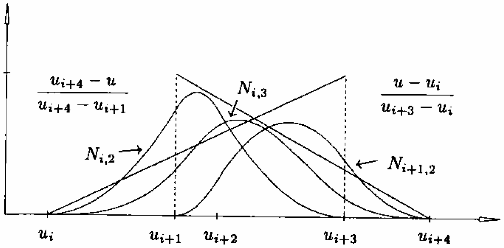

*Նկար 2.3. B-սփլայն բազիսային ֆունկցիաների ռեկուրսիվ սահմանումը:*

- բազիսային ֆունկցիաների բազմության հաշվարկը պահանջում է հանգույցների $`U`$ վեկտորի և $`p`$ աստիճանի նշում;
- (2.5) հավասարումը կարող է տալ $`0/0`$ քանորդ (տես օրինակները ստորև); այս քանորդը սահմանում ենք որպես զրո;
- $`N_{i,p}(u)`$ ֆունկցիաները կտոր առ կտոր բազմանդամներ են՝ սահմանված ողջ իրական առանցքի վրա. սովորաբար հետաքրքրություն է ներկայացնում միայն $`\lbrack u_{0},u_{m}\rbrack`$ միջակայքը;
- կիսաբաց $`\lbrack u_{i},u_{i + 1})`$ միջակայքը կոչվում է $`i`$-րդ հանգույցային միջակայք այն կարող է ունենալ զրոյական երկարություն, քանի որ հանգույցները պարտադիր չէ տարբեր լինեն;
- $`p`$-րդ աստիճանի ֆունկցիաների հաշվարկը առաջացնում է հատած եռանկյունաձև աղյուսակ

``` math
\begin{matrix}
N_{0,0} & & & \\
 & N_{0,1} & & \\
N_{1,0} & & N_{0,2} & \\
 & N_{1,1} & & N_{0,3} \\
N_{2,0} & & N_{1,2} & \\
 & N_{2,1} & & N_{1,3} \\
N_{3,0} & & N_{2,2} & \vdots \\
 & N_{3,1} & \vdots & \\
N_{4,0} & \vdots & & \\
 \vdots & & & 
\end{matrix}
```

Հակիրճության համար հաճախ $`N_{i,p}(u)`$-ի փոխարեն գրում ենք պարզապես $`N_{i,p}`$-ը:

Մի քանի խոսք տերմինաբանության մասին: Բաժին 2.1-ում մենք օգտագործել ենք (կոտրման կետ) տերմինը և պահանջել ենք, որ $`u_{i} < u_{i + 1}`$ բոլոր $`i`$-երի համար: Աշխատանքի մնացած մասում մենք օգտագործում ենք (հանգույց) տերմինը և ենթադրում ենք, որ $`u_{i} \leq u_{i + 1}`$: Կոտրման կետերը համապատասխանում են հանգույցների տարբեր արժեքների բազմությանը, և ոչ զրոյական երկարությամբ հանգույցային միջակայքերը սահմանում են առանձին բազմանդամային սեգմետներ։ Հետևաբար, մենք հանգույց բառը գործածում ենք երկու տարբեր իմաստով՝ որպես տարբեր $`U`$ բազմության արժեք (կտորման կետ), և $`U`$ բազմության տարր (կարող են գոյություն ունենալ $`U`$-ում լրացուցիչ հանգույցներ՝ նույն արժեքով): Համատեքստից պետք է պարզ լինի, թե որ իմաստն է նկատի առնված:

Օրինակներ

**Օրինակ 2.1.** Դիցուք $`U = \{ u_{0} = 0,u_{1} = 0,u_{2} = 0,u_{3} = 1,u_{4} = 1,u_{5} = 1\}`$ և $`p = 2`$: Այժմ հաշվենք 0, 1 և 2 աստիճանների B-սփլայն բազիսային ֆունկցիաները

``` math
N_{0,0} = N_{1,0} = 0\quad\quad - \infty < u < \infty
```

``` math
N_{2,0} = \left\{ \begin{matrix}
1 & 0 \leq u < 1 \\
0 & \text{հակառակ}\text{ }\text{դեպքում}
\end{matrix} \right.\ 
```

``` math
N_{3,0} = N_{4,0} = 0,\ երբ\  - \infty < u < \infty
```

``` math
N_{0,1} = \frac{u - 0}{0 - 0}N_{0,0} + \frac{0 - u}{0 - 0}N_{1,0} = 0,\ երբ\  - \infty < u < \infty
```

``` math
N_{1,1} = \frac{u - 0}{0 - 0}N_{1,0} + \frac{1 - u}{1 - 0}N_{2,0} = \left\{ \begin{matrix}
1 - u & 0 \leq u < 1 \\
0 & \text{հակառակ}\text{ }\text{դեպքում}
\end{matrix} \right.\ 
```

``` math
N_{2,1} = \frac{u - 0}{1 - 0}N_{2,0} + \frac{1 - u}{1 - 1}N_{3,0} = \left\{ \begin{matrix}
u & 0 \leq u < 1 \\
0 & \text{հակառակ}\text{ }\text{դեպքում}
\end{matrix} \right.\ 
```

``` math
N_{3,1} = \frac{u - 1}{1 - 1}N_{3,0} + \frac{1 - u}{1 - 1}N_{4,0} = 0,\ երբ\  - \infty < u < \infty
```

``` math
N_{0,2} = \frac{u - 0}{0 - 0}N_{0,1} + \frac{1 - u}{1 - 0}N_{1,1} = \left\{ \begin{matrix}
(1 - u)^{2} & 0 \leq u < 1 \\
0 & \text{հակառակ}\text{ }\text{դեպքում}
\end{matrix} \right.\ 
```

``` math
N_{1,2} = \frac{u - 0}{1 - 0}N_{1,1} + \frac{1 - u}{1 - 0}N_{2,1} = \left\{ \begin{matrix}
2u(1 - u) & 0 \leq u < 1 \\
0 & \text{հակառակ}\text{ }\text{դեպքում}
\end{matrix} \right.\ 
```

``` math
N_{2,2} = \frac{u - 0}{1 - 0}N_{2,1} + \frac{1 - u}{1 - 1}N_{3,1} = \left\{ \begin{matrix}
u^{2} & 0 \leq u < 1 \\
0 & \text{հակառակ}\text{ }\text{դեպքում}
\end{matrix} \right.\ 
```

Նշենք, որ $`N_{i,2}`$-երը, սահմանափակված $`u \in \lbrack 0,1\rbrack`$ միջակայքով, հանդիսանում են Բեռնշտայնի քառակուսային բազմանդամներ (Բաժին 1.3 և Նկար 1.13b): Այդ պատճառով հանգույցների հետևյալ տեսքի վեկտորով B-սփլայն ներկայացումը՝

``` math
U = \{\underset{p + 1}{\underbrace{0,\ldots,0}},\underset{p + 1}{\underbrace{1,\ldots,1}}\}
```

Բեզյեի ներկայացման ընդհանրացումն է:

**Օրինակ 2.2.** Դիցուք $`U = \{ u_{0} = 0,u_{1} = 0,u_{2} = 0,u_{3} = 1,u_{4} = 2,u_{5} = 3,u_{6} = 4,u_{7} = 4,u_{8} = 5,u_{9} = 5,u_{10} = 5\}`$ և $`p = 2`$: Այստեղ հաշվարկվում են զրոյական, առաջին և երկրորդ աստիճանների բազիսային ֆունկցիաները: Նույնաբար ոչ զրոյականները

ցուցադրված են համապատասխանաբար Նկար 2.4, 2.5 և 2.6-ում

``` math
N_{0,0} = N_{1,0} = 0,\ երբ\text{ } - \infty < u < \infty
```

``` math
N_{2,0} = \left\{ \begin{matrix}
1 & 0 \leq u < 1 \\
0 & \text{հակառակ}\text{ }\text{դեպքում}
\end{matrix} \right.\ 
```

``` math
N_{3,0} = \left\{ \begin{matrix}
1 & 1 \leq u < 2 \\
0 & \text{հակառակ}\text{ }\text{դեպքում}
\end{matrix} \right.\ 
```

``` math
N_{4,0} = \left\{ \begin{matrix}
1 & 2 \leq u < 3 \\
0 & \text{հակառակ}\text{ }\text{դեպքում}
\end{matrix} \right.\ 
```

``` math
N_{5,0} = \left\{ \begin{matrix}
1 & 3 \leq u < 4 \\
0 & \text{հակառակ}\text{ }\text{դեպքում}
\end{matrix} \right.\ 
```

``` math
N_{6,0} = 0\quad\text{for } - \infty < u < \infty
```

``` math
N_{7,0} = \left\{ \begin{matrix}
1 & 4 \leq u < 5 \\
0 & \text{հակառակ}\text{ }\text{դեպքում}
\end{matrix} \right.\ 
```

``` math
N_{8,0} = N_{9,0} = 0,\ երբ\  - \infty < u < \infty
```

``` math
N_{0,1} = \frac{u - 0}{0 - 0}N_{0,0} + \frac{0 - u}{0 - 0}N_{1,0} = 0,\ երբ\  - \infty < u < \infty
```

``` math
N_{1,1} = \frac{u - 0}{0 - 0}N_{1,0} + \frac{1 - u}{1 - 0}N_{2,0} = \left\{ \begin{matrix}
1 - u & 0 \leq u < 1 \\
0 & \text{հակառակ}\text{ }\text{դեպքում}
\end{matrix} \right.\ 
```

``` math
N_{2,1} = \frac{u - 0}{1 - 0}N_{2,0} + \frac{2 - u}{2 - 1}N_{3,0} = \left\{ \begin{matrix}
u & 0 \leq u < 1 \\
2 - u & 1 \leq u < 2 \\
0 & \text{հակառակ}\text{ }\text{դեպքում}
\end{matrix} \right.\ 
```

``` math
N_{3,1} = \frac{u - 1}{2 - 1}N_{3,0} + \frac{3 - u}{3 - 2}N_{4,0} = \left\{ \begin{matrix}
u - 1 & 1 \leq u < 2 \\
3 - u & 2 \leq u < 3 \\
0 & \text{հակառակ}\text{ }\text{դեպքում}
\end{matrix} \right.\ 
```

``` math
N_{4,1} = \frac{u - 2}{3 - 2}N_{4,0} + \frac{4 - u}{4 - 3}N_{5,0} = \left\{ \begin{matrix}
u - 2 & 2 \leq u < 3 \\
4 - u & 3 \leq u < 4 \\
0 & \text{հակառակ}\text{ }\text{դեպքում}
\end{matrix} \right.\ 
```

``` math
N_{5,1} = \frac{u - 3}{4 - 3}N_{5,0} + \frac{4 - u}{4 - 4}N_{6,0} = \left\{ \begin{matrix}
u - 3 & 3 \leq u < 4 \\
0 & \text{հակառակ}\text{ }\text{դեպքում}
\end{matrix} \right.\ 
```

``` math
N_{6,1} = \frac{u - 4}{4 - 4}N_{6,0} + \frac{5 - u}{5 - 4}N_{7,0} = \left\{ \begin{matrix}
5 - u & 4 \leq u < 5 \\
0 & \text{հակառակ}\text{ }\text{դեպքում}
\end{matrix} \right.\ 
```

``` math
N_{7,1} = \frac{u - 4}{5 - 4}N_{7,0} + \frac{5 - u}{5 - 5}N_{8,0} = \left\{ \begin{matrix}
u - 4 & 4 \leq u < 5 \\
0 & \text{հակառակ}\text{ }\text{դեպքում}
\end{matrix} \right.\ 
```

``` math
N_{8,1} = \frac{u - 5}{5 - 5}N_{8,0} + \frac{5 - u}{5 - 5}N_{9,0} = 0,\ երբ\  - \infty < u < \infty
```

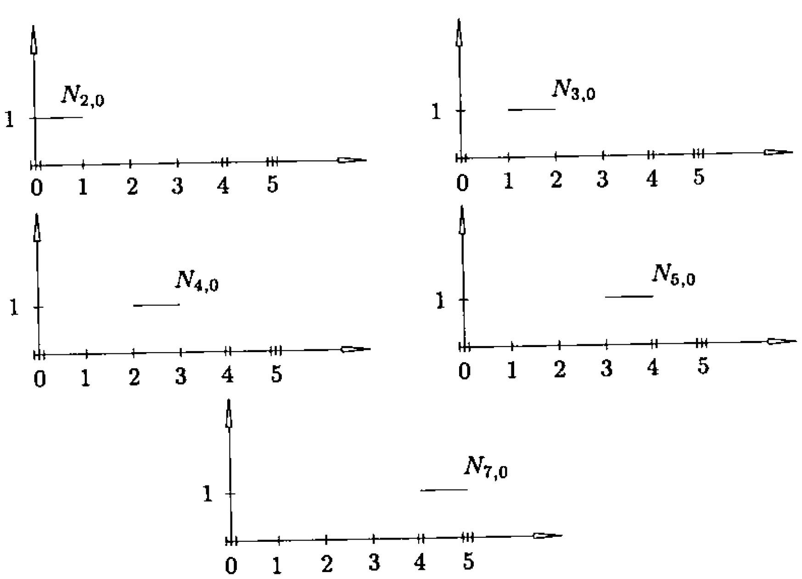

*Նկար 2.4. Զրոյական աստիճանի ոչ-զրոյական բազիսային ֆունկցիաները,* $`U = \{ 0,0,0,1,2,3,4,4,5,5,5\}`$*։*

Հետևյալ բոլոր $`N_{i,2}`$-երը զրո են ամենուր, բացի նշված միջակայքերից, այսինքն՝

``` math
N_{0,2} = \frac{u - 0}{0 - 0}N_{0,1} + \frac{1 - u}{1 - 0}N_{1,1} = (1 - u)^{2}\quad\quad 0 \leq u < 1
```

``` math
N_{1,2} = \frac{u - 0}{1 - 0}N_{1,1} + \frac{2 - u}{2 - 0}N_{2,1} = \left\{ \begin{matrix}
2u - \frac{3}{2}u^{2} & 0 \leq u < 1 \\
\frac{1}{2}(2 - u)^{2} & 1 \leq u < 2
\end{matrix} \right.\ 
```

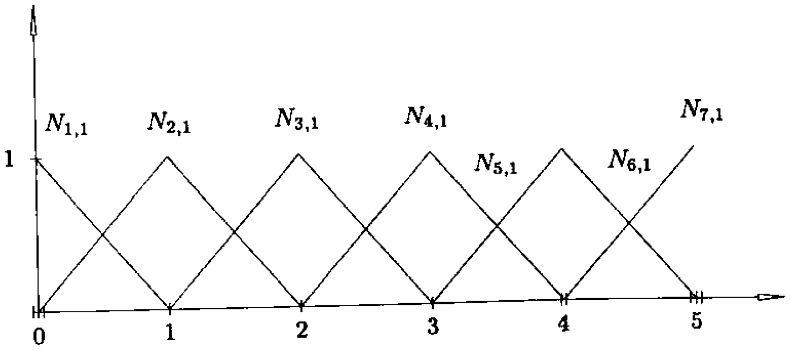

*Նկար 2.5. Ոչ-զրոյական առաջին աստիճանի բազիսային ֆունկցիաները,* $`U = \{ 0,0,0,1,2,3,4,4,5,5,5\}`$*։*

``` math
N_{2,2} = \frac{u - 0}{2 - 0}N_{2,1} + \frac{3 - u}{3 - 1}N_{3,1} = \left\{ \begin{matrix}
\frac{1}{2}u^{2} & 0 \leq u < 1 \\
 - \frac{3}{2} + 3u - u^{2} & 1 \leq u < 2 \\
\frac{1}{2}(3 - u)^{2} & 2 \leq u < 3
\end{matrix} \right.\ 
```

``` math
N_{3,2} = \frac{u - 1}{3 - 1}N_{3,1} + \frac{4 - u}{4 - 2}N_{4,1} = \left\{ \begin{matrix}
\frac{1}{2}(u - 1)^{2} & 1 \leq u < 2 \\
 - \frac{11}{2} + 5u - u^{2} & 2 \leq u < 3 \\
\frac{1}{2}(4 - u)^{2} & 3 \leq u < 4
\end{matrix} \right.\ 
```

``` math
N_{4,2} = \frac{u - 2}{4 - 2}N_{4,1} + \frac{4 - u}{4 - 3}N_{5,1} = \left\{ \begin{matrix}
\frac{1}{2}(u - 2)^{2} & 2 \leq u < 3 \\
 - 16 + 10u - \frac{3}{2}u^{2} & 3 \leq u < 4
\end{matrix} \right.\ 
```

``` math
N_{5,2} = \frac{u - 3}{4 - 3}N_{5,1} + \frac{5 - u}{5 - 4}N_{6,1} = \left\{ \begin{matrix}
(u - 3)^{2} & 3 \leq u < 4 \\
(5 - u)^{2} & 4 \leq u < 5
\end{matrix} \right.\ 
```

``` math
N_{6,2} = \frac{u - 4}{5 - 4}N_{6,1} + \frac{5 - u}{5 - 4}N_{7,1} = 2(u - 4)(5 - u)\quad\quad 4 \leq u < 5
```

``` math
N_{7,2} = \frac{u - 4}{5 - 4}N_{7,1} + \frac{5 - u}{5 - 5}N_{8,1} = (u - 4)^{2}\quad\quad 4 \leq u < 5
```

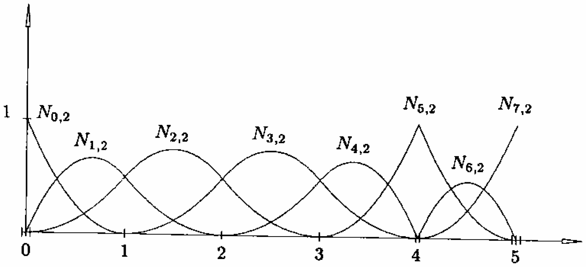

*Նկար 2.6. Երկրորդ աստիճանի ոչ-զրոյական բազիսային ֆունկցիաները,* $`U = \{ 0,0,0,1,2,3,4,4,5,5,5\}`$*։*

Այժմ թվարկենք B-սփլայն բազիսային ֆունկցիաների մի շարք կարևոր հատկություններ։ Ինչպես կտեսնենք հաջորդ գլխում, հենց այս հատկություններն են, որ պայմանավորում են B-սփլայն կորերի և մակերևույթների բազմաթիվ ցանկալի երկրաչափական բնութագրերը։ Ենթադրենք՝ տրված են $`p`$ աստիճանը և $`U = \{ u_{0},\ldots,u_{m}\}`$ հանգույցների վեկտորը։

Հատկություն 2.1 $`N_{i,p}(u) = 0`$, եթե $`u`$-ն գտնվում է $`\lbrack u_{i},u_{i + p + 1})`$ միջակայքից դուրս (լոկալ կրման հատկություն)։ Սա պատկերված է այստեղ ցուցադրված եռանկյունաձև սխեմայով։ Նկատենք, որ $`N_{1,3}`$-ը $`N_{1,0}`$, $`N_{2,0}`$, $`N_{3,0}`$ և $`N_{4,0}`$ ֆունկցիաների զուգակցումն է։ Հետևաբար, $`N_{1,3}`$-ը զրոյից տարբեր է միայն $`u \in \lbrack u_{1},u_{5})`$ միջակայքում

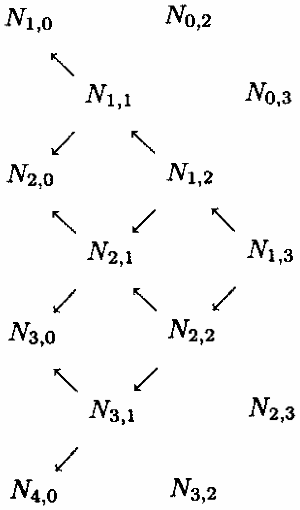

Հատկություն 2.2 Ցանկացած տրված հանգույցային միջակայքում, $`\lbrack u_{j},u_{j + 1})`$, $`N_{i,p}`$ ֆունկցիաներից զրոյից տարբեր են առավելագույնը $`p + 1`$-ը, մասնավորապես՝ $`N_{j - p,p},\ldots,N_{j,p}`$ ֆունկցիաները։ $`\lbrack u_{3},u_{4})`$ միջակայքում զրոյական աստիճանի զրոյից տարբեր միակ ֆունկցիան $`N_{3,0}`$-ն է։ Հետևաբար, $`\lbrack u_{3},u_{4})`$ միջակայքում զրոյից տարբեր խորանարդ ֆունկցիաներն են միայն $`N_{0,3},\ldots,N_{3,3}`$-ը։ Այս հատկությունը պատկերված է ստորև

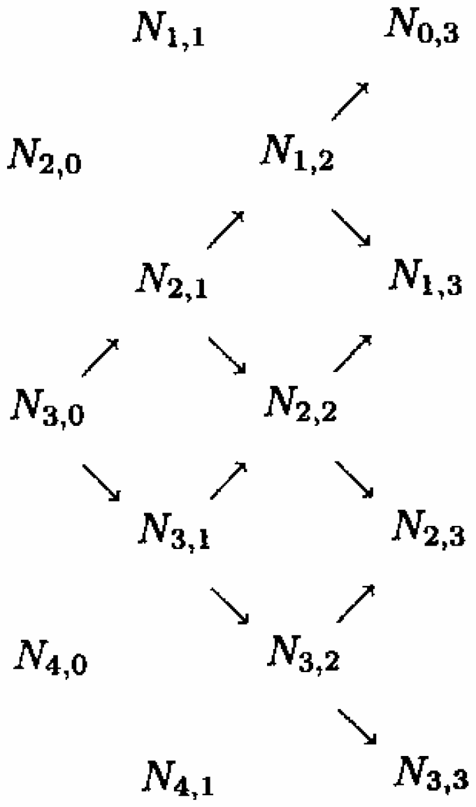

Հատկություն 2.3 $`N_{i,p}(u) \geq 0`$ բոլոր $`i`$, $`p`$ և $`u`$ արժեքների համար (ոչ-բացասականություն)։ Սա ապացուցվում է $`p`$-ով ինդուկցիայի միջոցով։ Այն ակնհայտորեն ճիշտ է $`p = 0`$-ի համար. ենթադրենք, որ այն ճիշտ է $`p - 1`$-ի համար, $`p \geq 0`$,

ընդ որում $`i`$ և $`u`$ կամայական են։ Ըստ սահմանման

``` math
\begin{array}{r}
N_{i,p}(u) = \frac{u - u_{i}}{u_{i + p} - u_{i}}N_{i,p - 1}(u) + \frac{u_{i + p + 1} - u}{u_{i + p + 1} - u_{i + 1}}N_{i + 1,p - 1}(u)\#(2.6)
\end{array}
```

Հատկություն 2.1-ի համաձայն $`N_{i,p - 1}(u) = 0`$, եթե $`u \notin \lbrack u_{i},u_{i + p})`$։ Սակայն $`u \in \lbrack u_{i},u_{i + p})`$-ից բխում է, որ

``` math
\frac{u - u_{i}}{u_{i + p} - u_{i}}
```

ոչ բացասական է։ Ըստ ենթադրության՝ $`N_{i,p - 1}(u)`$ ոչ բացասական է, հետևաբար (2.6) բանաձևի առաջին անդամը ևս ոչ բացասական է։ Նույնը ճիշտ է երկրորդ անդամի համար, հետևաբար $`N_{i,p}(u)`$ ֆունկցիաները ոչ բացասական են;

Հատկություն 2.4 Կամայական միջակայքային հանգույցի համար՝ $`\lbrack u_{i},u_{i + 1})`$, $`\sum_{j = i - p}^{i}N_{j,p}(u) = 1`$ բոլոր $`u \in \lbrack u_{i},u_{i + 1})`$-երի համար (միավորի տրոհում)։ Դա ապացուցելու համար դիտարկենք

``` math
\sum_{j = i - p}^{i}N_{j,p}(u) = \sum_{j = i - p}^{i}\frac{u - u_{j}}{u_{j + p} - u_{j}}N_{j,p - 1}(u) + \sum_{j = i - p}^{i}\frac{u_{j + p + 1} - u}{u_{j + p + 1} - u_{j + 1}}N_{j + 1,p - 1}(u)
```

Փոխարինելով երկրորդ գումարի գումարման փոփոխականը $`i - p`$-ից $`i - p + 1`$-ի, և հաշվի առնելով, որ $`N_{i - p,p - 1}(u) = N_{i + 1,p - 1}(u) = 0`$, կունենանք

``` math
\sum_{j = i - p}^{i}N_{j,p}(u) = \sum_{j = i - p + 1}^{i}\left\lbrack \frac{u - u_{j}}{u_{j + p} - u_{j}} + \frac{u_{j + p} - u}{u_{j + p} - u_{j}} \right\rbrack N_{j,p - 1}(u) = \sum_{j = i - p + 1}^{i}N_{j,p - 1}(u)
```

Նույն սկզբունքը կրկնակիորեն կիրառելով՝ ստանում ենք

``` math
\sum_{j = i - p}^{i}N_{j,p}(u) = \sum_{j = i - p + 1}^{i}N_{j,p - 1}(u) = \sum_{j = i - p + 2}^{i}N_{j,p - 2}(u) = \cdots = \sum_{j = i}^{i}N_{j,0}(u) = 1
```

Հատկություն 2.5 $`N_{i,p}(u)`$-ի բոլոր ածանցյալները գոյություն ունեն հանգույցային միջակայքի ներսում (որտեղ այն բազմանդամ է, տես Նկար 2.7)։ Հանգույցի կետում $`N_{i,p}(u)`$ ֆունկցիան $`p - k`$ անգամ անընդհատ դիֆերենցելի է, որտեղ $`k`$-ն հանգույցի պատիկությունն է։ Հետևաբար, աստիճանի մեծացումն ավելացնում է անընդհատությունը, իսկ հանգույցի պատիկության մեծացումը նվազեցնում է անընդհատությունը։

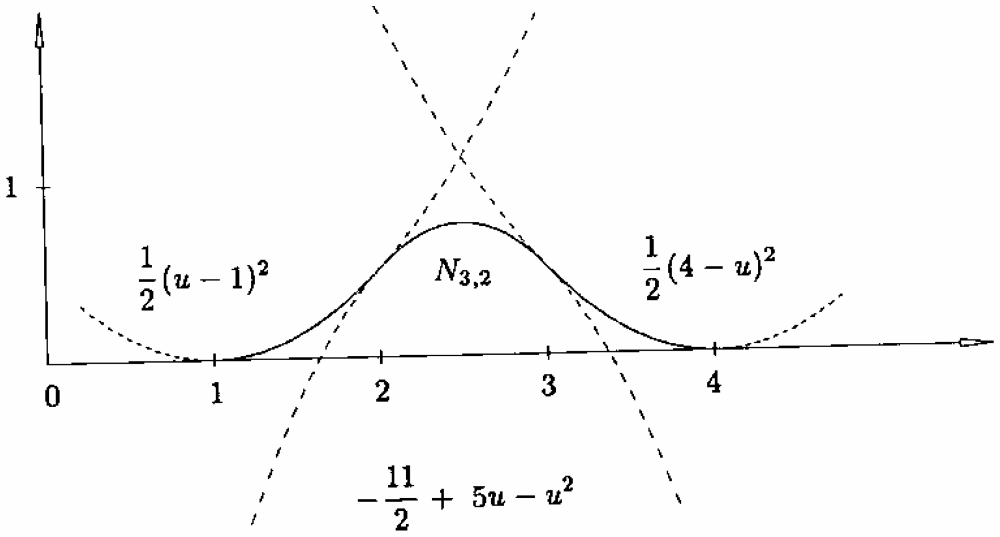

*Նկար 2.7.* $`N_{3,2}`$*-ի տրոհումը իր բազմանդամ մասերի (պարաբոլաների)։*

Հատկություն 2.6 Բացառությամբ $`p = 0`$ դեպքի, $`N_{i,p}(u)`$-ն ընդունում է ճշգրիտ մեկ մաքսիմալ արժեք։

Կարևոր է հասկանալ բազմակի հանգույցների ազդեցությունը։ Դիտարկենք $`N_{0,2}`$, $`N_{1,2}`$, $`N_{2,2}`$, $`N_{5,2}`$ և $`N_{6,2}`$ ֆունկցիաները՝ Նկար 2.6-ից։ Հիշելով, որ $`U = \{ 0,0,0,1,2,3,4,4,5,5,5\}`$ և (2.5)բանաձևից ու հատկություն 2.1-ից, տեսնում ենք, որ այս ֆունկցիաները հաշվարկվում են հետևյալ հանգույցային տիրույթներում և զրո են այդ տիրույթներից դուրս

``` math
\begin{aligned}
N_{0,2} & :\{ 0,0,0,1\} \\
N_{1,2} & :\{ 0,0,1,2\} \\
N_{2,2} & :\{ 0,1,2,3\} \\
N_{5,2} & :\{ 3,4,4,5\} \\
N_{6,2} & :\{ 4,4,5,5\}
\end{aligned}
```

Այժմ «պատիկություն» բառը հասկացվում է երկու տարբեր իմաստներով.

- Հանգույցի պատիկությունը հանգույցների վեկտորում;
- հանգույցի պատիկությունը կոնկրետ բազիսային ֆունկցիայի նկատմամբ։

Օրինակ, $`u = 0`$-ն ունի երեք պատիկություն նախորդ $`U`$ հանգույցների վեկտորում։ Սակայն $`N_{0,2}`$, $`N_{1,2}`$, $`N_{2,2}`$ և $`N_{5,2}`$ ֆունկցիաների նկատմամբ $`u = 0`$-ն, համապատասխանաբար, 3, 2, 1 և 0 պատիկությամբ հանգույց է։ Հատկություն 2.5-ից հետևում է, որ այս ֆունկցիաների անընդհատականությունը $`u = 0`$ կետում հետևյալն է. $`N_{0,2}`$-ն ընդհատ է; $`N_{1,2}`$-ը $`C^{0}`$ անընդհատ է; $`N_{2,2}`$-ը $`C^{1}`$ անընդհատ է; իսկ $`N_{5,2}`$-ը լիովին անփոփոխ է ($`N_{5,2}`$-ը և նրա բոլոր ածանցյալները հավասար են զրոյի $`u = 0`$ կետում՝ երկու կողմերից էլ)։ $`N_{1,2}`$-ը $`u = 0`$-ը «տեսնում» է որպես կրկնակի հանգույց, հետևաբար այն $`C^{0}`$ անընդհատ է։ $`N_{2,2}`$-ը «տեսնում» է իր բոլոր հանգույցները 1 բազմապատկությամբ, ուստի այն $`C^{1}`$ անընդհատ է ամենուր։ Ակնհայտ է, որ բազմակի հանգույցների մեկ այլ ազդեցությունը (ինչպես որևումէ ֆունկցիաների վրա) այն է, որ նվազեցվում է «երևացող» այն միջակայքերի քանակը, որտեղ ֆունկցիան ոչ-զրոյական է. օրինակ՝ $`N_{6,2}`$-ը ոչ-զրոյական է միայն $`u \in \lbrack 4,5)`$ միջակայքում, և այն $`C^{0}`$ անընդհատ է միայն $`u = 4`$ և $`u = 5`$ կետերում։

## 2.3 B-սփլայն բազիսային ֆունկցիաների ածանցյալները

Բազիսային ֆունկցիայի ածանցյալը տրվում է հետևյալ բանաձևով

``` math
\begin{array}{r}
N_{i,p}' = \frac{p}{u_{i + p} - u_{i}}N_{i,p - 1}(u) - \frac{p}{u_{i + p + 1} - u_{i + 1}}N_{i + 1,p - 1}(u)\#(2.7)
\end{array}
```

(Գրաֆիկական պատկերման համար տե՛ս Նկար 2.8:) Այս պնդումն ապացուցենք ինդուկցիայի եղանակով ըստ $`p`$-ի: $`p = 1`$ դեպքում $`N_{i,p - 1}`$-ը և $`N_{i + 1,p - 1}`$-ը հավասար են կամ 0-ի, կամ 1-ի, հետևաբար $`N_{i,p}'`$-ը հավասար է կամ

``` math
\frac{1}{u_{i + 1} - u_{i}}\quad\text{կամ}\quad - \frac{1}{u_{i + 2} - u_{i + 1}}
```

(տե՛ս Նկար 2.5): Այժմ ենթադրենք, որ բանաձև (2.7)-ը ճշմարիտ է $`p - 1`$-ի համար, որտեղ $`p > 1`$: Օգտագործելով արտադրյալի ածանցման կանոնը՝ $`(fg)' = f'g + fg'`$, բազիսային

``` math
N_{i,p}(u) = \frac{u - u_{i}}{u_{i + p} - u_{i}}N_{i,p - 1}(u) + \frac{u_{i + p + 1} - u}{u_{i + p + 1} - u_{i + 1}}N_{i + 1,p - 1}(u)
```

ֆունկցիան ածանցելու համար կստանանք․

``` math
\begin{array}{r}
N_{i,p}' = \frac{1}{u_{i + p} - u_{i}}N_{i,p - 1} + \frac{u - u_{i}}{u_{i + p} - u_{i}}N_{i,p - 1}' - \frac{1}{u_{i + p + 1} - u_{i + 1}}N_{i + 1,p - 1} + \frac{u_{i + p + 1} - u}{u_{i + p + 1} - u_{i + 1}}N_{i + 1,p - 1}'\#(2.8)
\end{array}
```

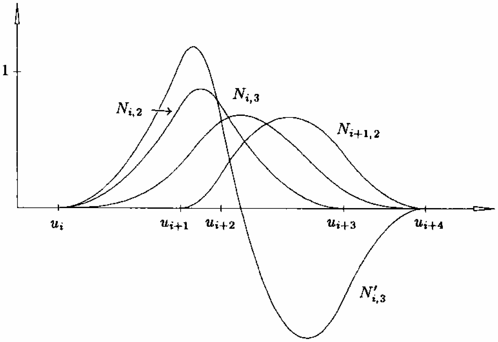

*Նկար 2.8. B-սփլայն ածանցյալների ռեկուրսիվ սահմանումը:*

(2.7) բանաձևը տեղադրելով (2.8) բանաձևի մեջ $`N_{i,p - 1}'`$-ի և $`N_{i + 1,p - 1}'`$-ի փոխարեն՝ ստանում ենք

``` math
\begin{aligned}
N_{i,p}' & = \frac{1}{u_{i + p} - u_{i}}N_{i,p - 1} + \frac{u - u_{i}}{u_{i + p} - u_{i}}\left( \frac{p - 1}{u_{i + p - 1} - u_{i}}N_{i,p - 2} - \frac{p - 1}{u_{i + p} - u_{i + 1}}N_{i + 1,p - 2} \right) \\
 & \quad - \frac{1}{u_{i + p + 1} - u_{i + 1}}N_{i + 1,p - 1} + \frac{u_{i + p + 1} - u}{u_{i + p + 1} - u_{i + 1}}\left( \frac{p - 1}{u_{i + p} - u_{i + 1}}N_{i + 1,p - 2} - \frac{p - 1}{u_{i + p + 1} - u_{i + 2}}N_{i + 2,p - 2} \right) \\
 & = \frac{1}{u_{i + p} - u_{i}}N_{i,p - 1} - \frac{1}{u_{i + p + 1} - u_{i + 1}}N_{i + 1,p - 1} + \frac{p - 1}{u_{i + p} - u_{i}} \cdot \frac{u - u_{i}}{u_{i + p - 1} - u_{i}}N_{i,p - 2} \\
 & \quad + \frac{p - 1}{u_{i + p} - u_{i + 1}}\left( \frac{u_{i + p + 1} - u}{u_{i + p + 1} - u_{i + 1}} - \frac{u - u_{i}}{u_{i + p} - u_{i}} \right)N_{i + 1,p - 2} - \frac{p - 1}{u_{i + p + 1} - u_{i + 1}} \cdot \frac{u_{i + p + 1} - u}{u_{i + p + 1} - u_{i + 2}}N_{i + 2,p - 2}
\end{aligned}
```

Նկատի ունենալով, որ

``` math
\begin{aligned}
\frac{u_{i + p + 1} - u}{u_{i + p + 1} - u_{i + 1}} - \frac{u - u_{i}}{u_{i + p} - u_{i}} & = \frac{u_{i + p + 1} - u}{u_{i + p + 1} - u_{i + 1}} - 1 + 1 - \frac{u - u_{i}}{u_{i + p} - u_{i}} \\
 & = - \frac{u - u_{i + 1}}{u_{i + p + 1} - u_{i + 1}} + \frac{u_{i + p} - u}{u_{i + p} - u_{i}} \\
 & = \frac{u_{i + p} - u}{u_{i + p} - u_{i}} - \frac{u - u_{i + 1}}{u_{i + p + 1} - u_{i + 1}}
\end{aligned}
```

ստանում ենք

``` math
\begin{aligned}
N_{i,p}' & = \frac{1}{u_{i + p} - u_{i}}N_{i,p - 1} - \frac{1}{u_{i + p + 1} - u_{i + 1}}N_{i + 1,p - 1} \\
 & \quad + \frac{p - 1}{u_{i + p} - u_{i}}\left( \frac{u - u_{i}}{u_{i + p - 1} - u_{i}}N_{i,p - 2} + \frac{u_{i + p} - u}{u_{i + p} - u_{i + 1}}N_{i + 1,p - 2} \right) \\
 & \quad - \frac{p - 1}{u_{i + p + 1} - u_{i + 1}}\left( \frac{u - u_{i + 1}}{u_{i + p} - u_{i + 1}}N_{i + 1,p - 2} + \frac{u_{i + p + 1} - u}{u_{i + p + 1} - u_{i + 2}}N_{i + 2,p - 2} \right)
\end{aligned}
```

Ըստ Կոքս–դը Բուրի բանաձևի (բանաձև (2.5)) \[4\], \[5\] համաձայն՝ փակագծերում գտնվող արտահայտությունները կարելի է փոխարինել համապատասխանաբար $`N_{i,p - 1}`$ և $`N_{i + 1,p - 1}`$ արտահայտություններով։ Այստեղից հետևում է, որ

``` math
\begin{aligned}
N_{i,p}' & = \frac{1}{u_{i + p} - u_{i}}N_{i,p - 1} - \frac{1}{u_{i + p + 1} - u_{i + 1}}N_{i + 1,p - 1} \\
 & + \frac{p - 1}{u_{i + p} - u_{i}}N_{i,p - 1} - \frac{p - 1}{u_{i + p + 1} - u_{i + 1}}N_{i + 1,p - 1} \\
 & = \frac{p}{u_{i + p} - u_{i}}N_{i,p - 1} - \frac{p}{u_{i + p + 1} - u_{i + 1}}N_{i + 1,p - 1}
\end{aligned}
```

Սա ավարտում է ապացույցը։

Այժմ նշանակենք $`N_{i,p}^{(k)}`$-ով $`N_{i,p}(u)`$ ֆունկցիայի $`k`$-րդ ածանցյալը։ (2.7) բանաձևի կրկնակի ածանցումը տալիս է հետևյալ ընդհանուր բանաձևը

``` math
\begin{array}{r}
N_{i,p}^{(k)}(u) = p\left( \frac{N_{i,p - 1}^{(k - 1)}}{u_{i + p} - u_{i}} - \frac{N_{i + 1,p - 1}^{(k - 1)}}{u_{i + p + 1} - u_{i + 1}} \right)\#(2.9)
\end{array}
```

(2.10) բանաձևը հանդիսանում է (2.7) բանաձևը ևս մեկ ընդհանրացում։ Այն հաշվարկում է $`N_{i,p}(u)`$ ֆունկցիայի $`k`$-րդ ածանցյալը $`N_{i,p - k},\ldots,N_{i + k,p - k}`$ ֆունկցիաների միջոցով

``` math
\begin{array}{r}
N_{i,p}^{(k)} = \frac{p!}{(p - k)!}\sum_{j = 0}^{k}a_{k,j}N_{i + j,p - k},\#(2.10)
\end{array}
```

որտեղ

``` math
\begin{aligned}
a_{0,0} & = 1, \\
a_{k,0} & = \frac{a_{k - 1,0}}{u_{i + p - k + 1} - u_{i}}, \\
a_{k,j} & = \frac{a_{k - 1,j} - a_{k - 1,j - 1}}{u_{i + p + j - k + 1} - u_{i + j}},\quad j = 1,\ldots,k - 1 \\
a_{k,k} & = \frac{- a_{k - 1,k - 1}}{u_{i + p + 1} - u_{i + k}}:
\end{aligned}
```

Դիտողություններ (2.10) բանաձևի վերաբերյալ.

- $`k`$-ն չպետք է գերազանցի $`p`$-ն (բոլոր ավելի բարձր կարգի ածանցյալները զրո են).
- հանգույցների տարբերություններ պարունակող հայտարարները կարող են դառնալ զրո. այս դեպքում քանորդը սահմանվում է որպես զրո ։

(2.10) բանաձևի ապացույցը բաց ենք թողնում, սակայն ստուգում ենք, որ այն ճշմարիտ է $`k = 1,2`$ դեպքերի համար։ Ըստ սահմանման

``` math
a_{1,0} = \frac{1}{u_{i + p} - u_{i}},\quad\quad a_{1,1} = - \frac{1}{u_{i + p + 1} - u_{i + 1}}
```

և

$`N_{i,p}^{(1)} = 2(a_{1,0}N_{i,p - 1} + a_{1,1}N_{i + 1,p - 1})`$։

Սա (2.7) բանաձևի հետ համեմատելը ապացուցում է $`k = 1`$ դեպքը. այժմ դիտարկենք $`k = 2`$ դեպքը։ (2.7) բանաձևը ածանցելով՝ ստանում ենք

``` math
\begin{matrix}
N_{i,p}^{(2)} = \frac{p}{u_{i + p} - u_{i}}N_{i,p - 1}^{(1)} - \frac{p}{u_{i + p + 1} - u_{i + 1}}N_{i + 1,p - 1}^{(1)} \\
 = \frac{p}{u_{i + p} - u_{i}}\left( \frac{p - 1}{u_{i + p - 1} - u_{i}}N_{i,p - 2} - \frac{p - 1}{u_{i + p} - u_{i + 1}}N_{i + 1,p - 2} \right) \\
\quad - \frac{p}{u_{i + p + 1} - u_{i + 1}}\left( \frac{p - 1}{u_{i + p} - u_{i + 1}}N_{i + 1,p - 2} - \frac{p - 1}{u_{i + p + 1} - u_{i + 2}}N_{i + 2,p - 2} \right) \\
 = p(p - 1)\lbrack\frac{a_{1,0}}{u_{i + p - 1} - u_{i}}N_{i,p - 2} \\
\quad - \frac{1}{u_{i + p} - u_{i + 1}}\left( \frac{1}{u_{i + p} - u_{i}} + \frac{1}{u_{i + p + 1} - u_{i + 1}} \right)N_{i + 1,p - 2} \\
\quad + \frac{a_{1,1}}{u_{i + p + 1} - u_{i + 2}}N_{i + 2,p - 2}\rbrack \\
 = p(p - 1)\left( a_{2,0}N_{i,p - 2} + \frac{a_{1,1} - a_{1,0}}{u_{i + p} - u_{i + 1}}N_{i + 1,p - 2} + a_{2,2}N_{i + 2,p - 2} \right)։
\end{matrix}
```

Նկատի ունենալով, որ $`k = 2`$, և

$`a_{2,1} = \frac{a_{1,1} - a_{1,0}}{u_{i + p} - u_{i + 1}}`$,

հետևում է, որ

$`N_{i,p}^{(2)}(u) = 2\sum_{j = 0}^{2}a_{2,j}N_{i + j,p - 2}(u)`$։

Շարադրանքի լրիվության համար բերում ենք B-սփլայն բազիսային ֆունկցիաների ածանցյալները հաշվարկելու համար ևս մեկ բանաձև։

``` math
\begin{array}{r}
\begin{matrix}
N_{i,p}^{(k)} = \frac{p}{p - k}\left( \frac{u - u_{i}}{u_{i + p} - u_{i}}N_{i,p - 1}^{(k)} + \frac{u_{i + p + 1} - u}{u_{i + p + 1} - u_{i + 1}}N_{i + 1,p - 1}^{(k)} \right) \\
k = 0,\ldots,p - 1
\end{matrix}\#(2.11)
\end{array}
```

(2.11) բանաձևը տալիս է $`N_{i,p}(u)`$-ի k-երորդ ածանցյալը՝ արտահայտված $`N_{i,p - 1}`$-ի և $`N_{i + 1,p - 1}`$-ի k-երորդ ածանցյալների միջոցով։

Նկար 2.9բ-ն և Նկար 2.10բ-ն ցույց են տալիս Նկար 2.9ա-ի և Նկար 2.10ա-ի բազիսային ֆունկցիաներին համապատասխանող ածանցյալները։ Նկար 2.11-ը ցույց է տալիս $`N_{i,3}`$-ի բոլոր ոչ-զրոյական ածանցյալները։ Նկատեք բազմապատիկ հանգույցների ազդեցությունը Նկար 2.10բ-ում. $`N_{6,3}'`$-ն եռակի հանգույցի մոտ ունի թռիչք։

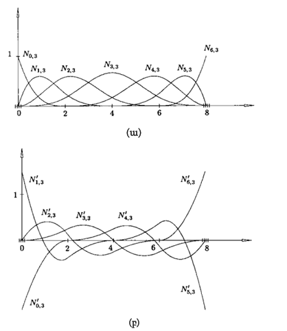

*Նկար 2.9. (ա) Խորանարդային բազիսային ֆունկցիաներ; (բ) ածանցյալները, որոնք համապատասխանում են Նկար 2.9ա-ում պատկերված բազիսային ֆունկցիաներին։*

## 2.4 Բազիսային ֆունկցիաների լրացուցիչ հատկություններ

Դիցուք $`\{ u_{j}\}`$, $`0 \leq j \leq k`$, կոտրման կետերի խիստ աճող բազմություն է։ Բոլոր $`p`$ աստիճանի կտոր առ կտոր բազմանդամ ֆունկցիաների բազմությունը՝ սահմանված $`\{ u_{j}\}`$-ի վրա, որոնք $`C^{r_{j}}`$ անընդհատ են $`u = u_{j}`$ կետում, կազմում է վեկտորական տարածություն՝ $`V`$ ($`- 1 \leq r_{j} \leq p`$)։ Եթե անընդհատության սահմանափակումներ չեն կիրառվում ($`r_{j} = - 1`$ բոլոր $`j`$-երի համար), ապա $`V`$-ի չափողականությունը (նշանակվում է $`dim(V)`$) հավասար է $`k(p + 1)`$-ի։ Յուրաքանչյուր անընդհատության սահմանափակում նվազեցնում է չափողականությունը մեկով, հետևաբար

``` math
\begin{array}{r}
\dim(V) = k(p + 1) - \sum_{j = 0}^{k}\left( r_{j} + 1 \right):\#(2.11)
\end{array}
```

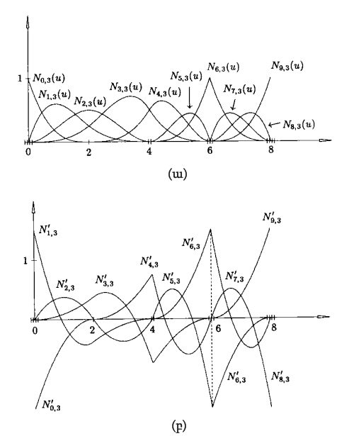

*Նկար 2.10. (ա) Խորանարդային բազիսային ֆունկցիաներ, որոնք ցույց են տալիս պարզ, կրկնակի և եռակի հանգույցները. (բ) Նկար 2.10 ֆունկցիաների ածանցյալները:*

(2.5) հատկության համաձայն՝ մենք ստանում ենք $`\{ u_{i}\}`$ հանգույցներով P աստիճանի բազիսային B-սփլայներ և ցանկալի շարունակականությամբ, ընտրելով համապատասխան հանգույցների պատիկությունները՝ $`s_{j}`$, որտեղ $`s_{j} = p - r_{j}`$: Հետևաբար, մենք օգտագործում ենք հետևյալ տեսքի հանգույցների վեկտոր

$`U = \{\underset{s_{0}}{\underbrace{u_{0},\ldots,u_{0}}},\underset{s_{1}}{\underbrace{u_{1},\ldots,u_{1}}},\ldots,\underset{s_{k}}{\underbrace{u_{k},\ldots,u_{k}}}\}`$։

Այժմ սահմանենք

$`m = \left( \sum_{j = 0}^{k}s_{j} \right) - 1`$։

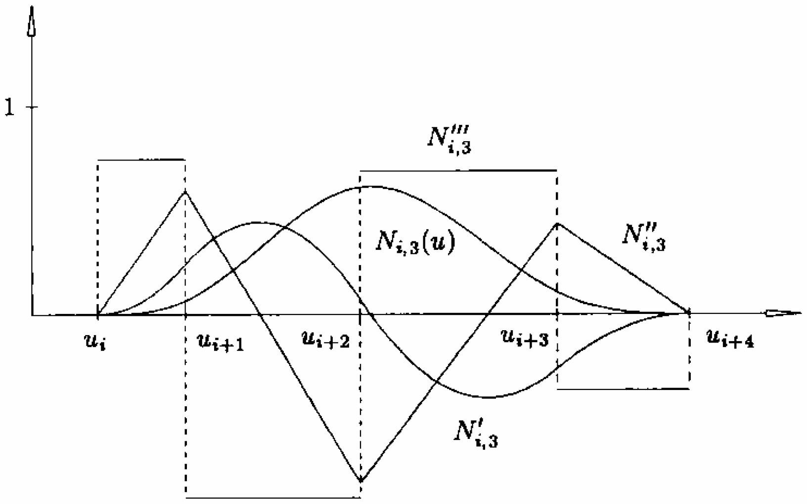

*Նկար 2.11.* $`N_{i,3}`$ *և նրա բոլոր ոչ-զրոյական ածանցյալները։*

Ուրեմն ակնհայտ է, որ գոյություն ունեն $`m`$ հատ զրոյական աստիճանի ֆունկցիաներ, $`N_{i,0}`$, $`m - 1`$ հատ առաջին աստիճանի ֆունկցիաներ, $`N_{i,1}`$, և ընդհանուր առմամբ՝ $`m - p`$ հատ $`p`$-րդ աստիճանի ֆունկցիաներ, $`N_{i,p}`$, որոնք ունեն ցանկալի շարունակականություն՝ $`r_{j} = p - s_{j}`$։ Հետևաբար $`N_{i,p}`$ ֆունկցիաները պարունակվում են $`V`$-ում։ Տեղադրելով $`s_{j} = p - r_{j}`$ (2.12) բանաձևի մեջ, ստանում ենք՝

``` math
\begin{matrix}
dim(V) = k(p + 1) - \sum_{j = 0}^{k}(p - s_{j} + 1) = \\
 = k(p + 1) - (k + 1)p + \sum_{j = 0}^{k}s_{j} - (k + 1) = \\
 = - p - 1 + \sum_{j = 0}^{k}{s_{j} =} \\
 = m - p:
\end{matrix}
```

Այսպիսով, $`U`$-ի վրա $`p`$-րդ աստիճանի B-սփլայն բազիսային ֆունկցիաների քանակը հավասար է $`dim(V)`$-ին։ Այժմ արդարացնենք «բազիսային» տերմինի կիրառումը՝ ցույց տալով, որ $`N_{i,p}`$ ֆունկցիաները գծորեն անկախ են, այսինքն՝ կազմում են $`V`$ վեկտորական տարածության բազիս։ Ապացույցն իրականացվում է $`p`$-ի ինդուկցիայի միջոցով։ Ակնհայտ է, որ զրոյական աստիճանի ֆունկցիաները գծորեն անկախ են։ Ենթադրենք $`(p - 1)`$-րդ աստիճանի ֆունկցիաները գծորեն անկախ են $`p > 0`$ դեպքում։ Տեղադրենք $`n = m - p - 1`$ և ենթադրենք, որ

``` math
\sum_{i = 0}^{n}\alpha_{i}N_{i,p}(u) = 0,
```

Բոլոր U –ի համար։

Օգտագործելով (2.7) բանաձևը՝ ստանում ենք

``` math
0 = \left( \sum_{i = 0}^{n}{\alpha_{i}N_{i,p}} \right)' = \sum_{i = 0}^{n}{\alpha_{i}N_{i,p}'} = p\sum_{i = 0}^{n}{\alpha_{i}\left( \frac{N_{i,p - 1}}{u_{i + p} - u_{i}} - \frac{N_{i + 1,p - 1}}{u_{i + p + 1} - u_{i + 1}} \right)}\ ,
```

որը նշանակում է, որ

``` math
0 = \sum_{i = 0}^{n}\alpha_{i}\frac{N_{i,p - 1}}{u_{i + p} - u_{i}} - \sum_{i = 0}^{n}\alpha_{i}\frac{N_{i + 1,p - 1}}{u_{i + p + 1} - u_{i + 1}}\ :
```

Այժմ նկատելով, որ $`N_{0,p - 1} = N_{n + 1,p - 1} = 0`$, և երկրորդ անդամում փոխելով գումարման փոփոխականը, կստանանք

``` math
0 = \sum_{i = 1}^{n}\frac{\alpha_{i} - \alpha_{i - 1}}{u_{i + p} - u_{i}}N_{i,p - 1\ },
```

որտեղից բխում է, որ $`\alpha_{i} - \alpha_{i - 1} = 0`$ բոլոր $`i`$-երի համար (ըստ ենթադրության), ինչն էլ իր հերթին նշանակում է, որ $`\alpha_{i} = 0`$ բոլոր $`i`$-երի համար։ Սա ավարտում է ապացույցը։

Այժմ մեր ուշադրությունը կդարձնենք հանգույցների վեկտորների վրա։ Ակնհայտ է, որ երբ աստիճանը ֆիքսված է, հանգույցների վեկտորն ամբողջությամբ որոշում է $`N_{i,p}(u)`$ ֆունկցիաները։ Գոյություն ունեն հանգույցների վեկտորների մի քանի տեսակներ, և, ցավոք, գրականության մեջ տերմինաբանությունը տարբեր է։ Այս աշխատանքում մենք կդիտարկենք միայն ոչ պարբերական (կամ սեղմված, կամ բաց) հանգույցների վեկտորները, որոնք ունեն հետևյալ տեսքը

``` math
\begin{array}{r}
U = \{\underset{\underset{p + 1}{\underbrace{}}}{a,\ldots,a},u_{p + 1},\ldots,u_{m - p - 1},\underset{\underset{p + 1}{\underbrace{}}}{b,\ldots,b}\}\#(2.13)
\end{array}
```

այսինքն՝ առաջին և վերջին հանգույցներն ունեն $`p + 1`$ բազմապատկություն։ Ոչ պարբերական հանգույցների վեկտորների համար ունենք բազիսային ֆունկցիաների երկու լրացուցիչ հատկություն.

Հատկություն 2.7. Հետևյալ տեսքի հանգույցների վեկտորը

``` math
U = \{\underset{p + 1}{\underbrace{0,\ldots,0}},\underset{p + 1}{\underbrace{1,\ldots,1}}\}
```

տալիս է $`p`$ աստիճանի Բեռնշտայնի բազմանդամները (տե՛ս Օրինակ 2.1-ը Բաժին 2.2-ում).

Հատկություն 2.8. Դիցուք $`m + 1`$-ը հանգույցների քանակն է։ Այդ դեպքում կան $`n + 1`$ բազիսային ֆունկցիաներ, որտեղ $`n = m - p - 1`$; $`N_{0,p}(a) = 1`$ և $`N_{n,p}(b) = 1`$։ Օրինակ՝ $`N_{0,p}(a) = 1`$ բխում է այն փաստից, որ $`N_{0,0},\ldots,N_{p - 1,0} = 0`$, քանի որ սա նշանակում է, որ $`N_{0,p}(a) = N_{p,0}(a) = 1`$։ P2.4-ից բխում է, որ $`N_{i,p}(a) = 0`$, երբ $`i \neq 0`$, և $`N_{i,p}(b) = 0`$, երբ $`i \neq n`$։

Աշխատանքի մնացած մասում բոլոր հանգույցների վեկտորները համարվում են ոչ պարբերական։ Մենք $`U = \{ u_{0},\ldots,u_{m}\}`$ հանգույցների վեկտորը կանվանենք հավասարաչափ, եթե բոլոր ներքին հանգույցները բաշխված են հավասարաչափ, այսինքն՝ եթե գոյություն ունի $`d`$ իրական թիվ այնպես, որ $`d = u_{i + 1} - u_{i}`$ բոլոր $`p \leq i \leq m - p - 1`$-երի համար; հակառակ դեպքում այն կոչվում է ոչ հավասարաչափ։

Օրինակ 2.2-ը (բաժին 2.2), ոչ հավասարաչափ է կրկնակի հանգույցի պատճառով $`u = 4`$-ում։ Նկար 2.9ա-ն ցույց է տալիս հավասարաչափ խորանարդային բազիսային ֆունկցիաների մի բազմություն, իսկ Նկար 2.10ա և 2.12-ը ցույց են տալիս ոչ հավասարաչափ խորանարդային բազիսային ֆունկցիաներ։

## 2.5 Հաշվարկային ալգորիթմներ

Այս բաժնում ներկայացվում են ալգորիթմներ \[1\]՝ հաշվարկելու բազիսային ֆունկցիաների և դրանց ածանցյալների արժեքները։ Դիցուք $`U = \{ u_{0},\ldots,u_{m}\}`$ հանդիսանում է բանաձև (2.13)-ի տեսքի հանգույցների վեկտոր և, ենթադրենք, որ մեզ հետաքրքրում են $`p`$ աստիճանի բազիսային ֆունկցիաները։ Ավելին, ենթադրենք, որ $`u`$-ն ֆիքսված է, և $`u \in \lbrack u_{i},u_{i + 1})`$։ Մենք մշակում ենք հինգ ալգորիթմ, որոնք հաշվարկում են.

- հանգույցների միջակայքի ինդեքսը՝ $`i`$;
- $`N_{i - p,p}(u),\ldots,N_{i,p}(u)`$ (հիմնված բանաձև \[2.5\]-ի վրա);
- $`N_{i - p,p}^{(k)}(u),\ldots,N_{i,p}^{(k)}(u)`$՝ $`k = 0,\ldots,p`$-ի համար; $`k > p`$ դեպքում ածանցյալները հավասար են զրոյի (այս ալգորիթմը հիմնված է բանաձև \[2.10\]-ի վրա);
- մեկ բազիսային ֆունկցիա՝ $`N_{j,p}(u)`$, որտեղ $`0 \leq j \leq m - p - 1`$;
- մեկ բազիսային ֆունկցիայի ածանցյալները՝ $`N_{j,p}^{(k)}(u)`$, որտեղ $`0 \leq j \leq m - p - 1`$ և $`k = 0,\ldots,p`$ (հիմնված բանաձև \[2.9\]-ի վրա)։

Մենք ներկայացնում ենք երկու ալգորիթմները, որոնք հաշվարկում են $`p + 1`$ ֆունկցիա, նախքան այն երկու ալգորիթմները, որոնք հաշվարկում են ընդամենը մեկ ֆունկցիա, քանի որ առաջինները առավել կարևոր են և, ըստ էության, մի փոքր ավելի պարզ են։

Ելնելով Հատկություն 2.2-ից և այն ենթադրությունից, որ $`u \in \lbrack u_{i},u_{i + 1})`$, հետևում է, որ մենք կարող ենք կենտրոնանալ $`N_{i - p,p},\ldots,N_{i,p}`$ ֆունկցիաների և դրանց ածանցյալների վրա. մնացած բոլոր ֆունկցիաները նույնաբար հավասար են զրոյի, և դրանք փաստացի հաշվարկելն անիմաստ է։ Հետևաբար, հաշվարկման առաջին քայլը այն հանգույցների միջակայքի որոշումն է, որում գտնվում է $`u`$-ն։ Կարելի է օգտագործել հանգույցների վեկտորի գծային կամ երկուական որոնում. մենք այստեղ ներկայացնում ենք երկուական որոնում։

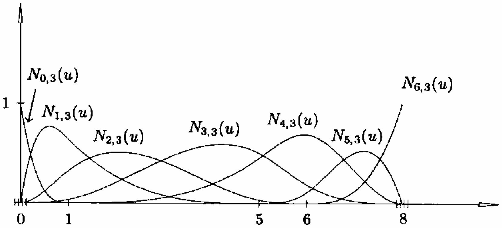

*Նկար 2.12. Ոչ միատեսակ խորանարդ բազիսային ֆունկցիաներ սահմանված* $`U = \{ 0,0,0,0,1,5,6,8,8,8,8\}`$ *վրա։*

Քանի որ մենք օգտագործում ենք $`u \in \lbrack u_{i},u_{i + 1})`$ տեսքի միջակայքեր, բազիսային ֆունկցիաների հաշվարկման ժամանակ ի հայտ եկող նուրբ խնդիրը $`u = u_{m}`$ հատուկ դեպքն է։ Լավագույնն այն է, որ սա մշակվի ամենացածր մակարդակում՝ միջակայքի ինդեքսը դնելով $`n( = m - p - 1)`$։ Հետևաբար, այս դեպքում $`u \in (u_{m - p - 1},u_{m - p}\rbrack`$։ FindSpan-ը ամբողջաթիվ ֆունկցիա է, որը վերադարձնում է միջակայքի ինդեքսը։

**ԱԼԳՈՐԻԹՄ A2.1**

    int  FindSpan(n,p,u,U)
      { /*  Determine the knot span index  */
        /*  Input: n,p,u,U  */
        /*  Return: the knot span index  */
      if (u == U[n+1])  return(n);   /* Special case */
      low = p;   high = n+1;   /* Do binary search */
      mid =(low+high)/2;
      while (u < U[mid]  ||  u >= U[mid+1])
        {
        if (u < U[mid])    high = mid;
          else             low = mid;
        mid = (low+high)/2;
        }
      return(mid);
      }

Այժմ անդրադառնանք երկրորդ ալգորիթմին։ Ենթադրելով, որ $`u`$-ն գտնվում է $`i`$-րդ միջակայքում, ոչ-զրոյական ֆունկցիաների հաշվարկը հանգեցնում է շրջված եռանկյունաձև սխեմայի

``` math
\begin{matrix}
 & & & & N_{i - p,p} \\
 & N_{i - 1,1} & & & \\
N_{i,0} & & \cdots & & \vdots \\
 & N_{i,1} & & & \\
 & & & & N_{i,p}
\end{matrix}
```

**Օրինակ**

**2.3.** Դիցուք $`p = 2`$, $`U = \{ 0,0,0,1,2,3,4,4,5,5,5\}`$, և $`u = 5/2`$ (տես Նկար 2.6)։ Այդ դեպքում $`i = 4`$, քանի որ $`u \in \lbrack u_{4},u_{5})`$։ Այսպիսով, հաշվարկում ենք

``` math
\begin{matrix}
 & & & & N_{2,2}(5/2) \\
 & N_{3,1}(5/2) & & & \\
N_{4,0}(5/2) & & & & N_{3,2}(5/2) \\
 & N_{4,1}(5/2) & & & \\
 & & & & N_{4,2}(5/2)
\end{matrix}
```

Տեղադրելով $`u = 5/2`$-ը բանաձև (2.5)-ի մեջ ստանում ենք

``` math
N_{4,0}\left( \frac{5}{2} \right) = 1\ ,
```

``` math
N_{3,1}\left( \frac{5}{2} \right) = \frac{1}{2}\ ,\quad N_{4,1}\left( \frac{5}{2} \right) = \frac{1}{2}\ ,
```

``` math
N_{2,2}\left( \frac{5}{2} \right) = \frac{1}{8}\ ,\quad\quad N_{3,2}\left( \frac{5}{2} \right) = \frac{6}{8}\ ,\quad\quad N_{4,2}\left( \frac{5}{2} \right) = \frac{1}{8}\ ,
```

Նշենք, որ ֆիքսված աստիճանի դեպքում ֆունկցիաների գումարը հավասար է 1-ի (Հատկություն 2.4)։

Կատարելով սույն օրինակի տեղադրումները, պարզ կդառնա, որ բանաձև (2.5)-ի մեջ առկա է մեծ քանակությամբ ավելորդ հաշվարկ։ Օրինակ, երկրորդ աստիճանի ֆունկցիաները ընդհանուր տեսքով գրելով՝ ունենք

``` math
\begin{array}{r}
N_{i - 2,2}(u) = \frac{u - u_{i - 2}}{u_{i} - u_{i - 2}}N_{i - 2,1}(u) + \frac{u_{i + 1} - u}{u_{i + 1} - u_{i - 1}}N_{i - 1,1}(u)\#(2.14)
\end{array}
```

``` math
\begin{array}{r}
N_{i - 1,2}(u) = \frac{u - u_{i - 1}}{u_{i + 1} - u_{i - 1}}N_{i - 1,1}(u) + \frac{u_{i + 2} - u}{u_{i + 2} - u_{i}}N_{i,1}(u)\#(2.15)
\end{array}
```

``` math
\begin{array}{r}
N_{i,2}(u) = \frac{u - u_{i}}{u_{i + 2} - u_{i}}N_{i,1}(u) + \frac{u_{i + 3} - u}{u_{i + 3} - u_{i + 1}}N_{i + 1,1}(u)\#(2.16)
\end{array}
```

Նկատենք, որ

- բանաձև (2.14)-ի առաջին անդամը և բանաձև (2.16)-ի վերջին անդամը չեն հաշվարկվում, քանի որ $`N_{i - 2,1}(u) = N_{i + 1,1}(u) = 0`$;
- հետևյալ արտահայտությունը

``` math
\frac{N_{i - 1,1}(u)}{u_{i + 1} - u_{i - 1}}
```

որը հանդիպում է բանաձև (2.14)-ի երկրորդ անդամում, հանդիպում է նաև բանաձև (2.15)-ի առաջին անդամում. նույնանման պնդում ճիշտ է բանաձև (2.15)-ի երկրորդ անդամի և բանաձև (2.16)-ի առաջին անդամի համար։

Մենք ներմուծում ենք հետևյալ նշանակումը

``` math
\text{left}\lbrack j\rbrack = u - u_{i + 1 - j},\quad\quad\text{right}\lbrack j\rbrack = u_{i + j} - u։
```

Այդ դեպքում Բանաձևեր (2.14)–(2.16)-ից ստանում են հետևյալ տեսքը

``` math
N_{i - 2,2}(u) = \frac{\text{left}\lbrack 3\rbrack}{\text{right}\lbrack 0\rbrack + \text{left}\lbrack 3\rbrack}\, N_{i - 2,1}(u) + \frac{\text{right}\lbrack 1\rbrack}{\text{right}\lbrack 1\rbrack + \text{left}\lbrack 2\rbrack}\, N_{i - 1,1}(u)
```

``` math
N_{i - 1,2}(u) = \frac{\text{left}\lbrack 2\rbrack}{\text{right}\lbrack 1\rbrack + \text{left}\lbrack 2\rbrack}N_{i - 1,1}(u) + \frac{\text{right}\lbrack 2\rbrack}{\text{right}\lbrack 2\rbrack + \text{left}\lbrack 1\rbrack}N_{i,1}(u)
```

``` math
N_{i,2}(u) = \frac{\text{left}\lbrack 1\rbrack}{\text{right}\lbrack 2\rbrack + \text{left}\lbrack 1\rbrack}N_{i,1}(u) + \frac{\text{right}\lbrack 3\rbrack}{\text{right}\lbrack 3\rbrack + \text{left}\lbrack 0\rbrack}N_{i + 1,1}(u)։
```

Այս դիտարկումների հիման վրա՝ Ալգորիթմ A2.2-ը հաշվարկում է բոլոր ոչ զրոյական բազիսային ֆունկցիաները և պահպանում դրանք N\[0\],…,N\[p\] զանգվածում։

**ԱԼԳՈՐԻԹՄ A2.2**

    BasisFuns(i,u,p,U,N)
    { /* Հաշվարկել ոչ զրոյական բազիսային ֆունկցիաները */
      /* Մուտք: i,u,p,U */
      /* Ելք: N */
    N[0]=1.0;
    for (j=1; j<=p; j++)
      {
      left[j] = u-U[i+1-j];
      right[j] = U[i+j]-u;
      saved= 0.0;
      for (r=0; r<j; r++)
        {
        temp = N[r]/(right[r+1]+left[j-r]);
        N[r] = saved+right[r+1]*temp;
        saved= left[j-r]*temp;
        }
      N[j] = saved;
      }
    }

Նշենք, որ Ալգորիթմ A2.2-ը ոչ միայն արդյունավետ է, այլև երաշխավորում է, որ զրոյի բաժանում տեղի չի ունենա, ինչը կարող է առաջանալ բանաձև (2.5)-ի ուղղակի կիրառման դեպքում։

Այժմ անցնենք երրորդ ալգորիթմին. մասնավորապես, մենք ցանկանում ենք հաշվարկել բոլոր $`N_{r,p}^{(k)}(u)`$-երը՝ $`i - p \leq r \leq i`$ և $`0 \leq k \leq n`$ պայմաններով, որտեղ $`n \leq p`$։ բանաձև (2.10)-ի քննությունը ցույց է տալիս, որ հիմնական բաղադրիչներն են՝

- Ալգորիթմ A2.2-ում հաշվարկված ոչ-զրոյական բազիսային ֆունկցիաների շրջված եռանկյունը.
- հանգույցների տարբերությունները (գումարները՝ right\[r+1\]+left\[j-r\]), որոնք նույնպես հաշվարկվում են Ալգորիթմ A2.2-ում.
- $`a_{k,j}`$-երի տարբերությունները. նշենք, որ $`a_{k,j}`$-երը կախված են $`a_{k - 1,j}`$-ից, բայց ոչ $`a_{s,j}`$-ից, $`s < k - 1`$ դեպքում։

Դիտարկված որպես $`(p + 1) \times (p + 1)`$ չափողականությամբ երկչափ զանգված՝ բազիսային ֆունկցիաները տեղավորվում են վերին եռանկյունում (ներառյալ անկյունագիծը), իսկ հանգույցների տարբերությունները՝ ստորին եռանկյունում, այսինքն՝

``` math
\begin{matrix}
N_{i,0}(u) & N_{i - 1,1}(u) & N_{i - 2,2}(u) \\
u_{i + 1} - u_{i} & N_{i,1}(u) & N_{i - 1,2}(u)։ \\
u_{i + 1} - u_{i - 1} & u_{i + 2} - u_{i} & N_{i,2}(u) \\
 & & 
\end{matrix}
```

**Օրինակ**

**2.4.** Դիցուք $`p = 2`$, $`U = \{ 0,0,0,1,2,3,4,4,5,5,5\}`$, և $`u = 5/2`$: Այդ դեպքում $`u \in \lbrack u_{4},u_{5})`$, և զանգվածը ստանում է հետևյալ տեսքը.

``` math
\begin{matrix}
N_{4,0}\left( \frac{5}{2} \right) = 1 & N_{3,1}\left( \frac{5}{2} \right) = \frac{1}{2} & N_{2,2}\left( \frac{5}{2} \right) = \frac{1}{8} \\
u_{5} - u_{4} = 1 & N_{4,1}\left( \frac{5}{2} \right) = \frac{1}{2} & N_{3,2}\left( \frac{5}{2} \right) = \frac{6}{8} \\
u_{5} - u_{3} = 2 & u_{6} - u_{4} = 2 & N_{4,2}\left( \frac{5}{2} \right) = \frac{1}{8} \\
 & & 
\end{matrix}
```

Այժմ հաշվենք $`N_{4,2}^{(1)}(5/2)`$ և $`N_{4,2}^{(2)}(5/2)`$ մեծությունները. Դնելով $`i = 4`$ բանաձև (2.10)-ում, ստանում ենք

``` math
\begin{aligned}
a_{1,0} & = \frac{1}{u_{6} - u_{4}} = \frac{1}{2} \\
a_{1,1} & = - \frac{1}{u_{7} - u_{5}} = - 1 \\
a_{2,0} & = \frac{a_{1,0}}{u_{5} - u_{4}} = \frac{1}{2} \\
a_{2,1} & = \frac{a_{1,1} - a_{1,0}}{u_{6} - u_{5}} = \frac{- 1 - \frac{1}{2}}{4 - 3} = - \frac{3}{2} \\
a_{2,2} & = - \frac{a_{1,1}}{u_{7} - u_{6}} = \frac{1}{4 - 4} = \frac{1}{0}
\end{aligned}
```

``` math
N_{4,2}^{(1)} = 2\left\lbrack a_{1,0}N_{4,1}\left( \frac{5}{2} \right) + a_{1,1}N_{5,1}\left( \frac{5}{2} \right) \right\rbrack
```

և

``` math
N_{4,2}^{(2)} = 2\left\lbrack a_{2,0}N_{4,0}\left( \frac{5}{2} \right) + a_{2,1}N_{5,0}\left( \frac{5}{2} \right) + a_{2,2}N_{6,0}\left( \frac{5}{2} \right) \right\rbrack
```

Այժմ $`a_{1,1}`$, $`a_{2,1}`$ և $`a_{2,2}`$ բոլորն օգտագործում են այնպիսի հանգույցների տարբերություններ, որոնք չկան զանգվածում, սակայն դրանք համապատասխանաբար բազմապատկվում են $`N_{5,1}(5/2)`$, $`N_{5,0}(5/2)`$ և

$`N_{6,0}(5/2)`$, որոնք նույնպես զանգվածում չեն։ Այս անդամները սահմանվում են որպես զրո, և մենք ստանում ենք

``` math
N_{4,2}^{(1)} = 2a_{1,0}N_{4,1}\left( \frac{5}{2} \right) = \frac{1}{2}\ ,
```

``` math
N_{4,2}^{(2)} = 2a_{2,0}N_{4,0}\left( \frac{5}{2} \right) = 1\ ։
```

Այս արժեքները ստուգելու համար հիշենք բաժին 2.2-ից, որ $`N_{4,2}(u) = 1/2(u - 2)^{2}`$

$`u \in \lbrack 2,3)`$ միջակայքում։ $`N_{3,2}^{(1)}(5/2)`$, $`N_{3,2}^{(2)}(5/2)`$, $`N_{2,2}^{(1)}(5/2)`$ և $`N_{2,2}^{(2)}(5/2)`$ արժեքների հաշվարկը կատարվում է հանգունորեն։

Այս դիտարկումների հիման վրա (և Օրինակ 2.4-ի) դժվար չէ մշակել Ալգորիթմ A2.3-ը, որը հաշվարկում է ոչ զրոյական բազիսային ֆունկցիաները և դրանց ածանցյալները՝ մինչև n-րդ ածանցյալը ներառյալ ($`n \leq p`$)։ Ելքը գտնվում է ders երկչափ զանգվածում։ ders\[k\]\[j\]-ը $`N_{i - p + j,p}`$ ֆունկցիայի k-րդ ածանցյալն է, որտեղ $`0 \leq k \leq n`$ և $`0 \leq j \leq p`$։ Օգտագործվում է երկու տեղային զանգված.

- ndu\[p+1\]\[p+1\]՝ բազիսային ֆունկցիաները և հանգույցների տարբերությունները պահելու համար;
- a\[2\]\[p+1\]՝ վերջին հաշվարկված $`a_{k,j}`$ և $`a_{k - 1,j}`$ երկու տողերը հերթափոխով պահելու համար։

Ալգորիթմը խուսափում է զրոյի բաժանումից և/կամ ndu\[\]\[\] զանգվածում չգտնվող անդամների օգտագործումից։

**ԱԼԳՈՐԻԹՄ A2.3**

    ALGORITHM A2.3
      DersBasisFuns(i,u,p,n,U,ders)
        { /*  Compute nonzero basis functions and their  */
          /*  derivatives.  First section is A2.2 modified  */
          /*  to store functions and knot differences.  */
          /*  Input:  i,u,p,n,U  */
          /*  Output: ders  */
        ndu[0][0]=1.0;
        for (j=1; j<=p; j++)
          {
          left[j] = u-U[i+1-j];
          right[j] = U[i+j]-u;
          saved= 0.0;
          for (r=0; r<j; r++)
            {                                          /* Lower triangle */
            ndu[j][r] = right[r+1]+left[j-r];
            temp = ndu[r][j-1]/ndu[j][r];
                                                         /* Upper triangle */
            ndu[r][j] = saved+right[r+1]*temp;
            saved= left[j-r]*temp;
            }
          ndu[j][j] = saved;

**ԱԼԳՈՐԻԹՄ A2.3 (շարունակություն)**

    }
    for (j=0; j<=p; j++)  /* Բեռնել բազիսային ֆունկցիաները */
       ders[0][j] = ndu[j][p];
    /* Այս հատվածը հաշվարկում է ածանցյալները (բանաձև [2.9]) */
    for (r=0; r<=p; r++)  /* Ցիկլ ըստ ֆունկցիայի ինդեքսի */
      {
      s1=0;   s2=1;   /* Փոփոխակել տողերը a զանգվածում */
      a[0][0] = 1.0;
      /* Ցիկլ k-րդ ածանցյալը հաշվարկելու համար */
      for (k=1; k<=n; k++)
        {
        d = 0.0;
        rk = r-k;     pk = p-k;
        if (r >= k)
          {
          a[s2][0] = a[s1][0]/ndu[pk+1][rk];
          d = a[s2][0]*ndu[rk][pk];
          }
        if (rk >= -1)   j1 = 1;
          else          j1 = -rk;
        if (r-1 <= pk)  j2 = k-1;
          else          j2 = p-r;
        for (j=j1; j<=j2; j++)
          {
          a[s2][j] = (a[s1][j]-a[s1][j-1])/ndu[pk+1][rk+j];
          d += a[s2][j]*ndu[rk+j][pk];
          }
        if (r <= pk)
          {
          a[s2][k] = -a[s1][k-1]/ndu[pk+1][r];
          d += a[s2][k]*ndu[r][pk];
          }
        ders[k][r] = d;
        j=s1;  s1=s2;  s2=j;  /* Փոխանակել տողերը */
        }
      }
    /* Բազմապատկել ճիշտ գործակիցներով */
    /* (բանաձև [2.9]) */
    r = p;
    for (k=1; k<=n; k++)
      {
      for (j=0; j<=p; j++)  ders[k][j] *= r;
      r *= (p-k);
      }
    }

Այժմ մեր ուշադրությունը կուղղենք վերջին երկու ալգորիթմներին, մասնավորապես՝ մեկ բազիսային ֆունկցիայի, $`N_{i,p}(u)`$, կամ մեկ բազիսային ֆունկցիայի ածանցյալների, $`N_{i,p}^{(k)}(u)`$, հաշվարկմանը։ Այս խնդիրների լուծումները հանգեցնում են եռանկյունաձև աղյուսակների՝ հետևյալ տեսքով

``` math
\begin{matrix}
N_{i,0} & & & \\
 & N_{i,1} & & \\
N_{i + 1,0} & & N_{i,2} & \\
 \vdots & & \cdots & N_{i,p} \\
N_{i + p - 1,0} & & N_{i + p - 2,2} & \\
 & N_{i + p - 1,1} & & \\
N_{i + p,0} & & & 
\end{matrix}
```

**Օրինակ**

**2.5.** Դիցուք $`p = 2`$, $`U = \{ 0,0,0,1,2,3,4,4,5,5,5\}`$, և $`u = 5/2`$։ $`N_{3,2}(5/2)`$-ի հաշվարկը տալիս է

``` math
\begin{matrix}
N_{3,0}(5/2) = 0 & & & \\
 & N_{3,1}(5/2) = \frac{1}{2} & & \\
N_{4,0}(5/2) = 1 & & N_{3,2}(5/2) = \frac{6}{8} & \\
 & N_{4,1}(5/2) = \frac{1}{2} & & \\
N_{5,0}(5/2) = 0 & & & 
\end{matrix}
```

$`N_{4,2}(5/2)`$-ը ստացվում է հետևյալից՝

``` math
\begin{matrix}
N_{4,0}(5/2) = 1 & & & \\
 & N_{4,1}(5/2) = \frac{1}{2} & & \\
N_{5,0}(5/2) = 0 & & N_{4,2}(5/2) = \frac{1}{8} & \\
 & N_{5,1}(5/2) = 0 & & \\
N_{6,0}(5/2) = 0 & & & 
\end{matrix}
```

Նկատենք, որ աղյուսակում ոչ զրոյական տարրերի դիրքը և հարաբերական քանակը կախված են $`p`$-ից և առաջին սյունակում 1-ի դիրքից։ Ալգորիթմ A2.4-ը հաշվարկում է միայն ոչ զրոյական տարրերը։ $`N_{i,p}(u)`$ արժեքը վերադարձվում է Nip փոփոխականում; m-ը U-ի ամենաբարձր ինդեքսն է ($`m + 1`$ հանգույցներ)։ Ալգորիթմը նման է Ալգորիթմ A2.2-ին temp և savedփոփոխականների կիրառմամբ։

**ԱԼԳՈՐԻԹՄ A2.4**

    ALGORITHM A2.4
        OneBasisFun(p,m,U,i,u,Nip)
        { /* Հաշվարկել Nip բազիսային ֆունկցիան */
            /* Input:  p,m,U,i,u */
            /* Output: Nip */

**ԱԼԳՈՐԻԹՄ A2.4 (շարունակություն)**

    if ((i == 0 && u == U[0]) ||        /* Հատուկ */
        (i == m-p-1 && u == U[m]))      /* դեպքեր */
      {
      Nip = 1.0;    return;
      }
    if (u < U[i] || u >= U[i+p+1])   /* Լոկալ հատկություն */
      {
      Nip = 0.0;    return;
      }
    for (j=0; j<=p; j++) /* Ինիցիալացնել զրոյական աստիճանի ֆունկցիաները */
      if (u >= U[i+j] && u < U[i+j+1])  N[j] = 1.0;
        else                N[j] = 0.0;
    for (k=1; k<=p; k++)  /* Հաշվել եռանկյունաձև աղյուսակը */
      {
      if (N[0] == 0.0)  saved= 0.0;
        else            saved= ((u-U[i])*N[0])/(U[i+k]-U[i]);
      for (j=0; j<p-k+1; j++)
        {
        Uleft = U[i+j+1];
        Uright = U[i+j+k+1];
        if (N[j+1] == 0.0)
          {
          N[j] = saved;    saved= 0.0;
          }
          else
          {
          temp = N[j+1]/(Uright-Uleft);
          N[j] = saved+(Uright-u)*temp;
          saved= (u-Uleft)*temp;
          }
        }
      }
    Nip = N[0];
    }

Այժմ ֆիքսված $`i`$-ի համար ածանցյալների՝ $`N_{i,p}^{(k)}(u)`$, հաշվարկը, $`k = 0,\ldots,n`$-ի համար, որտեղ $`n \leq p`$, օգտագործում է բանաձև (2.9)-ը։ Օրինակ, եթե $`p = 3`$ և $`n = 3`$, ապա

``` math
N_{i,3}^{(1)} = 3\left( \frac{N_{i,2}}{u_{i + 3} - u_{i}} - \frac{N_{i + 1,2}}{u_{i + 4} - u_{i + 1}} \right),
```

``` math
N_{i,3}^{(2)} = 3\left( \frac{N_{i,2}^{(1)}}{u_{i + 3} - u_{i}} - \frac{N_{i + 1,2}^{(1)}}{u_{i + 4} - u_{i + 1}} \right),
```

``` math
N_{i,3}^{(3)} = 3\left( \frac{N_{i,2}^{(2)}}{u_{i + 3} - u_{i}} - \frac{N_{i + 1,2}^{(2)}}{u_{i + 4} - u_{i + 1}} \right)։
```

Օգտագործելով եռանկյունաձև աղյուսակներ՝ մենք պետք է հաշվարկենք

$`k = 0`$.

``` math
\begin{matrix}
N_{i,0} & & & \\
 & N_{i,1} & & \\
N_{i + 1,0} & & N_{i,2} & \\
 & N_{i + 1,1} & & N_{i,3} \\
N_{i + 2,0} & & N_{i + 1,2} & \\
 & N_{i + 2,1} & & \\
N_{i + 3,0} & & & 
\end{matrix}
```

$`k = 1`$.

``` math
\begin{matrix}
N_{i,2} & \\
 & N_{i,3}^{(1)} \\
N_{i + 1,2} & 
\end{matrix}
```

$`k = 2`$.

``` math
\begin{matrix}
N_{i,1} & & \\
 & N_{i,2}^{(1)} & \\
N_{i + 1,1} & & N_{i,3}^{(2)} \\
 & N_{i + 1,2}^{(1)} & \\
N_{i + 2,1} & & 
\end{matrix}\ 
```

$`k = 3`$.

``` math
\begin{matrix}
N_{i,0} & & & \\
 & N_{i,1}^{(1)} & & \\
N_{i + 1,0} & & N_{i,2}^{(2)} & \\
 & N_{i + 1,1}^{(1)} & & N_{i,3}^{(3)} \\
N_{i + 2,0} & & N_{i + 1,2}^{(2)} & \\
 & N_{i + 2,1}^{(1)} & & \\
N_{i + 3,0} & & & 
\end{matrix}\ ։
```

Բառերով նկարագրած՝ ալգորիթմը հետևյալն է.

- հաշվարկել և պահպանել ամբողջ եռանկյունաձև աղյուսակը, որը համապատասխանում է $`k = 0`$-ին;
- $`k`$-րդ ածանցյալը ստանալու համար բեռնել աղյուսակի այն սյունը, որը պարունակում է $`p - k`$ աստիճանի ֆունկցիաները, և հաշվարկել եռանկյան մնացած մասը։

Ալգորիթմ A2.5-ը հաշվարկում է $`N_{i,p}^{(k)}(u)`$-ը $`k = 0,\ldots,n`$-ի համար, որտեղ $`n \leq p`$: $`k`$-րդ ածանցյալը վերադարձվում է ders\[k\]-ում.

**ԱԼԳՈՐԻԹՄ A2.5**

    DersOneBasisFun(p,m,U,i,u,n,ders)
    { /* Հաշվարկել Nip բազիսային ֆունկցիայի ածանցյալները */

**ԱԼԳՈՐԻԹՄ A2.5 (շարունակություն)**

    /*  Input:  p,m,U,i,u,n  */
    /*  Output: ders  */
    if (u < U[i] || u >= U[i+p+1])   /* Լոկալ հատկություն */
      {
      for (k=0; k<=n; k++)  ders[k] = 0.0;
      return;
      }
    for (j=0; j<=p; j++)  /* Նախադրում ենք զրոյական աստիճանի ֆունկցիաները */
      if (u >= U[i+j] && u < U[i+j+1])  N[j][0] = 1.0;
        else                            N[j][0] = 0.0;
    for (k=1; k<=p; k++)   /* Հաշվում ենք ամբողջական եռանկյունաձև աղյուսակը */
      {
      if (N[0][k-1] == 0.0)  saved= 0.0;
        else       saved= ((u-U[i])*N[0][k-1])/(U[i+k]-U[i]);
      for (j=0; j<p-k+1; j++)
        {
        Uleft = U[i+j+1];
        Uright = U[i+j+k+1];
        if (N[j+1][k-1] == 0.0)
          {
          N[j][k] = saved;    saved= 0.0;
          }
          else
          {
          temp = N[j+1][k-1]/(Uright-Uleft);
          N[j][k] = saved+(Uright-u)*temp;
          saved= (u-Uleft)*temp;
          }
        }
       }
    ders[0] = N[0][p];   /* Ֆունկցիայի արժեքը */
    for (k=1; k<=n; k++)   /* Հաշվում ենք ածանցյալները */
      {
      for (j=0; j<=k; j++)   /* Բեռնում ենք համապատասխան սյունակը */
        ND[j] = N[j][p-k];
      for (jj=1; jj<=k; jj++)   /* Հաշվում ենք k լայնությամբ աղյուսակը */
        {
        if (ND[0] == 0.0)  saved= 0.0;
          else       saved= ND[0]/(U[i+p-k+jj]-U[i]);
        for (j=0; j<k-jj+1; j++)
          {
          Uleft = U[i+j+1];
          Uright = U[i+j+p+jj+1];
          if (ND[j+1] == 0.0)
            {

**ԱԼԳՈՐԻԹՄ A2.5 (շարունակություն)**

    ND[j] = (p-k+jj)*saved;    saved= 0.0;
    }
    else
    {
    temp = ND[j+1]/(Uright-Uleft);
    ND[j] = (p-k+jj)*(saved-temp);
    saved= temp;
    }
    }
    }
    ders[k] = ND[0];    /* k-րդ ածանցյալ */
    }
    }

Վերջապես, նկատենք, որ Ալգորիթմ A2.3-ը և A2.5-ը հաշվարկում են ածանցյալները աջից, եթե $`u`$-ն հանգույց է։ Այնուամենայնիվ, բանաձև (2.5), (2.9), (2.10) և այս գլխի մյուս բանաձևերը կարող էին սահմանվել՝ օգտագործելով $`u \in (u_{i},u_{i + 1}\rbrack`$ տեսքի միջակայքեր։ Սա չէր փոխի Ալգորիթմ A2.2-ից մինչև A2.5-ը։ Այլ կերպ ասած՝ ածանցյալները ձախից կարելի է գտնել՝ պարզապես ստիպելով միջակայք-որոնման ալգորիթմին օգտագործել $`(u_{i},u_{i + 1}\rbrack`$ տեսքի միջակայքեր՝ $`\lbrack u_{i},u_{i + 1})`$-ի փոխարեն։ Նախորդ օրինակում, երբ $`p = 2`$ և $`U = \{ 0,0,0,1,2,3,4,4,5,5,5\}`$, եթե $`u = 2`$, ապա $`i = 3`$ միջակայքը տալիս է ածանցյալներ ձախից, իսկ $`i = 4`$-ը՝ ածանցյալներ աջից։

# ԳԼՈՒԽ 3. B-ՍՓԼԱՅՆ ԿՈՐԵՐ

## 3.1 B-սփլայն կորերի սահմանումը և հատկությունները

Այժմ սահմանենք ոչ ռացիոնալ B-սփլայն կորերն ու մակերևույթները \[1\], որից հետո կուսումնասիրենք դրանց հատկությունները և կստանանք դրանց ածանցյալների արտահայտությունները։ Հակիրճության համար, այսուհետև դրանք ուղղակի կանվանենք *ոչ ռացիոնալ*։ Մեր գլխավոր նպատակը կլինի ձևավորել ինտուիտիվ պատկերացում B-սփլայն կորերի և մակերևույթների մասին, ինչպես նաև, դրանց վրա կետերի և ածանցյալների հաշվարկման համար տալ որոշ ալգորիթմների սահմանումը։ Այդ նպատակով մանրակրկիտ կդիտարկենք բազմաթիվ օրինակներ ու պատկերներ։ B-սփլայն-ների օգտագործումը համակարգիչների աջակցությամբ երկրաչափական նախագծման (CAGD) մեջ՝ կորերի և մակերևույթների սահմանման համար, առաջին անգամ առաջարկվել է Գորդոնի և Ռիզենֆելդի կողմից։

Այսպիսով, $`p`$-րդ աստիճանի B-սփլայն կորը սահմանվում է հետևյալ կերպ․

``` math
\begin{array}{r}
C(u) = \sum_{i = 0}^{n}{N_{i,p}(u)P_{i}}\#(3.1)
\end{array}
```

որտեղ $`\left\{ P_{i} \right\}`$-ները հենակետերն են, իսկ $`\left\{ N_{i,p}(u) \right\}`$-ները $`p`$-րդ աստիճանի **B-սփլայն բազիսային ֆունկցիաներն** են, որոնք սահմանված են ոչ պարբերական (և ոչ միատեսակ) հանգույցային վեկտորի վրա․

$`U = \{ a,\ldots,a,\text{\:\,}u_{p + 1},\ldots,u_{m - p - 1},\text{\:\,}b,\ldots,b\}`$,

որտեղ կա $`m + 1`$ հատ հանգույց։ Եթե հակառակը նշված չէ, ապա ենթադրվում է, որ $`a = 0`$և $`b = 1`$։ $`\left\{ P_{i} \right\}`$-ներով կազմված բազմանկյունը կոչվում է **կառավարման բազմակյուն**։\
B-սփլայն կորերի օրինակներ (որոշ դեպքերում՝ համապատասխան բազիսային ֆունկցիաների հետ միասին) ներկայացված են Նկ. 3.1–3.14-ում։

Ֆիքսված $`u`$ արժեքի համար B-սփլայն կորի վրա որևէ կետ հաշվարկելու համար անհրաժեշտ են հետևյալ երեք քայլերը․

1.  գտնել այն հանգույցային միջակայքը, որում ընկած է $`u`$-ն,

2.  հաշվել ոչ զրոյական բազիսային ֆունկցիաները,

3.  բազմապատկել ոչ զրոյական բազիսային ֆունկցիաների արժեքները համապատասխան կառավարման կետերով։

Դիտարկենք հետևյալ օրինակը։ Դիցուք $`U = \left\{ 0,0,0,1,2,3,4,4,5,5,5 \right\},\ \ u = \frac{5}{2},\ \ p = 2`$։ Այդ դեպքում $`u \in \lbrack u_{4},u_{5}),`$ և

``` math
N_{2,2}(u) = \frac{1}{8}\ \ \ \ \ \ N_{3,2}(u) = \frac{6}{8}\ \ \ \ \ \ N_{4,2}(u) = \frac{1}{8}։
```

Բազմապատկելով համապատասխան կառավարման կետերով, ստանում ենք՝

``` math
C\left( \frac{5}{2} \right) = \frac{1}{8}P_{2} + \frac{6}{8}P_{3} + \frac{1}{8}P_{4}։
```

Այժմ ներկայացնենք **B-սփլայն կորերի մի շարք հատկություններ**։ Թող $`C(u)`$-ն սահմանված լինի ըստ հավասարում (3.1)-ի։

1.  Եթե $`n = p`$, և $`U = \left\{ 0,\ldots,0,1,\ldots,1 \right\},`$ ապա $`C(u)`$-ն Բեզյեի կոր է (Նկ. 3.1)։

2.  $`C(u)`$-ն կտոր առ կտոր բազմանդամային կոր է (քանի որ $`N_{i,p}(u)`$-ները այդպիսի բազմանդամներ են)։ Կորի $`p`$ աստիճանը, կառավարման կետերի $`n + 1`$ քանակը, և հանգույցների $`m + 1`$քանակը կապված են հետևյալ առնչությամբ՝

``` math
\begin{array}{r}
m = n + p + 1\#(3.2)
\end{array}
```

Նկ. 3.2 և 3.3-ում ներկայացված են բազիսային ֆունկցիաներն ու B-սփլայն կորերի այն հատվածները, որոնք համապատասխանում են առանձին հանգույցային միջակայքերին՝ երկու պատկերներում էլ հաջորդող հոծ/կետագիծ հատվածները համապատասխանում են կորը սահմանող տարբեր բազմանդամներին (հանգույցային միջակայքերին)։

> 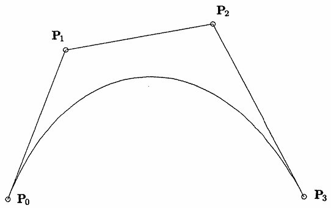

*Նկար 3.1. Խորանարդային B-սփլայն* $`U = \left\{ 0,0,0,0,1,1,1,1 \right\}`$*-ի վրա, այսինքն խորանարդային Բեզյեի կոր*

3.  Վերջնակետերի ինտերպոլացիա՝ $`C(0) = P_{0}\text{  և  }C(1) = P_{n}\text{։}`$

4.  Աֆինական ինվարիանտություն․ աֆինական ձևափոխությունը կիրառվում է կորի կառավարման կետերի վրա։ Դիցուք $`r`$-ը $`E^{3}`$-ի (եռաչափ Էվկլիդյան տարածություն) ինչ-որ մի կետ է։ Աֆինական ձևափոխությունը, որը կնշանակենք $`\Phi`$-ով, արտապատկերում է $`E^{3}`$-ը $`E^{3}`$-ի մեջ և ունի հետևյալ տեսքը՝

``` math
\Phi(r) = Ar + v,
```

> որտեղ $`A`$-ն $`3 \times 3`$ չափի մատրից է, իսկ $`v`$-ն՝ վեկտոր։ Աֆինական ձևափոխությունները ներառում են տեղափոխությունները, պտույտները, մասշտաբավորումները և խզումները։ B-սփլայն կորերի համար աֆինական ինվարիանտության հատկությունը հետևում է $`N_{i,p}(u)`$-ների \[միավորների բաժանման\] հատկությունից։ Ենթադրենք $`r = \sum_{i}^{}\alpha_{i}p_{i},{\ \ p}_{i} \in E^{3},\ \ \sum_{i}^{}\alpha_{i} = 1,`$ ապա\`
>
> ``` math
> \Phi(r) = \Phi\left( \sum_{i}^{}\alpha_{i}p_{i} \right) = A\left( \sum_{i}^{}\alpha_{i}p_{i} \right) + v = \sum_{i}^{}\alpha_{i}Ap_{i} + \sum_{i}^{}\alpha_{i}v = \sum_{i}^{}\alpha_{i}(Ap_{i} + v) = \sum_{i}^{}\alpha_{i}\Phi(p_{i}).
> ```

5.  Ուռուցիկ թաղանթի ուժեղ հատկություն․ Կորը ամբողջությամբ գտնվում է իր կառավարման բազմանկյան ուռուցիկ թաղանթի ներսում։ Ավելին, եթե $`u \in \left( u_{i},u_{i + 1} \right),\ \ p \leq i < m - p - 1,`$ ապա $`C(u)`$-ն գտնվում է կառավարման կետերի $`P_{i - p},\ldots,P_{i}`$ ուռուցիկ թաղանթի ներսում (Նկ. 3.4, 3.5 և 3.6)։

> 

*Նկար 3.2. (ա) Խորանարդային բազիսային ֆունկցիաներ* $`U = \left\{ 0,0,0,0,\frac{1}{4},\frac{1}{2},\frac{3}{4},1,1,1,1 \right\}`$*, (բ)3.2(ա)-ում պատկերված բազիսային ֆունկցիաներով կառուցված որն խորանարդային կոր*

Այս փաստը հետևում է $`N_{i,p}(u)`$-ների ոչ բացասական լինելու և միավորի բաժանման հատկություններից, ինչպես նաև այն փաստից, որ $`N_{j,p}(u) = 0`$ $`j < i - p`$ և $`j > i`$, երբ $`u \in (u_{i},u_{i + 1})`$։ Նկ. 3.6-ը ցույց է տալիս, թե ինչպես կարելի է կառուցել քառակուսային կոր, որը պարունակում է ուղիղ գծի հատված։ Քանի որ $`P_{2}`$, $`P_{3}`$ և $`P_{4}`$ կետերը համագիծ են, ուժեղ ուռուցիկ թաղանթի հատկությունը ստիպում է, որ կորը լինի ուղիղ գծի հատված $`C(2/5)`$-ից մինչև $`C(3/5)`$։

6.  Տեղային փոփոխման սխեմա․ $`P_{i}`$-ի տեղափոխությունը փոխում է $`C(u)`$-ն միայն $`\lbrack u_{i},u_{i + p + 1})`$ միջակայքում (Նկ. 3.7)։ Սա հետևում է այն փաստից, որ $`N_{i,p}(u) = 0`$ է, երբ $`\left. \ u \notin \lbrack u_{i},u_{i + p + 1} \right)`$։


*Նկար 3.3. (ա) Քառակուսայինբազիսային ֆունկցիաներ ըստ* $`U = \left\{ 0,0,0,0,\frac{1}{5},\frac{2}{5},\frac{3}{5},\frac{4}{5},1,1,1 \right\}`$*, (բ) 3.3 (ա) նկարում պատկերված բազիսային ֆունկցիաներով կառուցված քառակուսային կոր*

7.  Կառավարման բազմանկյունը ներկայացնում է կորի **կտոր առ կտոր գծային մոտարկում**։ Այս մոտարկումը կարող է բարելավվել նոր հանգույցների ներմուծման կամ աստիճանի բարձրացման միջոցով։ Ընդհանուր դեպքում ինչքան փոքր է դրա աստիճանը, այնքան B-սփլայն կորը ավելի մոտ է անցնում իր կառավարման բազմանկյանը (տես Նկ. 3.8 և 3.9)։ Նկ. 3.9-ում պատկերված կորերը սահմանված են նույն վեց կառավարման կետերով և հետևյալ հանգույցային վեկտորներով․

    - $`p = 1:U = \{ 0,0,\frac{1}{5},\frac{3}{5},\frac{4}{5},1,1\}`$

    - $`p = 2:U = \{ 0,0,0,\frac{1}{4},\frac{2}{4},\frac{3}{4},1,1,1\}`$

    - $`p = 3:U = \{ 0,0,0,0,\frac{1}{2},\frac{1}{2},1,1,1,1\}`$

    - $`p = 4:U = \{ 0,0,0,0,0,\frac{1}{2},1,1,1,1,1\}`$

    - $`p = 5:U = \{ 0,0,0,0,0,0,1,1,1,1,1,1\}`$


*Նկար 3.4. Ուռուցիկ թաղանթի ուժեղ հատկությունը քառակուսային կորի համար․ եթե* $`\left. \ u \in \lbrack u_{i},u_{i + 1} \right)`$*, ապա* $`C(u)`$*-ն գտնվում է* $`P_{i - 2}P_{i - 1}P_{i}`$ *եռանկյան մեջ*

> Այստեղ տեսնում ենք, որ որքան փոքր է աստիճանը, այնքան քիչ քանակությամբ կառավարման կետեր են մասնակցում $`C(u_{0})`$-ի հաշվարկին տվյալ $`u_{0}`$-ի համար։ Եզրային դեպքը $`p = 1`$-ն է, երբ յուրաքանչյուր $`C(u)`$ կետ պարզապես երկու կառավարման կետերի միջև գծային ինտերպոլացիա է։ Այդ դեպքում կորը հենց կառավարման բազմանկյունն է։

8.  Կորի երկայնքով $`u = 0`$-ից մինչև $`u = 1`$ շարժվելիս $`N_{i,p}(u)`$ ֆունկցիաները գործում են անջատիչների պես: Երբ $`u`$-ն անցնում է որևէ հանգույցի վրայով, մի $`N_{i,p}(u)`$ ֆունկցիա իր համապատասխան $`P_{i}`$ կառավարման կետով «անջատվում» են, իսկ հաջորդները «միացվում» են (տես Նկ. 3.2 և 3.3)։


*Նկար 3.5. Ուժեղ ուռուցիկ թաղանթի հատկությունը քառակուսային կորի համար․ եթե* $`\left. \ u \in \lbrack u_{i},u_{i + 1} \right)`$, *ապա* $`C(u)`$*-ն գտնվում է* $`P_{i - 3}P_{i - 2}P_{i - 1}P_{i}`$ *քառանկյան մեջ*

9.  Տատանումների նվազման հատկություն (Variation diminishing property)․\
    ոչ մի հարթություն կորի հետ չունի ավելի շատ հատումներ, քան կառավարման բազմանկյան հետ (երկչափ կորերի դեպքում «հարթություն» բառը փոխարինվում է «ուղիղ» բառով)։


*Նկար 3.6. Քառակուսային B-սփլայն կոր* $`U = \{ 0,0,0,1/5,2/5,3/5,4/5,1,1,1\}`$ *հանգույցային վեկտորի վրա, որտեղ կորն ուղիղ գծային հատված է* $`C(2/5)`$*-ից մինչև* $`C(3/5)`$

10. $`C(u)`$ կորի անընդհատությունն ու դիֆերենցելիությունը հետևում են $`N_{i,p}(u)`$-երի համապատասխան հատկություններից (քանի որ $`C(u)`$-ն պարզապես $`N_{i,p}(u)`$-երի գծային կոմբինացիա է)։ Ուստի $`C(u)`$-ն անվերջ դիֆերենցելիելի է հանգույցային միջակայքների ներսում, և առնվազն $`p - k`$ անգամ դիֆերենցելիելի է $`k`$-պատիկ հանգույցում։


*Նկար 3.7. Խորանարդային կոր* $`U = \{ 0,0,0,0,1/4,1/2,3/4,1,1,1,1\}`$ *հանգույցային վեկտորի վրա, որտեղ* $`P_{4}`$*-ի տեղափոխումը դեպի* $`P_{4}'`$ *փոխում է կորը* $`\lbrack 1/4,1)`$ *միջակայքում*

Նկ. 3.10-ում ցուցադրված է քառակուսային կոր ($`p = 2`$)։ Կորը $`C^{1}`$ անընդհատ է (առաջին ածանցյալը գոյություն ունի, իսկ երկրորդը՝ ոչ) 1-պատիկ բոլոր ներքին հանգույցներում։ Կրկնակի հանգույցում՝ $`u = 4/5`$-ում, $`C(u)`$-ն միայն $`C^{0}`$ անընդհատ է, հետևաբար առաջանում է սուր ծայր (տեսանելի ընդհատում)։ Նկ. 3.11-ում պատկերված է նույն հանգույցային վեկտորի վրա սահմանված մեկ այլ քառակուսային կոր։ Այսպիսով, երկու կորերն էլ սահմանվում են նույն հիմքային $`N_{i,p}(u)`$ ֆունկցիաներով։ Սակայն Նկ. 3.11-ի կորը $`u = 4/5`$-ում $`C^{1}`$ անընդհատ է։ Այստեղից հետևում է, որ երբեմն խզվող ֆունկցիաները կարելի է այնպես համադրել, որ ստացված արդյունքը լինի անընդհատ։ Նկատենք, որ $`P_{4}`$, $`P_{5}`$ և $`P_{6}`$ կետերը համագիծ են, և $`\text{երկարություն}\left( P_{4}P_{5} \right) = \text{երկարություն}\left( P_{5}P_{6} \right)։`$ Նկ. 3.12-ում ցուցադրված է խորանարդային կոր, որը $`C^{2}`$ անընդհատ է $`u = 1/4`$-ում և $`u = 1/2`$-ում, բայց կրկնակի հանգույցում՝ $`u = 3/4`$-ում, միայն $`C^{1}`$ անընդհատ է։ Անզեն աչքը կարող է նկատել երկրորդ կարգի ածանցյալի խզումները, սակայն սովորաբար չի նկատում երրորդ և ավելի բարձր կարգի ածանցյալների խզումները։ Այդ պատճառով խորանարդային կորերը սովորաբար բավարար են տեսողական նպատակներով օգտագործման համար։


*Նկար 3.8. (ա) 9-րդ աստիճանի Բեզյեի կոր՝* $`U = \{ 0,0,0,0,0,0,0,0,0,0,1,1,1,1,1,1,1,1,1,1\}`$ *հանգույցային վեկտորի վրա, (բ) նույն կառավարման բազմանկյունով քառակուսային կոր, որը սահմանված է* $`U = \{ 0,0,0,1/5,2/5,3/5,4/5,5/5,6/5,7/5,1,1,1\}`$ *հանգույցի վրա*

11. Կորերը կառուցելիս հնարավոր է (և երբեմն օգտակար) օգտագործել մի շարք համընկնող կառավարման կետեր։ Նկ. 3.13-ում ցուցադրված է քառակուսային կոր՝ $`P_{2} = P_{3}`$ կրկնակի կառավարման կետով։ Կորի մեզ հետաքրքող հատվածը գտնվում է $`C(1/4)`$-ից մինչև $`C(3/4)`$։ Իրոք, $`C(1/2) = P_{2} = P_{3},`$ և $`C(1/4)`$-ից մինչև $`C(1/2)`$, ինչպես նաև $`C(1/2)`$-ից մինչև $`C(3/4)`$ հատվածներում կորը ուղիղ գծի հատված է։ Սա հետևում է 5-րդ հատկությունից։ Իրոք, $`C(u)`$-ն գտնվում է $`P_{1}P_{2}P_{3}`$ ուռուցիկ թաղանթի մեջ (որն ուղիղ է), երբ $`u \in \left\lbrack \frac{1}{4},\frac{\text{ }1}{2} \right)`$։


*Նկար 3.9. Տարբեր աստիճանների B-սփլայն կորեր, որոնք կառուցված են նույն կառավարման բազմանկյան վրա*

Բացի այդ, քանի որ $`u = 1/2`$ հանգույցն ունի 1-պատիկություն, կորը պարտադիր պետք է լինի $`C^{1}`$ անընդհատ այդ կետում, նույնիսկ եթե այն ընդհատվում է այդ կետում։


*Նկար 3.10. Քառակուսային կոր* $`U = \{ 0,0,0,1/5,2/5,3/5,4/5,4/5,1,1,1\}`$ *հանգույցային վեկտորի վրա, որն ունի սրություն* $`u = 4/5`$*-ում*

Սա պայմանավորված է նրանով, որ առաջին ածանցյալի վեկտորի մեծությունը $`u = 1/2`$-ում անընդհատորեն ձգտում է զրոյի։ Նկատի առնենք, որ $`u = 1/2`$-ում ածանցյալը համեմատական է $`P_{3} - P_{2}`$ տարբերությանը։ Նկ. 3.14ա և 3.14բ-ում ներկայացված են խորանարդային կորերի օրինակներ, որոնք օգտագործում են նույն կառավարման բազմանկյունը, ներառյալ $`P_{2} = P_{3}`$ կրկնակի կառավարման կետը, բայց ունեն տարբեր հանգույցային վեկտորներ։


*Նկար 3.11. Քառակուսային կոր* $`U = \{ 0,0,0,1/5,2/5,3/5,4/5,4/5,1,1,1\}`$ *հանգույցային վեկտորի վրա, որի առաջին ածանցյալն անընդհատ է* $`u = 4/5`$*-ում*


*Նկար 3.12. Խորանարդային կոր* $`U = \{ 0,0,0,0,1/4,1/2,3/4,3/4,1,1,1,1\}`$ *հանգույցային վեկտորի վրա, որը* $`C^{2}`$ *անընդհատ է* $`u = 1/4`$*-ում և* $`u = 1/2`$*-ում, իսկ* $`u = 4/5`$*-ում՝* $`C^{1}`$*անընդհատ*


*Նկար 3.13. Քառակուսային կոր* $`U = \{ 0,0,0,1/4,1/2,3/4,1,1,1\}`$ *հանգույցային վեկտորի վրա, որտեղ* $`P_{2} = P_{3}`$*-ը կրկնակի կառավարման կետ է*

## 3.2 B-սփլայն կորի ածանցյալները

Ենթադրենք $`C^{(k)}(u)`$-ով նշանակված է $`C(u)`$-ի $`k`$-րդ ածանցյալը։ Եթե $`u`$-ն ֆիքսված է, ապա $`C^{(k)}(u)`$-ն կարելի է ստանալ՝ հաշվարկելով բազիսային ֆունկցիաների $`k`$-րդ ածանցյալը։ Մասնավորապես՝

``` math
\ \ \ \ \ \ \ \ \ \ \ \ \ \ \ \ \ \ \ \ \ \ \ \ \ \ \ \ \ \ \ \ \ \ \ \ \ \ \ \ \ \ \ \ \ \ \ \ \ \ \ C^{(k)}(u) = \sum_{i = 0}^{n}{N_{i,p}}^{(k)}(u)P_{i}\ \ \ \ \ \ \ \ \ \ \ \ \ \ \ \ \ \ \ \ \ \ \ \ \ \ \ \ \ \ \ \ \ \ \ \ \ \ \ \ \ \ \ \ (3.3)
```

Դիտարկենք հետևյալ օրինակը։ Դիցուք $`p = 2`$, $`U = \{ 0,0,0,1,2,3,4,4,5,5,5\},`$ և $`u = 5/2`$։ Կարող ենք գրել, որ՝

``` math
N_{2,2}'\left( \frac{5}{2} \right) = 0 - \frac{2}{3 - 1}\frac{1}{2} = - \frac{1}{2},
```

``` math
N_{3,2}'\left( \frac{5}{2} \right) = \frac{2}{3 - 1} - \frac{2}{4 - 2} = 0,
```

``` math
N_{4,2}'\left( \frac{5}{2} \right) = - \frac{2}{4 - 2} - 0 = - 1:
```
Այստեղից հետևում է, որ

``` math
C_{}'\left( \frac{5}{2} \right) = \ {- \frac{1}{2}P}_{2} + \ \frac{1}{2}P_{4}\ 
```


*Նկար 3.14. Խորանարդային կորեր կրկնակի* $`P_{2} = P_{3}`$ *կառավարման կետերով․ (ա)* $`U = \{ 0,0,0,0,1/4,3/4,1,1,1,1\}`$*, (բ)* $`U = \{ 0,0,0,0,1/2,1/2,1,1,1,1\}`$

Այժմ, $`u`$-ն ֆիքսելու փոխարեն, դիտարկենք $`p`$-րդ աստիճանի B-սփլայն կորի ֆորմալ դիֆերենցումը․

``` math
C(u) = \sum_{i = 0}^{n}{N_{i,p}(u)P_{i}},
```

որը սահմանված է հետևյալ հանգույցային վեկտորի վրա\`

``` math
U = \{\underset{p + 1}{\underbrace{0,\ldots,0}},u_{p + 1},\ldots,u_{m - p - 1},\underset{p + 1}{\underbrace{1,\ldots,1}}\} ։
```

Հավասարում (3.3)-ից ստանում ենք՝

``` math
C'(u) = \sum_{i = 0}^{n}{{N'}_{i,p}(u)P_{i}} = \sum_{i = 0}^{n}\left( \frac{p}{u_{i + p} - u_{i}}N_{i,p - 1}(u) - \frac{p}{u_{i + p + 1} - u_{i + 1}}N_{i + 1,p - 1}(u) \right)P_{i} = \left( p\sum_{i = - 1}^{n - 1}{N_{i + 1,p - 1}(u)\frac{P_{i + 1}}{u_{i + p + 1} - u_{i + 1}}} \right) - \left( p\sum_{i = 0}^{n}{N_{i + 1,p - 1}(u)\frac{P_{i}}{u_{i + p + 1} - u_{i + 1}}} \right) = = p\frac{N_{0,p - 1}(u)P_{0}}{u_{p + 1} - u_{0}} + p\sum_{i = 0}^{n - 1}N_{i + 1,p - 1}(u)\frac{P_{i + 1} - P_{i}}{u_{i + p + 1} - u_{i + 1}} - p\frac{N_{n + 1,p - 1}(u)P_{n}}{u_{n + p + 1} - u_{n + 1}}.
```

Առաջին և վերջին անդամները հավասարվում են $`0/0`$-ի, որն ըստ սահմանման, 0 է։ Հետևաբար ստանում ենք՝

``` math
C'(u) = p\sum_{i = 0}^{n - 1}N_{i + 1,p - 1}(u)\frac{P_{i + 1} - P_{i}}{u_{i + p + 1} - u_{i + 1}} = \sum_{i = 0}^{n - 1}N_{i + 1,p - 1}(u)Q_{i},
```
որտեղ

``` math
\ \ \ \ \ \ \ \ \ \ \ \ \ \ \ \ \ \ \ \ \ \ \ \ \ \ \ \ \ \ \ \ \ \ \ \ \ \ \ \ \ \ \ \ \ \ \ \ \ \ \ \ \ \ \ Q_{i} = p\frac{P_{i + 1} - P_{i}}{u_{i + p + 1} - u_{i + 1}}։\ \ \ \ \ \ \ \ \ \ \ \ \ \ \ \ \ \ \ \ \ \ \ \ \ \ \ \ \ \ \ \ \ \ \ \ \ \ \ \ \ \ \ (3.4)
```

Այժմ $`U`$-ից հանենք առաջին և վերջին հանգույցները, և ստացված նոր հանգույցային վեկտորը նշանակենք $`U'`$-ով՝

``` math
\ \ \ \ \ \ \ \ \ \ \ \ \ \ \ \ \ \ \ \ \ \ \ \ \ \ \ \ \ \ \ \ \ \ \ \ \ \ \ \ U' = \{\underset{p}{\underset{\overset{}{︸}}{0,\ldots,0}},u_{p + 1},\ldots,u_{m - p - 1},\underset{p}{\underset{\overset{}{︸}}{1,\ldots,1}}\}\ \ \ \ \ \ \ \ \ \ \ \ \ \ \ \ \ \ \ \ \ \ \ \ \ \ \ \ (3.5)
```
Այդ դեպքում $`U'`$ կունենա $`m - 1`$ հանգույց։ Հեշտ է նկատել, որ $`U`$-ի վրա հաշվարկված $`N_{i + 1,p - 1}(u)`$ ֆունկցիան հավասար է $`U'`$-ի վրա հաշվարկված $`N_{i,p - 1}(u)`$։ Ուստի կարող ենք ասել, որ՝

``` math
\ \ \ \ \ \ \ \ \ \ \ \ \ \ \ \ \ \ \ \ \ \ \ \ \ \ \ \ \ \ \ \ \ \ \ \ \ \ \ \ \ \ \ \ \ \ \ \ \ \ \ \ C'(u) = \sum_{i = 0}^{n - 1}N_{i,p - 1}(u)Q_{i}\ \ \ \ \ \ \ \ \ \ \ \ \ \ \ \ \ \ \ \ \ \ \ \ \ \ \ \ \ \ \ \ \ \ \ \ \ \ \ \ \ (3.6)
```

որտեղ $`Q_{i}`$-ները սահմանված են հավասարում (3.4)-ով, իսկ $`N_{i,p - 1}(u)`$-ները հաշվարկվում են $`U'`$ հանգույցային վեկտորի վրա։ Հետևաբար $`C'(u)`$-ն հանդիսանում է $`\left( p-1 \right)`$-րդ աստիճանի B-սփլայն կոր։

Դիտարկենք հետևյալ օրինակները․

1.  Դիցուք տրված է

``` math
C(u) = \sum_{i = 0}^{4}N_{i,2}(u)\text{ }P_{i}
```

տեսքով երկրորդ աստիճանի B-սփլայն կոր, սահմանված $`U = \{ 0,0,0,2/5,3/5,1,1,1\}`$ հանգույցային վեկտորի վրա։ Այդ դեպքում $`U' = \{ 0,0,2/5,3/5,1,1\}`$*,* և առաջին ածանցյալը տրվում է՝

``` math
C'(u) = \sum_{i = 0}^{3}N_{i,1}(u)\text{ }Q_{i},
```

բանաձևով, որտեղ կառավարման նոր կետերը հաշվվում են ըստ՝

``` math
Q_{i} = \frac{2\text{ }(P_{i + 1} - P_{i})}{u_{i + 3} - u_{i + 1}},i = 0,\ldots,3։
```

Կստանանք՝

``` math
{Q_{0} = \frac{2(P_{1} - P_{0})}{\frac{2}{5} - 0} = 5(P_{1} - P_{0}),
}{Q_{1} = \frac{2(P_{2} - P_{1})}{\frac{3}{5} - 0} = \frac{10}{3}(P_{2} - P_{1}),
}{Q_{2} = \frac{2(P_{3} - P_{2})}{1 - \frac{2}{5}} = \frac{10}{3}(P_{3} - P_{2}),
}{Q_{3} = \frac{2(P_{4} - P_{3})}{1 - \frac{3}{5}} = 5(P_{4} - P_{3}),}
```

$`C(u)`$ և $`C'(u)`$ կորերը պատկերված են Նկարներ 3.15ա և 3.15բ-ում։

2.  Դիցուք տրված է

``` math
C(u) = \sum_{i = 0}^{6}N_{i,3}(u)\text{ }P_{i}
```

> երրորդ աստիճանի B-սփլայն կորը, սահմանված $`U = \{ 0,0,0,0,2/5,3/5,3/5,1,1,1,1\}`$ հանգույցային վեկտորի վրա։ Այդ դեպքում $`U' = \{ 0,0,0,2/5,3/5,3/5,1,1,1\}`$*,* և

``` math
C'(u) = \sum_{i = 0}^{5}N_{i,2}(u)\text{ }Q_{i},
```

որտեղ

``` math
{Q_{0} = \frac{3(P_{1} - P_{0})}{u_{4} - u_{1}} = \frac{3(P_{1} - P_{0})}{2/5},
}{Q_{1} = \frac{3(P_{2} - P_{1})}{u_{5} - u_{2}} = \frac{3(P_{2} - P_{1})}{3/5},
}{Q_{2} = \frac{3(P_{3} - P_{2})}{u_{6} - u_{3}} = \frac{3(P_{3} - P_{2})}{3/5},
}{Q_{3} = \frac{3(P_{4} - P_{3})}{u_{7} - u_{4}} = \frac{3(P_{4} - P_{3})}{1 - 2/5},
}{Q_{4} = \frac{3(P_{5} - P_{4})}{u_{8} - u_{5}} = \frac{3(P_{5} - P_{4})}{1 - 3/5},
}{Q_{5} = \frac{3(P_{6} - P_{5})}{u_{9} - u_{6}} = \frac{3(P_{6} - P_{5})}{1 - 3/5}}
```

$`C(u)`$ և $`C'(u)`$ կորերը ներկայացված են Նկարներ 3.16ա և 3.16բ-ում։ Նկատենք, որ $`C'(u)`$-ն երկրորդ աստիճանի կոր է և ունի սրածայր գագաթ $`u = 3/5`$ կրկնակի հանգույցում։

3.  Հիշեցնենք, որ $`p`$-րդ աստիճանի Բեզյեի կորն իրենից ներկայացնում է B-սփլայն կոր՝ սահմանված $`U = \{ 0,\ldots,0,1,\ldots,1\}`$ հանգույցային վեկտորի վրա (առանց ներքին հանգույցների)։ Այս դեպքում (3.4) բանաձևը վերածվում է

``` math
Q_{i} = p\text{ }\left( P_{i + 1} - P_{i} \right),\ \ 0 \leq i \leq n - 1,
```

``` math
C'(u) = \sum_{i = 0}^{n - 1}B_{i,n - 1}(u)\text{ }Q_{i}:
```

> որը համարժեք է (1.9) հավասարմանը։

B-սփլայն կորի ծայրակետերում առաջին կարգի ածանցյալները տրվում են հետևյալ կերպ\
$`C'(0) = Q_{0} = \frac{p}{u_{p + 1}}\left( P_{1} - P_{0} \right),`$
``` math
\begin{matrix}
\ \ \ \ \ \ \ \ \ \ \ \ \ \ \ \ \ \ \ \ \ \ \ \ \ \ \ \ \ \ \ \ \ \ \ \ \ \ \ \ \ \ \ \  & C'(1) = Q_{n - 1} = \frac{p}{1 - u_{m - p - 1}}(P_{n} - P_{n - 1}). & \ \ \ \ \ \ \ \ \ \ \ \ \ \ \ \ \ \ \ \ \ \ \ \ \ \ \ \ \ \  & \text{(3.7)}
\end{matrix}
```

(տես Օրինակներ 3.1 և 3.2, ինչպես նաև Նկարներ 3.15ա, b և Նկարներ 3.16ա, բ)։


*Նկար 3.15. ( ա) Քառակուսային կոր* $`U = \{ 0,0,0,2/5,3/5,1,1,1\}`$*-ի վրա, (բ) կորի ածանցյալը առաջին աստիճանի B-սփլայն կոր է* $`U' = \{ 0,0,2/5,3/5,1,1\}`$*-ի վրա*

Նկատենք, որ նկարներ 3.15բ և 3.16բ-ում ածանցյալ վեկտորների և կառավարման կետերի տեսողական տարբերությունների ընկալումը բարելավելու նպատակով պատկերված են փոքրացված մասշտաբով՝ համապատասխանաբար $`1/2`$ և $`1/3`$։

Քանի որ $`C'(u)`$-ն ինքնին B-սփլայն կոր է, մենք կարող ենք անդրադարձ ձևով կիրառել (3.4)–(3.6) հավասարումները՝ ավելի բարձր կարգի ածանցյալներ ստանալու համար։ Դիցուք $`P_{i}^{(0)} = P_{i}`$, այդ դեպքում կգրենք՝

``` math
C(u) = C^{(0)}(u) = \sum_{i = 0}^{n}N_{i,p}(u)P_{i}^{(0)}։
```
Այնուհետև

``` math
{\ \ \ \ \ \ \ \ \ \ \ \ \ \ \ \ \ \ \ \ \ \ \ \ \ \ \ \ \ \ \ \ \ \ \ \ \ \ \ \ \ \ \ \ \ \ \ \ \ \ \ C}^{(k)}(u) = \sum_{i = 0}^{n - k}N_{i,p - k}(u)P_{i}^{(k)}\ \ \ \ \ \ \ \ \ \ \ \ \ \ \ \ \ \ \ \ \ \ \ \ \ \ \ \ \ \ \ \ \ \ \ \ \ \ \ \ (3.8)
```


*Նկար 3.16. (ա) Խորանարդային կոր* $`U = \{ 0,0,0,0,2/5,3/5,3/5,1,1,1,1\}`$*-ի վրա, (բ) դրա քառակուսային ածանցյալի կորը* $`U' = \{ 0,0,0,2/5,3/5,3/5,1,1,1\}`$*-ի վրա*


*Նկար 3.16. (Շարունակություն)*

որտեղ

``` math
P_{i}^{(k)} = \ \left\{ \begin{array}{r}
\ \ \ \ \ \ \ \ \ \ \ \ P_{i},\ \ \ \ \ \ \ \ \ \ \ \ \ \ \ \ \ \ \ \ \ \ \ \ \ \ \ \ \ \ \ \ \ \ \ \ \ \ \ \ \ \ \ \ \ \ \ \ k = 0 \\
\frac{p - k + 1}{u_{i + p + 1} - u_{i + k}}\left( P_{i + 1}^{(k - 1)} - P_{i}^{(k - 1)} \right),\ \ \ k > 0
\end{array} \right.\ 
```

և $`U^{(k)} = \{ 0,\ldots,0,u_{p + 1},\ldots,u_{m - p - 1},1,\ldots,1\},`$ որում սկզբից և վերջից առկա են $`p - k + 1`$ հատ կրկնվող հանգույցներ։

Հաշվենք B-սփլայն կորի երկրորդ կարգի ածանցյալը $`u = 0`$ ծայրակետում, օգտագործելով (3.8) հավասարումը ($`p > 1`$)․

``` math
C^{(2)}(0) = P_{0}^{(2)} = \frac{p - 2 + 1}{u_{p + 1} - u_{2}}\left( P_{1}^{(1)} - P_{0}^{(1)} \right) = \ \frac{p - 1}{u_{p + 1} - u_{2}} - \left\lbrack \frac{p}{u_{p + 2} - u_{2}}\left( P_{2}^{(0)} - P_{1}^{(0)} \right) - \frac{p}{u_{p + 1} - u_{1}}\left( P_{1}^{(0)} - P_{0}^{(0)} \right) \right\rbrack ։
```

Քանի որ $`u_{1} = u_{2} = 0`$, ապա հետևում է, որ

``` math
\begin{array}{r}
\ \ \ \ \ \ \ \ \ C^{(2)}(0) = \frac{p(p - 1)}{u_{p + 1}}\left\lbrack \frac{P_{0}}{u_{p + 1}} - \frac{{(u}_{p + 1} + u_{p + 2})P_{1}}{u_{p + 1}u_{p + 2}} + \frac{P_{2}}{u_{p + 2}} \right\rbrack\ \ \ ։\ \ \ \ \ \ \ \ \ \#(3.9)
\end{array}
```
Նմանապես,

$`\begin{matrix}
 & C^{(2)}(1) = \frac{p(p - 1)}{1 - u_{m - p - 1}} \times & & 
\end{matrix}`$

``` math
\begin{array}{r}
\left\lbrack \frac{P_{n}}{1 - u_{m - p - 1}} - \frac{(2 - u_{m - p - 1} - u_{m - p - 2})P_{n - 1}}{(1 - u_{m - p - 1})(1 - u_{m - p - 2})} + \frac{P_{n - 2}}{1 - u_{m - p - 2}} \right\rbrack ։\#(3.10)
\end{array}
```

Նկատենք, որ Բեզյեի կորերի դեպքում այս հավասարումները բերվում են (1.10) հավասարման համապատասխան արտահայտություններին։ Նկար 3.17-ում պատկերված է Նկար 3.15ա-ի երկրորդ աստիճանի կորը՝ $`C^{(2)}(0)`$ և $`C^{(2)}(1)`$ վեկտորներով։ $`C^{(2)}(u)`$-ն կտոր առ կտոր զրոյական աստիճանի կոր է, այսինքն՝ այն հաստատուն (բայց տարբեր) վեկտոր է $`\lbrack 0,2/5),\lbrack 2/5,3/5),(3/5,1\rbrack`$ միջակայքներից յուրաքանչյուրում։


*Նկար 3.17. նկար 3․15 (ա)-ի կորի երկրորդ աստիճանի ածանցյալները ծայրակետերում*

# ԳԼՈՒԽ 4. ԲԵԶՅԵԻ ԽՈՐԱՆԱՐԴԱՅԻՆ ՕՊՏԻՄԱԼ ՍՓԼԱՅՆԻ ԿԱՌՈՒՑՈՒՄԸ ԻՆՏԵՐՊՈԼՅԱՑԻՈՆ ՀԱՆԳՈՒՅՑՆԵՐՈՎ

## 4.1 Խնդրի դրվածքը

Համակարգչային գրաֆիկայում, տառատեսակների և տեխնիկական գծագրերի նախագծման ժամանակ հաճախ անհրաժեշտ է կառուցել հարթ կոր, որն անցնում է հարթության տրված $`Q_{0},\ Q_{1},\ \ldots,\ Q_{n}`$ կետերով՝ ինտերպոլյացիոն հանգույցներով։ Գրաֆիկական խմբագրիչների մեծ մասում այդ նպատակով օգտագործվում են Բեզյեի խորանարդային կորերից կազմված սփլայններ (բաժին 1.3)։ $`Q_{i}`$ և $`Q_{i + 1}`$ հանգույցները միացնող յուրաքանչյուր Բեզյեի կոր որոշվում է չորս կետով՝ երկու եզրակետով (հանգույցներով) և երկու հսկիչ կետով։

Սովորաբար օգտագործողը նոր հանգույցը նշում է մկնիկի ձախ կոճակը սեղմելով և, կոճակը բաց չթողնելով, մկնիկը տեղաշարժելով միաժամանակ սահմանում է այդ հանգույցի նկատմամբ համաչափ երկու հսկիչ կետ (Նկար 4.1)։ Համաչափությունն ապահովում է առաջին կարգի ածանցյալի անընդհատությունը միացման կետերում, սակայն երկրորդ կարգի ածանցյալը, հետևաբար և կորությունը, այնտեղ ընդհանուր դեպքում թռիչք ունի։


*Նկար 4.1. Սփլայնի կառուցումը տարածված գրաֆիկական խմբագրիչներում*

Նման եղանակը անփորձ օգտագործողի համար հարմար չէ. նա պետք է իմանա, թե ինչ են հսկիչ կետերը և ինչպես են դրանք ազդում կորի ձևի վրա։ Շատ ավելի պարզ կլիներ, եթե օգտագործողը նշեր միայն հանգույցները, իսկ ծրագիրն ինքնուրույն հաշվեր հսկիչ կետերը։

Այս գլխի հիմնական արդյունքները հրապարակված են \[9\] հոդվածում։ Գլխում լուծվում են հետևյալ խնդիրները՝

1\) մշակել եղանակ, որը միայն ինտերպոլյացիոն հանգույցներով կառուցում է Բեզյեի խորանարդային սփլայն՝ միջանկյալ հանգույցներում առաջին և երկրորդ կարգի անընդհատ ածանցյալներով,

2\) հետազոտել սփլայնը կազմող Բեզյեի կորերի պարամետրացման ազդեցությունը սփլայնի ձևի վրա,

3\) գտնել լավագույն սփլայնը՝ որպես օպտիմալացման խնդրի լուծում (բաժին 4.4)։

Նշենք, որ միջանկյալ հանգույցներում երկրորդ կարգի անընդհատ ածանցյալներով և եզրային հանգույցներում զրոյական երկրորդ ածանցյալով ինտերպոլյացիոն խորանարդային սփլայնը դասական բնական խորանարդային սփլայնն է \[3\]։ Այստեղ այն կառուցվում է անմիջապես Բեզյեի տեսքով, այսինքն՝ հաշվարկվում են հենց այն հսկիչ կետերը, որոնց հետ աշխատում են գրաֆիկական համակարգերը։ Աշխատանքի հիմնական արդյունքը պարամետրացման ազդեցության հետազոտությունն ու դրա օպտիմալացումն է։

## 4.2 Երկրորդ կարգի անընդհատ ածանցյալներով Բեզյեի սփլայնի կառուցումը

Դիտարկենք $`P_{0},\ P_{1},\ P_{2},\ P_{3}`$ կետերով տրված Բեզյեի խորանարդային կորը (բաժին 1.3)՝

$`B(s) = (1 - s)^{3}P_{0} + 3(1 - s)^{2}sP_{1} + 3(1 - s)s^{2}P_{2} + s^{3}P_{3},\ \ 0 \leq s \leq 1.`$ (4.1)

Երկու անգամ ածանցելով ըստ $`s`$-ի՝ ստանում ենք

$`B'(s) = 3\left\lbrack - (1 - s)^{2}P_{0} + (1 - s)(1 - 3s)P_{1} + s(2 - 3s)P_{2} + s^{2}P_{3} \right\rbrack,`$ (4.2)

$`B''(s) = 6\left\lbrack (1 - s)P_{0} + (3s - 2)P_{1} + (1 - 3s)P_{2} + sP_{3} \right\rbrack.`$ (4.3)

Տեղադրելով $`s = 0`$ և $`s = 1`$՝ ստանում ենք ածանցյալների արժեքները կորի եզրակետերում, որոնք համընկնում են (1.10) ընդհանուր բանաձևերի հետ $`n = 3`$ դեպքում՝

$`B'(0) = 3\left( P_{1} - P_{0} \right),\ \ B'(1) = 3\left( P_{3} - P_{2} \right),`$ (4.4)

$`B''(0) = 6\left( P_{0} - 2P_{1} + P_{2} \right),\ \ B''(1) = 6\left( P_{1} - 2P_{2} + P_{3} \right).`$ (4.5)

Սփլայնի $`i`$-րդ հատվածը, որը միացնում է $`Q_{i}`$ և $`Q_{i + 1}`$ հանգույցները, նշանակենք $`C_{i}(s)`$-ով ($`i = 0,\ 1,\ \ldots,\ n - 1`$), իսկ նրա հսկիչ կետերը՝ $`A_{i}`$ և $`B_{i}`$։ Այսինքն՝ $`C_{i}`$ կորի համար $`P_{0} = Q_{i}`$, $`P_{1} = A_{i}`$, $`P_{2} = B_{i}`$, $`P_{3} = Q_{i + 1}`$։ (4.4) և (4.5) բանաձևերից ստանում ենք

$`C_{i}'(0) = 3\left( A_{i} - Q_{i} \right),\ \ C_{i}'(1) = 3\left( Q_{i + 1} - B_{i} \right),`$ (4.6)

$`C_{i}''(0) = 6\left( Q_{i} - 2A_{i} + B_{i} \right),\ \ C_{i}''(1) = 6\left( A_{i} - 2B_{i} + Q_{i + 1} \right).`$ (4.7)

Պահանջենք, որ յուրաքանչյուր միջանկյալ $`Q_{i}`$ հանգույցում ($`i = 1,\ \ldots,\ n - 1`$) այնտեղ միացող $`C_{i - 1}`$ և $`C_{i}`$ կորերի առաջին և երկրորդ կարգի ածանցյալները համընկնեն՝ $`C_{i - 1}'(1) = C_{i}'(0)`$, $`C_{i - 1}''(1) = C_{i}''(0)`$։ (4.6) և (4.7) բանաձևերի օգնությամբ այս պայմանները գրվում են հետևյալ տեսքով՝

$`B_{i - 1} + A_{i} = 2Q_{i},`$ (4.8)

$`A_{i - 1} - 2B_{i - 1} + 2A_{i} - B_{i} = 0,\ \ i = 1,\ \ldots,\ n - 1.`$ (4.9)

(4.8) պայմանը նշանակում է, որ $`Q_{i}`$ հանգույցը $`B_{i - 1}A_{i}`$ հատվածի միջնակետն է, այսինքն՝ այն համընկնում է գրաֆիկական խմբագրիչներում օգտագործվող համաչափության պայմանի հետ։ (4.9) պայմանը լրացուցիչ ապահովում է երկրորդ կարգի ածանցյալի անընդհատությունը։

Անհայտները $`A_{i}`$, $`B_{i}`$ ($`i = 0,\ \ldots,\ n - 1`$) կետերն են, ընդամենը $`2n`$ հատ, իսկ (4.8)–(4.9) հավասարումների թիվը $`2(n - 1)`$ է։ Համակարգը միարժեքորեն լուծելու համար անհրաժեշտ են ևս երկու պայման, որոնք վերցնում ենք եզրային $`Q_{0}`$ և $`Q_{n}`$ հանգույցներում։ Պահանջենք, որ այնտեղ սփլայնի երկրորդ կարգի ածանցյալը լինի զրո՝ $`C_{0}''(0) = 0`$, $`C_{n - 1}''(1) = 0`$, որտեղից

$`2A_{0} - B_{0} = Q_{0},\ \  - A_{n - 1} + 2B_{n - 1} = Q_{n}.`$ (4.10)

Այսպիսով, ստացվել է $`2n`$ անհայտով $`2n`$ գծային հավասարումների համակարգ։ Համակարգի գործակիցները իրական թվեր են, իսկ անհայտները՝ հարթության կետեր։ Քանի որ բոլոր հավասարումները գծային են, համակարգը լուծվում է առանձին $`x`$ և $`y`$ կոորդինատների համար՝ միևնույն մատրիցով, և Գաուսի սովորական մեթոդը կիրառվում է այնպես, ինչպես թվային անհայտների դեպքում։

Անհայտները դասավորենք $`A_{0},\ B_{0},\ A_{1},\ B_{1},\ \ldots,\ A_{n - 1},\ B_{n - 1}`$ հերթականությամբ, իսկ հավասարումները՝ հետևյալ կերպ. սկզբում $`Q_{0}`$ հանգույցի եզրային պայմանը, այնուհետև յուրաքանչյուր $`i = 1,\ \ldots,\ n - 1`$ համար (4.9) և (4.8) հավասարումները, և վերջում $`Q_{n}`$ հանգույցի եզրային պայմանը։ Այս դեպքում մատրիցի զրոյից տարբեր տարրերը գտնվում են միայն գլխավոր անկյունագծի վրա, դրանից մեկ ներքև և երկու վերև, այսինքն՝ մատրիցը քառանկյունագծային է (ժապավենային)։ Ժապավենային մատրիցի համար Գաուսի մեթոդի յուրաքանչյուր քայլում զրոյացվում է գլխավոր տարրից ներքև գտնվող միայն մեկ տարր, իսկ տողի փոփոխվող տարրերի քանակը սահմանափակ է։ Սյունակում գլխավոր տարրի ընտրությունը ժապավենի վերին լայնությունը մեծացնում է առավելագույնը մեկով, ուստի համակարգը լուծվում է $`O(n)`$ գործողություններով և $`O(n)`$ հիշողությամբ։ Համակարգի միարժեք լուծելիությունը բխում է բնական խորանարդային սփլայնի գոյության և միակության թեորեմից \[3\]։

Ամփոփելով՝ սփլայնի կառուցման ալգորիթմը բաղկացած է հետևյալ քայլերից.

1\) կազմել (4.8)–(4.10) համակարգը նշված հերթականությամբ,

2\) լուծել այն Գաուսի մեթոդով $`x`$ և $`y`$ կոորդինատների համար,

3\) $`i`$-րդ հատվածի համար վերցնել $`Q_{i},\ A_{i},\ B_{i},\ Q_{i + 1}`$ կետերը և ըստ (4.1) բանաձևի կառուցել Բեզյեի կորը։

**Օրինակ 4.1.** Կառուցենք Բեզյեի սփլայն $`Q_{0} = (0,\ 0)`$, $`Q_{1} = (2,\ 2)`$, $`Q_{2} = (3,\ 1)`$, $`Q_{3} = (4,\ 1)`$ հանգույցներով։ Այստեղ $`n = 3`$, և անհայտներն են $`A_{0},\ B_{0},\ A_{1},\ B_{1},\ A_{2},\ B_{2}`$ կետերը։ Առաջին և վերջին հավասարումները $`Q_{0}`$ և $`Q_{3}`$ հանգույցների եզրային պայմաններն են, իսկ 2–5 հավասարումները արտահայտում են ածանցյալների հավասարությունը $`Q_{1}`$ և $`Q_{2}`$ հանգույցներում՝

$`\begin{bmatrix}
2 & - 1 & 0 & 0 & 0 & 0 \\
1 & - 2 & 2 & - 1 & 0 & 0 \\
0 & 1 & 1 & 0 & 0 & 0 \\
0 & 0 & 1 & - 2 & 2 & - 1 \\
0 & 0 & 0 & 1 & 1 & 0 \\
0 & 0 & 0 & 0 & - 1 & 2
\end{bmatrix}\begin{bmatrix}
A_{0} \\
B_{0} \\
A_{1} \\
B_{1} \\
A_{2} \\
B_{2}
\end{bmatrix} = \begin{bmatrix}
(0,\ 0) \\
(0,\ 0) \\
(4,\ 4) \\
(0,\ 0) \\
(6,\ 2) \\
(4,\ 1)
\end{bmatrix}`$ (4.11)

Մատրիցի կառուցվածքից երևում է, որ այն իսկապես քառանկյունագծային է։ Լուծելով համակարգը՝ ստանում ենք հսկիչ կետերը՝

$`A_{0} = (0.756,\ 0.956),\ \ B_{0} = (1.511,\ 1.911),\ \ A_{1} = (2.489,\ 2.089),`$

$`B_{1} = (2.711,\ 1.311),\ \ A_{2} = (3.289,\ 0.689),\ \ B_{2} = (3.644,\ 0.844).`$ (4.12)

Հետևաբար, սփլայնի երեք հատվածներն են՝

$`C_{i}(s) = (1 - s)^{3}Q_{i} + 3(1 - s)^{2}sA_{i} + 3(1 - s)s^{2}B_{i} + s^{3}Q_{i + 1},\ \ i = 0,\ 1,\ 2.`$ (4.13)

Կառուցված սփլայնը պատկերված է Նկար 4.2-ում։ Ստացված կորի համար թվային ստուգումը ցույց է տալիս, որ $`Q_{1}`$ և $`Q_{2}`$ հանգույցներում առաջին և երկրորդ կարգի ածանցյալների տարբերությունը չի գերազանցում $`10^{- 14}`$-ը, այսինքն՝ պայմանները բավարարվում են հաշվողական ճշտությամբ։


*Նկար 4.2. Բեզյեի խորանարդային սփլայն (0, 0), (2, 2), (3, 1), (4, 1) հանգույցներով։ Հանգույցները նշված են շրջանակներով, հսկիչ կետերը՝ խաչերով*

## 4.3 Պարամետրացման ազդեցությունը սփլայնի ձևի վրա

Նախորդ բաժնում սփլայնի յուրաքանչյուր հատված պարամետրացված էր $`\lbrack 0,\ 1\rbrack`$ հատվածի վրա, այսինքն՝ եթե սփլայնը դիտարկենք որպես կետի շարժման հետագիծ (բաժին 1.1), ապա բոլոր հատվածները «անցնում» են միևնույն ժամանակում՝ անկախ դրանց երկարությունից։ Ավելի բնական է $`i`$-րդ հատվածին տալ իր սեփական պարամետրական միջակայքը՝ $`h_{i} > 0`$ երկարությամբ։ Դիցուք $`t_{0} = 0`$, $`t_{i + 1} = t_{i} + h_{i}`$, և

$`S(t) = C_{i}\left( \frac{t - t_{i}}{h_{i}} \right),\ \ t \in \left\lbrack t_{i},\ t_{i + 1} \right\rbrack,\ \ i = 0,\ \ldots,\ n - 1.`$ (4.14)

Քանի որ $`s = \left( t - t_{i} \right)/h_{i}`$, ապա ըստ $`t`$-ի ածանցյալները կապված են ըստ $`s`$-ի ածանցյալների հետ $`dS/dt = \left( 1/h_{i} \right)dC_{i}/ds`$, $`d^{2}S/dt^{2} = \left( 1/h_{i}^{2} \right)d^{2}C_{i}/ds^{2}`$ առնչություններով։ Նշանակենք $`\alpha_{i} = 1/h_{i}`$։ Այդ դեպքում միջանկյալ հանգույցներում առաջին և երկրորդ կարգի ածանցյալների անընդհատության պայմանները (4.8)–(4.9) փոխարինվում են հետևյալներով՝

$`\alpha_{i - 1}B_{i - 1} + \alpha_{i}A_{i} = \left( \alpha_{i - 1} + \alpha_{i} \right)Q_{i},`$ (4.15)

$`\alpha_{i - 1}^{2}A_{i - 1} - 2\alpha_{i - 1}^{2}B_{i - 1} + 2\alpha_{i}^{2}A_{i} - \alpha_{i}^{2}B_{i} = \left( \alpha_{i}^{2} - \alpha_{i - 1}^{2} \right)Q_{i},`$ (4.16)

իսկ եզրային պայմանները (4.10) չեն փոխվում, քանի որ զրոյական երկրորդ ածանցյալը $`h_{i}`$-ով բազմապատկելուց հետո մնում է զրո։ $`\alpha_{i} = 1`$ դեպքում (4.15)–(4.16) հավասարումները վերածվում են (4.8)–(4.9)-ի։ Համակարգի մատրիցը կրկին քառանկյունագծային է, ուստի լուծումը պահանջում է $`O(n)`$ գործողություն։

Նշենք երկու կարևոր հատկություն։ Առաջին՝ (4.15)-ից հետևում է, որ $`Q_{i}`$ հանգույցը $`B_{i - 1}A_{i}`$ հատվածը բաժանում է $`h_{i - 1}:h_{i}`$ հարաբերությամբ, այսինքն՝ հսկիչ կետերն այլևս համաչափ չեն։ Երկրորդ՝ (4.15) հավասարումը առաջին աստիճանի համասեռ է $`\alpha_{i}`$-երի նկատմամբ, իսկ (4.16)-ը՝ երկրորդ աստիճանի, ուստի բոլոր $`h_{i}`$-երը միևնույն թվով բազմապատկելը սփլայնի ձևը չի փոխում։ Սփլայնի ձևը կախված է միայն $`h_{0}:h_{1}:\ldots:h_{n - 1}`$ հարաբերություններից, և ընդհանուր ժամանակը կարելի է համարել $`T = \sum_{i = 0}^{n - 1}h_{i} = 1`$։

Դիտարկենք պարամետրացման երեք եղանակ \[14\], \[15\], որտեղ $`l_{i} = \left| Q_{i + 1} - Q_{i} \right|`$-ն հարևան հանգույցների հեռավորությունն է՝

1\) հավասարաչափ (ստանդարտ)՝ $`h_{i} = 1`$,

2\) ըստ հեռավորության (լարի երկարությամբ)՝ $`h_{i} = l_{i}`$,

3\) կենտրոնաձիգ՝ $`h_{i} = \sqrt{l_{i}}`$ \[8\]։

**Օրինակ 4.2.** Կառուցենք սփլայնը Օրինակ 4.1-ի հանգույցներով, բայց հաշվի առնելով հանգույցների հեռավորությունները։ Ունենք $`l_{0} = \left| Q_{0}Q_{1} \right| \approx 2.828`$, $`l_{1} = \left| Q_{1}Q_{2} \right| \approx 1.414`$, $`l_{2} = \left| Q_{2}Q_{3} \right| = 1`$, հետևաբար $`\alpha_{0} \approx 0.354`$, $`\alpha_{1} \approx 0.707`$, $`\alpha_{2} = 1`$։ Լուծելով (4.10), (4.15), (4.16) համակարգը՝ ստանում ենք հսկիչ կետերը, որոնք բերված են Աղյուսակ 4.1-ում երեք պարամետրացումների համար։

Աղյուսակ 4.1

**Օրինակ 4.2-ի սփլայնի հսկիչ կետերը տարբեր պարամետրացումների դեպքում**

| **Հսկիչ կետ** | **Հավասարաչափ** | **Ըստ հեռավորության** | **Կենտրոնաձիգ** |
|:-------------:|:---------------:|:---------------------:|:---------------:|
| $`A_{0}`$ | (0.756, 0.956)  |    (0.695, 1.202)     | (0.735, 1.060)  |
| $`B_{0}`$ | (1.511, 1.911)  |    (1.390, 2.405)     | (1.470, 2.119)  |
| $`A_{1}`$ | (2.489, 2.089)  |    (2.305, 1.798)     | (2.375, 1.916)  |
| $`B_{1}`$ | (2.711, 1.311)  |    (2.589, 1.194)     | (2.648, 1.242)  |
| $`A_{2}`$ | (3.289, 0.689)  |    (3.291, 0.863)     | (3.296, 0.796)  |
| $`B_{2}`$ | (3.644, 0.844)  |    (3.645, 0.932)     | (3.648, 0.898)  |


*Նկար 4.3. Օրինակ 4.2-ի սփլայնները երեք պարամետրացումներով*

Այս օրինակում սփլայնները քիչ են տարբերվում (Նկար 4.3), քանի որ հանգույցների հեռավորությունները մեծ չափով չեն տարբերվում։ Ըստ հեռավորության պարամետրացման դեպքում $`B_{0}`$ և $`A_{1}`$ կետերը այլևս համաչափ չեն $`Q_{1}`$-ի նկատմամբ. երկար $`Q_{0}Q_{1}`$ հատվածի հսկիչ կետը հեռանում է հանգույցից, և կորը երկար հատվածում ավելի է կորանում, իսկ կարճ հատվածներում՝ ուղղվում։

Տարբերությունն ավելի ակնառու է, երբ հանգույցների հեռավորությունները խիստ անհավասար են։ Դիտարկենք տենորի բանալու կորագիծ մասը, որը տրված է տասնմեկ հանգույցով՝ $`(3.5,\ 6)`$, $`(3,\ 7)`$, $`(4,\ 8)`$, $`(5.5,\ 7.5)`$, $`(5.5,\ 5.5)`$, $`(2,\ 4)`$, $`(5.5,\ 2.5)`$, $`(5.5,\ 0.5)`$, $`(4,\ 0)`$, $`(3,\ 1)`$, $`(3.5,\ 2)`$։ Միջին $`(2,\ 4)`$ հանգույցին կից երկու հատվածները մյուսներից զգալիորեն երկար են։ Կառուցված սփլայնները պատկերված են Նկար 4.4-ում։


*Նկար 4.4. Տենորի բանալու սփլայնը երեք պարամետրացումներով*

Սփլայնների համեմատության համար օգտագործենք երկու չափանիշ։ Առաջինը պարամետրական ծռման էներգիան է, որը (4.3)-ից հաշվվում է ճշգրիտ՝

$`E = \int_{0}^{1}{\left| S''(t) \right|^{2}dt} = \sum_{i = 0}^{n - 1}{\frac{12}{h_{i}^{3}}\left( \left| a_{i} \right|^{2} + a_{i} \cdot b_{i} + \left| b_{i} \right|^{2} \right)},`$ (4.17)

որտեղ $`a_{i} = Q_{i} - 2A_{i} + B_{i}`$, $`b_{i} = A_{i} - 2B_{i} + Q_{i + 1}`$, և $`\sum_{i = 0}^{n - 1}h_{i} = 1`$։ Իրոք, (4.3)-ից $`C_{i}''(s) = 6\left\lbrack (1 - s)a_{i} + sb_{i} \right\rbrack`$, ուստի $`\int_{0}^{1}{\left| C_{i}'' \right|^{2}ds} = 12\left( \left| a_{i} \right|^{2} + a_{i} \cdot b_{i} + \left| b_{i} \right|^{2} \right)`$, իսկ $`t`$ փոփոխականին անցնելիս ինտեգրալը բազմապատկվում է $`1/h_{i}^{3}`$-ով։ Երկրորդ չափանիշը երկրաչափական ծռման էներգիան է՝ $`\int_{}^{}{\kappa^{2}ds}`$, որտեղ $`\kappa`$-ն կորությունն է, իսկ $`s`$-ը՝ աղեղի երկարությունը։ Այն կախված չէ պարամետրացումից և նկարագրում է հենց կորի ձևը։ Արդյունքները բերված են Աղյուսակ 4.2-ում։

Աղյուսակ 4.2

**Սփլայնների համեմատությունը տարբեր պարամետրացումների դեպքում**

| **Օրինակ** | **Պարամետրացում** | $`E = \int_{}^{}{\vert S''\vert ^{2}dt}`$ | $`\int_{}^{}{\kappa^{2}ds}`$ | **առավ.** $`\vert \kappa\vert `$ |
|:--:|:--:|:--:|:--:|:--:|
| Օրինակ 4.2 | հավասարաչափ | 540.0 | 4.99 | 2.57 |
|  | ըստ հեռավորության | 387.3 | 3.76 | 2.39 |
|  | կենտրոնաձիգ | 395.7 | 4.09 | 2.70 |
| Տենորի բանալի | հավասարաչափ | 187 923 | 19.7 | 9.05 |
|  | ըստ հեռավորության | 82 948 | 76.0 | 53.6 |
|  | կենտրոնաձիգ | 95 066 | 27.3 | 15.7 |

Աղյուսակից կարելի է անել հետևյալ եզրակացությունները.

1\) Պարամետրացումը էապես ազդում է սփլայնի ձևի վրա, թեև բոլոր սփլայններն անցնում են միևնույն հանգույցներով և ունեն անընդհատ առաջին և երկրորդ կարգի ածանցյալներ։

2\) Երկու օրինակներում էլ ըստ հեռավորության պարամետրացումը տալիս է ամենափոքր պարամետրական էներգիան. ստանդարտի համեմատ $`E`$-ն փոքրանում է 28 %-ով (Օրինակ 4.2) և 56 %-ով (տենորի բանալի)։

3\) Պարամետրական էներգիայի փոքրացումը միշտ չէ, որ նշանակում է երկրաչափորեն ավելի հարթ կոր։ Օրինակ 4.2-ում երկու չափանիշներն էլ փոքրանում են, սակայն տենորի բանալու դեպքում ըստ հեռավորության սփլայնը երկար հատվածներում գրեթե ուղիղ է, իսկ կորությունը կենտրոնանում է միջին $`(2,\ 4)`$ հանգույցում. այնտեղ առավելագույն կորությունը մոտ 6 անգամ մեծ է ստանդարտից, իսկ $`\int_{}^{}{\kappa^{2}ds}`$-ը՝ մոտ 4 անգամ (Նկար 4.4բ)։ Կենտրոնաձիգ պարամետրացումը միջանկյալ արդյունք է տալիս։

Այսպիսով, պարամետրացման ընտրությունը թույլ է տալիս կառավարել սփլայնի ձևը՝ առանց հանգույցները փոխելու։ Բնական հարց է առաջանում. հնարավո՞ր է գտնել այնպիսի $`h_{0},\ \ldots,\ h_{n - 1}`$ պարամետրացում, որի դեպքում սփլայնը լինի լավագույնը ընտրված չափանիշով։ Այս խնդիրը դիտարկվում է հաջորդ բաժնում։

## 4.4 Օպտիմալ պարամետրացում

Բաժին 4.3-ում ցույց տրվեց, որ միևնույն հանգույցներով սփլայնի ձևը կախված է $`h_{0},\ \ldots,\ h_{n - 1}`$ պարամետրական միջակայքերից։ Այս բաժնում լուծվում է հակառակ խնդիրը. գտնել այն պարամետրացումը, որի դեպքում սփլայնը լավագույնն է տրված չափանիշով։

**4.4.1 Խնդրի ձևակերպումը**

Ֆիքսված $`h = \left( h_{0},\ \ldots,\ h_{n - 1} \right)`$ դեպքում հսկիչ կետերը միարժեքորեն որոշվում են (4.10), (4.15), (4.16) համակարգից, ուստի (4.17) էներգիան $`h`$-ի ֆունկցիա է՝ $`E = E(h)`$։ Օպտիմալ սփլայնը սահմանենք որպես հետևյալ խնդրի լուծում՝

$`E(h) \rightarrow min,\ \ \sum_{i = 0}^{n - 1}h_{i} = 1,\ \ h_{i} > 0.`$ (4.18)

Ընդհանուր ժամանակի ֆիքսումը անհրաժեշտ է։ Ինչպես նշվեց, $`h`$-ը $`c > 0`$ թվով բազմապատկելիս սփլայնի ձևը չի փոխվում, իսկ (4.17)-ից հետևում է, որ $`E(ch) = c^{- 3}E(h)`$, ուստի առանց պայմանի էներգիան կարելի էր անսահմանափակ փոքրացնել՝ պարզապես «դանդաղեցնելով» շարժումը։ $`\sum_{}^{}h_{i} = 1`$ պայմանով համեմատվում են միայն տարբեր ձևի սփլայնները։

$`E(h)`$ ֆունկցիան գծային չէ և բացահայտ տեսքով չի արտահայտվում, քանի որ $`A_{i}`$, $`B_{i}`$ կետերը կախված են $`h`$-ից գծային համակարգի լուծման միջոցով։ Սակայն ցանկացած $`h`$-ի համար $`E(h)`$-ի արժեքը հաշվվում է արագ. համակարգը լուծվում է $`O(n)`$ գործողությամբ (բաժին 4.2), իսկ (4.17) գումարը՝ նույնպես $`O(n)`$-ով։ Դա թույլ է տալիս կիրառել թվային օպտիմալացման մեթոդներ \[7\]։

**4.4.2 Լուծման մեթոդը**

$`h_{i} > 0`$ և $`\sum_{}^{}h_{i} = 1`$ սահմանափակումներից ազատվելու համար կատարենք փոփոխականի փոխարինում՝

$`h_{i} = \frac{e^{x_{i}}}{\sum_{j = 0}^{n - 1}e^{x_{j}}},\ \ x_{i}\mathbb{\in R.}`$ (4.19)

Ցանկացած իրական $`x_{0},\ \ldots,\ x_{n - 1}`$ թվերի համար (4.19)-ով տրված $`h_{i}`$-երը դրական են և նրանց գումարը մեկ է, ուստի (4.18)-ը վերածվում է առանց սահմանափակումների $`F(x) = E\left( h(x) \right)`$ ֆունկցիայի մինիմիզացման խնդրի։ Այն լուծենք կոորդինատային որոնման մեթոդով (hill climbing \[7\]), որը չի պահանջում ածանցյալների հաշվարկ.

1\) սկզբնական մոտավորություն ընտրել հավասարաչափ պարամետրացումը՝ $`x_{i} = 0`$, քայլը՝ $`\delta = 0.5`$,

2\) հերթով յուրաքանչյուր $`i`$-ի համար փորձել $`x_{i} + \delta`$ և $`x_{i} - \delta`$ արժեքները. եթե $`F`$-ը փոքրանում է, ընդունել նոր արժեքը,

3\) եթե ամբողջ անցման ընթացքում $`F`$-ը ոչ մի անգամ չի փոքրացել, քայլը կիսել՝ $`\delta: = \delta/2`$,

4\) կրկնել 2–3 քայլերը, մինչև $`\delta < 10^{- 6}`$։

$`F`$-ի յուրաքանչյուր հաշվարկ պահանջում է մեկ գծային համակարգի լուծում, ուստի մեթոդի աշխատանքը որոշվում է հաշվարկների քանակով։ Ավելի արագ զուգամիտության համար կարելի է օգտագործել գրադիենտային մեթոդներ \[7\], սակայն դիտարկվող խնդիրներում կոորդինատային որոնումն արդեն բավարար արագ է։

**4.4.3 Արդյունքները**

Օրինակ 4.2-ի հանգույցների համար մեթոդը կանգ է առնում 226 հաշվարկից հետո (մոտ 0.01 վ սովորական անհատական համակարգչով), տենորի բանալու համար՝ 876 հաշվարկից հետո (մոտ 0.09 վ)։ Երկու օրինակներում էլ հավասարաչափ և ըստ հեռավորության սկզբնական մոտավորություններից ստացվում է միևնույն լուծումը, ինչը թվային հիմք է տալիս ենթադրելու, որ գտնված մինիմումը միակն է։ Ստացված պարամետրացումները և էներգիաները բերված են Աղյուսակ 4.3-ում։

Աղյուսակ 4.3

**Օպտիմալ պարամետրացումը և պարամետրական էներգիան**

| **Օրինակ** | **Պարամետրացում** | $`h_{0},\ h_{1},\ \ldots`$ **(նորմավորված)** | $`E`$ | **Փոփոխություն** |
|:--:|:--:|:--:|:--:|:--:|
| Օրինակ 4.2 | հավասարաչափ | 0.333, 0.333, 0.333 | 540.0 | — |
|  | ըստ հեռավորության | 0.540, 0.270, 0.191 | 387.3 | −28.3 % |
|  | օպտիմալ | 0.476, 0.329, 0.195 | 358.5 | −33.6 % |
| Տենորի բանալի | հավասարաչափ | 0.100 (բոլորը) | 187 923 | — |
|  | ըստ հեռավորության | 0.056, 0.071, 0.080, 0.101, 0.192, … | 82 948 | −55.9 % |
|  | օպտիմալ | 0.055, 0.087, 0.079, 0.102, 0.178, … | 78 921 | −58.0 % |

Տենորի բանալու հանգույցները համաչափ են միջին $`(2,\ 4)`$ հանգույցի նկատմամբ, և օպտիմալ պարամետրացումը նույնպես համաչափ է ($`h_{i} = h_{9 - i}`$), ուստի աղյուսակում բերված է դրա առաջին կեսը։ Աղյուսակից երևում է, որ օպտիմալ պարամետրացումը մոտ է ըստ հեռավորության պարամետրացմանը, իսկ օպտիմալ սփլայնի էներգիան ըստ հեռավորության սփլայնի էներգիայից փոքր է ընդամենը 7.4 %-ով (Օրինակ 4.2) և 4.9 %-ով (տենորի բանալի)։ Այսպիսով, ըստ հեռավորության պարամետրացումը (4.18) խնդրի լավ մոտավոր լուծում է, որը չի պահանջում օպտիմալացում, իսկ օպտիմալացումը տալիս է լրացուցիչ մի քանի տոկոս շահ։

**4.4.4 Սահուն անցում ստանդարտ և օպտիմալ սփլայնների միջև**

Քանի որ օպտիմալ $`h^{*}`$ պարամետրացումը հաշվվում է միայն մեկ անգամ, իսկ ցանկացած ֆիքսված պարամետրացման դեպքում սփլայնը կառուցվում է $`O(n)`$ գործողությամբ, գրաֆիկական խմբագրիչում կարելի է իրականացնել սահիչ, որը սփլայնի ձևը սահուն փոխում է ստանդարտից օպտիմալ։ Դրա համար սահիչի $`\lambda \in \lbrack 0,\ 1\rbrack`$ դիրքին համապատասխանեցնենք

$`h(\lambda) = (1 - \lambda)h^{0} + \lambda h^{*},`$ (4.20)

որտեղ $`h^{0}`$-ն հավասարաչափ պարամետրացումն է։ $`h(\lambda)`$-ի բոլոր բաղադրիչները դրական են, և նրանց գումարը մեկ է, ուստի $`\lambda`$-ի ցանկացած արժեքի դեպքում ստացվում է միևնույն հանգույցներով անցնող և երկրորդ կարգի անընդհատ ածանցյալներ ունեցող սփլայն (Նկար 4.5)։ Տենորի բանալու համար $`\lambda = 0;\ 0.25;\ 0.5;\ 0.75;\ 1`$ արժեքներին համապատասխանում են $`E = 187\, 923;\ 127\, 804;\ 97\, 859;\ 83\, 394;\ 78\, 921`$ էներգիաները, այսինքն՝ $`\lambda`$-ն մեծացնելիս էներգիան մոնոտոն նվազում է։ Թվային ստուգումը ցույց է տալիս, որ բոլոր միջանկյալ սփլայններում ածանցյալների թռիչքը հանգույցներում չի գերազանցում $`2 \cdot 10^{- 12}`$-ը։


*Նկար 4.5. Սահուն անցում ստանդարտ (λ = 0) և օպտիմալ (λ = 1) սփլայնների միջև (4.20) բանաձևով*

**4.4.5 Օպտիմալացում երկրաչափական չափանիշով**

Բաժին 4.3-ում նշվեց, որ պարամետրական $`E`$ էներգիայի փոքրացումը միշտ չէ, որ երկրաչափորեն ավելի հարթ կոր է տալիս։ Աղյուսակ 4.3-ի օպտիմալ սփլայնը տենորի բանալու դեպքում ժառանգում է ըստ հեռավորության սփլայնի թերությունը. միջին հանգույցում առավելագույն կորությունը կազմում է $`35.96`$, իսկ $`\int_{}^{}{\kappa^{2}ds} = 52.99`$, մինչդեռ ստանդարտ սփլայնի համար՝ համապատասխանաբար $`9.05`$ և $`19.72`$ (Նկար 4.6բ)։ Պատճառն այն է, որ $`E`$-ն չափում է ոչ միայն կորի ձևը, այլև պարամետրով շարժման «արագացումը», և այն փոքրացնելու համար ձեռնտու է երկար հատվածներն ուղղել, իսկ կորությունը կենտրոնացնել կարճ միջակայքում։

Եթե նպատակը հենց կորի ձևն է (օրինակ՝ տառատեսակներում կամ ճանապարհների նախագծման ժամանակ), ապա (4.18)-ում $`E(h)`$-ի փոխարեն կարելի է մինիմիզացնել պարամետրացումից անկախ երկրաչափական էներգիան \[13\]՝

$`G(h) = \int_{}^{}{\kappa^{2}ds} = \sum_{i = 0}^{n - 1}{\int_{0}^{1}{\kappa_{i}^{2}(s)\left| C_{i}'(s) \right|ds}} \rightarrow min,\ \ \kappa_{i} = \frac{C_{i}' \times C_{i}''}{\left| C_{i}' \right|^{3}}.`$ (4.21)

Այստեղ $`G(h)`$-ն հաշվվում է թվային ինտեգրմամբ (յուրաքանչյուր հատվածում 201 կետ), իսկ օպտիմալացման համար կիրառվում է նույն կոորդինատային որոնման մեթոդը։ Արդյունքները բերված են Աղյուսակ 4.4-ում և Նկար 4.6-ում։

Աղյուսակ 4.4

**Սփլայնների երկրաչափական բնութագրերը տարբեր պարամետրացումների դեպքում**

| **Օրինակ** | **Պարամետրացում** | $`\int_{}^{}{\kappa^{2}ds}`$ | **առավ.** $`\vert \kappa\vert `$ | $`E`$ |
|:--:|:--:|:--:|:--:|:--:|
| Օրինակ 4.2 | հավասարաչափ | 4.99 | 2.57 | 540.0 |
|  | ըստ հեռավորության | 3.76 | 2.39 | 387.3 |
|  | $`E`$-ի օպտիմում | 4.41 | 3.25 | 358.5 |
|  | $`G`$-ի օպտիմում | 3.47 | 1.99 | 516.1 |
| Տենորի բանալի | հավասարաչափ | 19.72 | 9.05 | 187 923 |
|  | ըստ հեռավորության | 76.02 | 53.64 | 82 948 |
|  | $`E`$-ի օպտիմում | 52.99 | 35.96 | 78 921 |
|  | $`G`$-ի օպտիմում | 17.08 | 5.96 | 1 088 284 |


*Նկար 4.6. Տենորի բանալու սփլայնը. ա) հավասարաչափ պարամետրացում, բ) E-ի օպտիմում, գ) G-ի օպտիմում (միևնույն մասշտաբով)*

Աղյուսակ 4.4-ից հետևում են հետևյալ եզրակացությունները.

1\) Երկրաչափական չափանիշով օպտիմալացումը տալիս է բոլոր դիտարկված սփլայններից ամենահարթը. ստանդարտի համեմատ $`\int_{}^{}{\kappa^{2}ds}`$-ը փոքրանում է 30.5 %-ով (Օրինակ 4.2) և 13.4 %-ով (տենորի բանալի), իսկ առավելագույն կորությունը՝ համապատասխանաբար 22.6 %-ով և 34.1 %-ով։ Տենորի բանալու միջին հանգույցում սուր շրջադարձը վերանում է (Նկար 4.6գ)։

2\) $`E`$ և $`G`$ չափանիշները հակասում են իրար. $`G`$-ի օպտիմումում պարամետրական էներգիան մեծ է, իսկ $`E`$-ի օպտիմումում՝ երկրաչափականը։ Հետևաբար, «լավագույն» սփլայնը կախված է կիրառությունից։ Եթե կարևոր է պարամետրով շարժումը (անիմացիա, ռոբոտի կամ գործիքի շարժում ժամանակի ընթացքում), նպատակահարմար է $`E`$ չափանիշը, իսկ եթե կարևոր է միայն կորի ձևը՝ $`G`$ չափանիշը։

3\) $`G(h)`$-ի մինիմիզացման խնդիրը ուռուցիկ չէ։ Տենորի բանալու դեպքում տարբեր սկզբնական մոտավորություններից ստացվում են երկու տարբեր, միմյանց հայելային արտապատկերող լուծումներ ($`h_{i}`$ և $`h_{9 - i}`$), որոնք տալիս են միևնույն $`G = 17.077`$ արժեքը, իսկ համաչափ պարամետրացման դասում լավագույն արժեքը $`G = 17.371`$ է։ Այսինքն՝ համաչափ հանգույցների դեպքում օպտիմալ սփլայնը կարող է համաչափ չլինել։ Այդ պատճառով $`G`$-ի օպտիմալացման ժամանակ խորհուրդ է տրվում սկսել մի քանի սկզբնական մոտավորությունից և ընտրել լավագույն արդյունքը։ $`G`$-ի հաշվարկը $`E`$-ի համեմատ թանկ է (թվային ինտեգրում), և տենորի բանալու դեպքում մեթոդը պահանջում է մոտ 6300 հաշվարկ (մոտ 4 վ), ուստի, ի տարբերություն $`E`$-ի, այս օպտիմալացումը նպատակահարմար է կատարել մեկ անգամ, այլ ոչ թե կորի յուրաքանչյուր փոփոխության ժամանակ։

Այսպիսով, մշակված եղանակը թույլ է տալիս միայն ինտերպոլյացիոն հանգույցներով ավտոմատ կառուցել Բեզյեի խորանարդային սփլայն՝ երկրորդ կարգի անընդհատ ածանցյալներով, և պարամետրացման ընտրությամբ ստանալ օպտիմալ սփլայն ինչպես պարամետրական, այնպես էլ երկրաչափական չափանիշով։

## 4.5 Ծրագրային իրականացում և ստուգումներ

Աշխատանքում դիտարկված ալգորիթմները և օպտիմալ սփլայնի կառուցման եղանակը իրականացված են ինտերակտիվ ծրագրի տեսքով։ Ծրագրի նպատակն է ա) թվայնորեն ստուգել 1–4 գլուխների տեսական պնդումները, բ) համեմատել օպտիմալ սփլայնը այլ մեթոդների հետ, գ) ցույց տալ, որ մեթոդը կարելի է օգտագործել գրաֆիկական խմբագրիչում, որտեղ օգտագործողը նշում է միայն ինտերպոլյացիոն հանգույցները։

**4.5.1 Ծրագրի կառուցվածքը**

Ծրագիրը գրված է JavaScript լեզվով և ամբողջությամբ պարունակվում է մեկ HTML ֆայլում (մոտ 1060 տող)։ Այն տեղադրում չի պահանջում, աշխատում է ցանկացած ժամանակակից վեբ դիտարկիչում և ինտերնետ կապի կարիք չունի։ Գրաֆիկան կառուցվում է HTML5 Canvas տարրի միջոցով։ Ծրագրի հիմնական մոդուլները և դրանց կապը թեզի բաժինների հետ բերված են Աղյուսակ 4.5-ում։

Աղյուսակ 4.5

**Ծրագրի հիմնական ֆունկցիաները**

| **Ֆունկցիա** | **Նշանակություն** | **Թեզի բաժին** |
|:--:|:--:|:--:|
| findSpan | հանգույցային միջակայքի որոնում | Ալգորիթմ A2.1 |
| basisFuns | ոչ զրոյական բազիսային ֆունկցիաներ | Ալգորիթմ A2.2 |
| dersBasisFuns | բազիսային ֆունկցիաների ածանցյալներ | Ալգորիթմ A2.3 |
| curvePoint, curveDerivs | B-սփլայն կորի կետ և ածանցյալներ | բաժիններ 3.1, 3.2 |
| deCasteljau, bernstein | Բեզյեի կորի կետ | բաժին 1.3 |
| ratEval | Բեզյեի ռացիոնալ կոր | բաժին 1.4 |
| solve | Գաուսի մեթոդ գլխավոր տարրի ընտրությամբ | բաժին 4.2 |
| parametrize | հավասարաչափ, ըստ հեռավորության, կենտրոնաձիգ | բաժին 4.3 |
| buildOptimal | օպտիմալ սփլայն (ինտերպոլյացիա, հարթեցում) | բաժին 4.5.2 |
| buildCatmull, buildLagrange | համեմատության մեթոդներ | բաժին 4.5.4 |
| segMetrics, curvature | էներգիա, կորություն, ճշտություն | բաժիններ 4.3, 4.4 |
| runTests | ավտոմատ ստուգումներ | բաժին 4.5.3 |

**4.5.2 Օպտիմալ սփլայնի հաշվարկը ծրագրում**

Ծրագրում օպտիմալ սփլայնը հաշվվում է 2–3 գլուխների B-սփլայն ապարատով, որը թույլ է տալիս միևնույն եղանակով լուծել և՛ ինտերպոլյացիայի, և՛ հարթեցման խնդիրները։ Տրված $`t_{0} = 0 < t_{1} < \ldots < t_{n} = 1`$ պարամետրական արժեքների համար սփլայնը ներկայացվում է որպես երրորդ աստիճանի B-սփլայն $`S(t) = \sum_{j = 0}^{n + 2}{N_{j,3}(t)D_{j}}`$՝ U = {0, 0, 0, 0, $`t_{1},\ \ldots,\ t_{n - 1}`$, 1, 1, 1, 1} հանգույցային վեկտորի վրա, որտեղ $`D_{j}`$-երը B-սփլայնի հսկիչ կետերն են։ Կազմվում են երկու մատրից՝ ինտերպոլյացիայի $`(A)_{kj} = N_{j,3}\left( t_{k} \right)`$ մատրիցը (Ալգորիթմներ A2.1, A2.2) և ծռման էներգիայի $`(R)_{ij} = \int_{0}^{1}{N_{i,3}''N_{j,3}''dt}`$ մատրիցը, որն ըստ A2.3-ի հաշվվում է Գաուսի երկկետանի քառակուսային բանաձևով։ Քանի որ $`N_{j,3}''`$-ը յուրաքանչյուր միջակայքում գծային է, այդ բանաձևը տալիս է ինտեգրալի ճշգրիտ արժեքը։

Ինտերպոլյացիայի դեպքում լուծվում է $`\int_{}^{}{|S''|^{2}dt} = D^{T}RD \rightarrow \min`$ խնդիրը $`AD = Q`$ պայմանով։ Լագրանժի բազմապատկիչների մեթոդով այն բերվում է գծային համակարգի՝

$`\begin{bmatrix}
R & A^{T} \\
A & 0
\end{bmatrix}\begin{bmatrix}
D \\
\mu
\end{bmatrix} = \begin{bmatrix}
0 \\
Q
\end{bmatrix}.`$ (4.22)

Հարթեցման դեպքում, երբ կետերը պարունակում են չափման սխալներ, կորը չի պարտադրվում անցնել դրանցով, և մինիմիզացվում է $`\sum_{k}^{}\left| S\left( t_{k} \right) - Q_{k} \right|^{2} + \lambda\int_{}^{}{|S''|^{2}dt}`$ ֆունկցիոնալը \[11\], որը բերում է նորմալ հավասարումներին՝

$`\left( A^{T}A + \lambda R \right)D = A^{T}Q.`$ (4.23)

Այստեղ $`\lambda \geq 0`$ պարամետրը որոշում է հարթության և տվյալներին մոտ լինելու միջև փոխզիջումը։ Ծրագրում $`\lambda`$-ն նորմավորվում է $`A^{T}A`$ և $`R`$ մատրիցների հետքերի հարաբերությամբ, որպեսզի սահիչի միևնույն դիրքը տա նման արդյունք տարբեր մասշտաբի տվյալների համար։ Լուծումից հետո յուրաքանչյուր $`\left\lbrack t_{k},\ t_{k + 1} \right\rbrack`$ միջակայքում B-սփլայնը վերածվում է Բեզյեի խորանարդային հատվածի՝

$`P_{0} = S\left( t_{k} \right),\ \ P_{1} = P_{0} + \frac{h_{k}}{3}S'\left( t_{k} \right),\ \ P_{2} = P_{3} - \frac{h_{k}}{3}S'\left( t_{k + 1} \right),\ \ P_{3} = S\left( t_{k + 1} \right),`$ (4.24)

որտեղ $`h_{k} = t_{k + 1} - t_{k}`$։ (4.24) բանաձևերը բխում են (4.4)-ից և (4.14)-ից։

Հոլադեյի թեորեմի համաձայն \[3\], \[10\], տրված հանգույցներով անցնող և երկրորդ կարգի անընդհատ ածանցյալ ունեցող բոլոր ֆունկցիաներից $`\int_{}^{}{|S''|^{2}dt}`$-ի նվազագույն արժեքը տալիս է բնական խորանարդային սփլայնը։ Հետևաբար, (4.22) համակարգի լուծումը պետք է համընկնի 4.2–4.3 բաժիններում (4.10), (4.15), (4.16) համակարգով ստացված սփլայնի հետ, եթե $`h_{k} = t_{k + 1} - t_{k}`$։ Այս պնդումը ստուգվել է թվայնորեն. Օրինակ 4.2-ի և տենորի բանալու հանգույցների համար բոլոր երեք պարամետրացումներով երկու անկախ իրականացումներով ստացված Բեզյեի հսկիչ կետերի տարբերությունը չի գերազանցում $`5 \cdot 10^{- 15}`$-ը։ Այսպիսով, ծրագիրը հաստատում է 4.2–4.3 բաժինների արդյունքները, իսկ 4.2 բաժնի ուղղակի եղանակը քառանկյունագծային մատրիցի շնորհիվ ավելի պարզ է իրականացման համար։

**4.5.3 Ծրագրի ներդիրները**

Ծրագրի ներդիրները պատկերված են Նկարներ 4.7–4.11-ում։ Բոլոր ներդիրներում օգտագործողը մկնիկով ավելացնում, տեղափոխում և ջնջում է կետերը, իսկ կորը վերահաշվվում է իրական ժամանակում։


*Նկար 4.7. «Օպտիմալ սփլայն» ներդիրը. կարմիրով՝ օպտիմալ սփլայնը, կանաչ կետագծով՝ C¹ սփլայնը, բարակ գծերով՝ կորության դիագրամը (curvature comb)՝ կորի կետերից նորմալի ուղղությամբ տարված, կորությանը համեմատական հատվածներ*


*Նկար 4.8. «Բեզյե և դը Կաստելյո» ներդիրը*


*Նկար 4.9. «Ռացիոնալ Բեզյե» ներդիրը. շրջանագծի քառորդը w = (1, 1, 2) կշիռներով*


*Նկար 4.10. «B-սփլայն» ներդիրը*


*Նկար 4.11. «Ստուգումներ» ներդիրը. ինը ավտոմատ ստուգումների արդյունքները*

Ինը ստուգումներն էլ հաջող են (Նկար 4.11)։ Դրանք կատարվում են ֆիքսված սկզբնական արժեքով պատահական տվյալներով, ուստի արդյունքները վերարտադրելի են։ Հինգերորդ ստուգումը թվայնորեն հաստատում է բաժին 1.3-ի պնդումը. 32-բիթանոց թվաբանության դեպքում դը Կաստելյոյի ալգորիթմը մոտ $`4 \cdot 10^{6}`$ անգամ ավելի ճշգրիտ է, քան Հորների մեթոդը։

**4.5.4 Համեմատություն այլ մեթոդների հետ**

Օպտիմալ սփլայնը համեմատվել է երկու տարածված մեթոդի հետ. ա) Քեթմուլ–Ռոմի տիպի C¹ սփլայն \[12\], որի շոշափողները հանգույցներում որոշվում են հարևան կետերով, բ) բոլոր հանգույցներով անցնող մեկ բազմանդամ (Լագրանժի ինտերպոլյացիա, բարիկենտրոնական տեսքով)։ Համեմատության համար օգտագործվել է ծրագրի «Օրինակ» տվյալների հավաքածուն՝ 10 հանգույց 1000 × 600 չափի տիրույթում։ Արդյունքները բերված են Աղյուսակ 4.6-ում, որտեղ էներգիաները տրված են օպտիմալ սփլայնի նկատմամբ։

Աղյուսակ 4.6

**Օպտիմալ սփլայնի համեմատությունը այլ մեթոդների հետ (10 հանգույց)**

| **Պարամետրացում** | **C¹ սփլայն.** $`E/E_{opt}`$ | **C¹ սփլայն.** $`\kappa_{\max}/\kappa_{max,opt}`$ | **C¹ սփլայն.** $`\Delta\kappa`$ **հանգույցում** | **Լագրանժ.** $`E/E_{opt}`$ |
|:--:|:--:|:--:|:--:|:--:|
| հավասարաչափ | 1.24 | 1.45 | $`1.1 \cdot 10^{- 2}`$ | 17.8 |
| ըստ հեռավորության | 1.26 | 1.96 | $`1.6 \cdot 10^{- 2}`$ | 67.6 |
| կենտրոնաձիգ | 1.18 | 1.35 | $`9.1 \cdot 10^{- 3}`$ | 20.7 |

Աղյուսակից հետևում է, որ C¹ սփլայնի ծռման էներգիան 18–26 %-ով մեծ է օպտիմալից, իսկ առավելագույն կորությունը՝ 1.35–1.96 անգամ։ Բացի այդ, C¹ սփլայնի կորությունը հանգույցներում թռիչք ունի, մինչդեռ օպտիմալ սփլայնի համար թռիչքը հաշվողական ճշտության կարգի է ($`< 10^{- 16}`$)։ Մեկ բազմանդամով ինտերպոլյացիան 18–68 անգամ ավելի մեծ էներգիա ունի. բարձր աստիճանի բազմանդամը տատանվում է հանգույցների միջև, ինչը համապատասխանում է բաժին 2.1-ում նշված թերությանը։

Հարթեցման ռեժիմը ստուգվել է աղմուկով տվյալների վրա։ $`y = 0.5 - 0.22\sin(2.4\pi x)`$ կորի վրա վերցվել են 25 կետ, որոնց $`y`$ կոորդինատին ավելացվել է $`\lbrack - 0.04,\ 0.04\rbrack`$ միջակայքում հավասարաչափ բաշխված պատահական սխալ։ Աղյուսակ 4.7-ում բերված են կառուցված սփլայնի միջին քառակուսային շեղումները տվյալներից և սկզբնական (առանց աղմուկի) կորից՝ $`\lambda`$-ի տարբեր արժեքների դեպքում։

Աղյուսակ 4.7

**Հարթեցման արդյունքները աղմուկով տվյալների համար (25 կետ)**

| $`\lambda`$ | **Շեղում տվյալներից (միջ. քառ.)** | **Շեղում իրական կորից (միջ. քառ.)** | $`E`$ |
|:--:|:--:|:--:|:--:|
| 0 (ինտերպոլյացիա) | 0.00 | 11.78 | $`4.76 \cdot 10^{8}`$ |
| 0.1 | 1.25 | 11.12 | $`3.13 \cdot 10^{8}`$ |
| 1 | 4.41 | 9.39 | $`8.23 \cdot 10^{7}`$ |
| 10 | 7.45 | 8.16 | $`2.02 \cdot 10^{7}`$ |
| 100 | 10.71 | 11.13 | $`1.21 \cdot 10^{7}`$ |

Ինտերպոլյացիայի դեպքում ($`\lambda = 0`$) սփլայնն անցնում է բոլոր կետերով և կրկնում է աղմուկը։ $`\lambda`$-ն մեծացնելիս սփլայնը հեռանում է տվյալներից, բայց մոտենում է իրական կորին. $`\lambda = 10`$ դեպքում իրական կորից շեղումը 31 %-ով փոքր է, քան ինտերպոլյացիայի դեպքում։ Շատ մեծ $`\lambda`$-ի դեպքում սփլայնը գրեթե ուղղվում է, և շեղումը կրկին մեծանում է։ Այսպիսով, գոյություն ունի $`\lambda`$-ի լավագույն արժեք, որը կախված է աղմուկի մակարդակից. այն կարելի է ընտրել ինտերակտիվ սահիչով։

Բաժին 4.4-ի օպտիմալ պարամետրացման հաշվարկները կատարվել են առանձին Python ծրագրով (optimal_parametrization.py), որը օգտագործում է (4.10), (4.15), (4.16) համակարգը և կոորդինատային որոնման մեթոդը։ Հետագայում այն կարելի է ներառել ինտերակտիվ ծրագրում՝ որպես «Օպտիմալ պարամետրացում» կոճակ և ստանդարտ ու օպտիմալ սփլայնների միջև անցման սահիչ (4.20)։

# ԵԶՐԱԿԱՑՈՒԹՅՈՒՆՆԵՐ ԵՎ ԱՌԱՋԱՐԿՈՒԹՅՈՒՆՆԵՐ

Կատարված աշխատանքի հիման վրա կարելի է անել հետևյալ եզրակացությունները.

1\. Ուսումնասիրվել են կորերի ներկայացման եղանակները։ Ցույց է տրվել, որ Բեզյեի ներկայացումը համարժեք է աստիճանային բազիսին, սակայն ավելի հարմար է ինտերակտիվ նախագծման համար և թվայնորեն կայուն է. 20-րդ աստիճանի կորի համար 32-բիթանոց թվաբանությամբ դը Կաստելյոյի ալգորիթմը մոտ $`4 \cdot 10^{6}`$ անգամ ավելի ճշգրիտ է, քան Հորների մեթոդը։ Կոնական հատույթները ճշգրիտ ներկայացվում են միայն ռացիոնալ կորերով։

2\. Ուսումնասիրվել են B-սփլայն բազիսային ֆունկցիաները, դրանց հատկությունները և A2.1–A2.5 հաշվարկային ալգորիթմները, որոնց իրականացման ճշտությունը ստուգվել է թվայնորեն (միավորի տրոհման սխալը՝ $`6.7 \cdot 10^{- 16}`$)։

3\. Մշակվել է եղանակ, որը միայն ինտերպոլյացիոն հանգույցներով կառուցում է երկրորդ կարգի անընդհատ ածանցյալներով Բեզյեի խորանարդային սփլայն։ $`n`$ հատվածի համար $`2n`$ հսկիչ կետերը որոշվում են քառանկյունագծային մատրիցով համակարգից, որը լուծվում է $`O(n)`$ գործողությամբ, ուստի սփլայնը կարող է վերահաշվվել իրական ժամանակում։

4\. Ստացվել են անընդհատության պայմանները կամայական պարամետրացման համար։ Ցույց է տրվել, որ սփլայնի ձևը կախված է միայն պարամետրական միջակայքերի հարաբերություններից։ Ըստ հեռավորության պարամետրացումը ստանդարտի համեմատ փոքրացնում է ծռման էներգիան 28 %-ով (Օրինակ 4.2) և 56 %-ով (տենորի բանալի)։

5\. Ձևակերպվել և կոորդինատային որոնման մեթոդով լուծվել է օպտիմալ պարամետրացման խնդիրը։ Օպտիմալ սփլայնի էներգիան ստանդարտից փոքր է 34 %-ով և 58 %-ով, իսկ ըստ հեռավորության սփլայնից՝ 7.4 %-ով և 4.9 %-ով։ Տարբեր սկզբնական մոտավորություններից ստացվում է միևնույն լուծումը, և հաշվարկը տևում է վայրկյանի հարյուրերորդականներ։

6\. Ցույց է տրվել, որ պարամետրական ծռման էներգիայի մինիմիզացումը կարող է կորությունը կենտրոնացնել առանձին հանգույցներում։ Երկրաչափական $`\int_{}^{}{\kappa^{2}ds}`$ չափանիշով օպտիմալացումը տալիս է ամենահարթ կորը. ստանդարտի համեմատ $`\int_{}^{}{\kappa^{2}ds}`$-ը փոքրանում է 13–31 %-ով, իսկ առավելագույն կորությունը՝ 23–34 %-ով։ Այս խնդիրը ուռուցիկ չէ և համաչափ տվյալների դեպքում կարող է ունենալ ոչ համաչափ լուծումներ։

7\. Մշակվել է ինտերակտիվ ծրագիր, որի օպտիմալ սփլայնը համընկնում է 4.2–4.3 բաժինների եղանակով ստացվածի հետ ($`5 \cdot 10^{- 15}`$ ճշտությամբ)։ Ինը ավտոմատ ստուգումները հաստատում են թեզի տեսական պնդումները։ Օպտիմալ սփլայնի էներգիան Քեթմուլ–Ռոմի C¹ սփլայնի համեմատ փոքր է 18–26 %-ով, կորությունը հանգույցներում թռիչք չունի, իսկ մեկ բազմանդամով ինտերպոլյացիան ունի 18–68 անգամ ավելի մեծ էներգիա։ Աղմուկով տվյալների դեպքում հարթեցման ռեժիմը փոքրացնում է իրական կորից շեղումը մինչև 31 %-ով։

Առաջարկություններ.

1\) գրաֆիկական խմբագրիչներում միայն հանգույցներով սփլայնի կառուցման համար խորհուրդ է տրվում օգտագործել ըստ հեռավորության պարամետրացումը որպես լռելյայն տարբերակ, իսկ օպտիմալ պարամետրացումը և ստանդարտից օպտիմալ անցման սահիչը՝ որպես լրացուցիչ հնարավորություն,

2\) եթե կարևոր է կորի ձևը (տառատեսակներ, ճանապարհներ, երթուղիներ), նպատակահարմար է օգտագործել երկրաչափական $`\int_{}^{}{\kappa^{2}ds}`$ չափանիշը, իսկ եթե կարևոր է պարամետրով շարժումը (անիմացիա, գործիքի կամ ռոբոտի շարժում)՝ պարամետրական էներգիան,

3\) երկրաչափական չափանիշով օպտիմալացման ժամանակ անհրաժեշտ է օգտագործել մի քանի սկզբնական մոտավորություն,

4\) հետագա հետազոտությունների ուղղություններ են օպտիմալ պարամետրացման գրադիենտային մեթոդների կիրառումը, փակ կորերի և մակերևույթների դեպքը, ինչպես նաև կորության սահմանափակումներով օպտիմալացումը երթուղիների նախագծման համար։

# ՕԳՏԱԳՈՐԾՎԱԾ ԳՐԱԿԱՆՈՒԹՅԱՆ ՑԱՆԿ

\[1\] L. Piegl and W. Tiller, The NURBS Book, 2nd ed. Berlin, Germany: Springer-Verlag, 1997.

\[2\] G. Farin, Curves and Surfaces for CAGD: A Practical Guide, 5th ed. San Francisco, CA, USA: Morgan Kaufmann, 2002.

\[3\] C. de Boor, A Practical Guide to Splines, rev. ed. New York, NY, USA: Springer, 2001.

\[4\] M. G. Cox, "The numerical evaluation of B-splines," IMA J. Appl. Math., vol. 10, no. 2, pp. 134–149, 1972.

\[5\] C. de Boor, "On calculating with B-splines," J. Approx. Theory, vol. 6, no. 1, pp. 50–62, 1972.

\[6\] D. Salomon, Curves and Surfaces for Computer Graphics. New York, NY, USA: Springer, 2006.

\[7\] J. Nocedal and S. J. Wright, Numerical Optimization, 2nd ed. New York, NY, USA: Springer, 2006.

\[8\] E. T. Y. Lee, "Choosing nodes in parametric curve interpolation," Computer-Aided Design, vol. 21, no. 6, pp. 363–370, 1989.

\[9\] <span class="mark">Է. Ս. Մարտիրոսյան, Գ. Ս. Մաչկալյան, «Բեզյեի խորանարդային սփլայնի կառուցումը ինտերպոլյացիոն հանգույցներով», ՀԱՊՀ Բանբեր, 2026 (ներկայացված է տպագրության)։</span>

\[10\] J. C. Holladay, "A smoothest curve approximation," Math. Tables Aids Comput., vol. 11, no. 60, pp. 233–243, 1957.

\[11\] C. H. Reinsch, "Smoothing by spline functions," Numer. Math., vol. 10, no. 3, pp. 177–183, 1967.

\[12\] E. Catmull and R. Rom, "A class of local interpolating splines," in Computer Aided Geometric Design, R. E. Barnhill and R. F. Riesenfeld, Eds. New York, NY, USA: Academic Press, 1974, pp. 317–326.

\[13\] H. P. Moreton and C. H. Séquin, "Functional optimization for fair surface design," ACM SIGGRAPH Comput. Graph., vol. 26, no. 2, pp. 167–176, 1992.

\[14\] C. Yuksel, S. Schaefer, and J. Keyser, "Parameterization and applications of Catmull–Rom curves," Computer-Aided Design, vol. 43, no. 7, pp. 747–755, 2011.

\[15\] J.-J. Fang and C.-L. Hung, "An improved parameterization method for B-spline curve and surface interpolation," Computer-Aided Design, vol. 45, no. 6, pp. 1005–1028, 2013.

\[16\] Z. Yan, S. Schiller, G. Wilensky, N. Carr, and S. Schaefer, "κ-curves: Interpolation at local maximum curvature," ACM Trans. Graph., vol. 36, no. 4, Art. no. 129, 2017.
